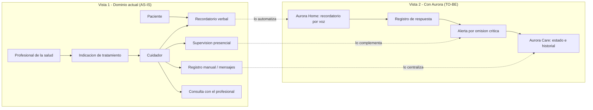

# Correcciones 1, 2 y 3 (parcial) — Estudio Inicial: situación actual (AS-IS) vs. propuesta (TO-BE)

> **Qué cambia en el Docs:** en la sección **Estudio Inicial Aurora** se reemplazan, en este orden, los bloques **"Procesos Involucrados"** (incluye *Flujos de procesos*, *Participantes*, *Información que maneja el sistema*, *Clasificación de evento*, *Sistemas involucrados*) y **"Mapa global de procesos del Entorno"**. El resto del Estudio Inicial (Objetivo, Contexto, Ámbito, Impulsos, Propuesta) se toca solo en los puntos indicados en la sección 4 de este archivo.
>
> **Criterio de la profe:** primero cómo se hace hoy el cuidado *sin Aurora* (quiénes, qué información, qué problemas, qué herramientas), y recién después, identificado como **TO-BE**, el funcionamiento de Aurora.
>
> **Texto marcado `[A CONFIRMAR]`:** es un dato que no está en los repos y que el equipo tiene que validar antes de subirlo.

---

## 1. Texto para reemplazar: "Procesos Involucrados"

**Qué reemplazar en el Docs:** borrá todo lo que hoy está **desde el título "Procesos Involucrados" (inclusive) hasta justo antes del título "Impulsos"**, y pegá en su lugar el texto de esta sección y el de la sección 2. **El título "Impulsos" y todo lo que sigue (Necesidades, Problemas, Oportunidades, Propuesta) no se tocan.**

Ese tramo del Docs incluye, en este orden: *Procesos Involucrados* (con *Flujos de procesos*, *Participantes*, *Información que maneja el sistema*, *Clasificación de evento*), *Sistemas involucrados* y *Mapa global de procesos del Entorno* (con su figura). El texto nuevo ya trae su propio título *Procesos Involucrados*, así que el viejo se borra junto con el resto.

**Qué NO pegar:** las notas con formato de cita (las líneas que empiezan con `>`), el bloque de código `mermaid` y las secciones 3 y 4 de este archivo. Son instrucciones para ustedes, no texto del documento.

---

## Procesos Involucrados

El análisis se organiza en dos partes. La **Parte A** describe cómo se resuelve hoy el cuidado domiciliario de una persona con pérdida de memoria, sin ninguna solución de Aurora. La **Parte B** describe el proceso futuro (**TO-BE**) que Aurora propone. Los problemas identificados en la Parte A son los que justifican las decisiones de la Parte B.

### A. Situación actual (AS-IS): el cuidado domiciliario sin Aurora

#### A.1 Descripción del proceso actual

Hoy el cuidado de una persona con deterioro cognitivo leve o moderado en su hogar se organiza de forma **manual y presencial**. Uno o más familiares, que suelen convivir con el paciente o vivir cerca, asumen el rol de cuidador y se ocupan de:

* Recordar al paciente, de forma verbal, la medicación, las comidas, la hidratación, la higiene y el descanso.
* Supervisar de manera presencial que las rutinas se cumplan y que el paciente no se exponga a situaciones de riesgo (salir solo del hogar, cocinar, caerse).
* Anotar lo que ocurre (si tomó la medicación, cómo estuvo de ánimo, si hubo un episodio) en cuadernos, calendarios o mensajes.
* Coordinarse con otros familiares para cubrir los horarios en que el cuidador principal no está.
* Llevar la información al profesional de la salud en las consultas periódicas, normalmente de memoria o con anotaciones sueltas.

El cuidado es **reactivo**: se interviene cuando el cuidador advierte un problema, no antes. Cuando el cuidador no está presente, no hay un mecanismo que recuerde las rutinas ni que avise de un incidente.

#### A.2 Flujo del proceso actual

1. El profesional de la salud indica el tratamiento, la medicación y las pautas de rutina (en consulta, por receta o por indicación verbal).
2. El cuidador traduce esas indicaciones a su organización doméstica: pastillero semanal, alarmas en el celular, notas en el calendario o en un cuaderno.
3. El paciente realiza sus actividades diarias en el hogar.
4. Cuando llega la hora de una rutina o de una medicación, el cuidador, si está presente, se lo recuerda verbalmente. Si no está, depende de que el paciente lo recuerde solo o de que otro familiar lo llame.
5. El cuidador verifica **de manera presencial** si el paciente cumplió (por ejemplo, mirando el pastillero).
6. Si el cuidador observa algo anormal (desorientación, agitación, una caída), decide por su cuenta cómo actuar y a quién avisar, normalmente por llamada o por mensajería instantánea.
7. Lo ocurrido se registra, si se registra, en notas personales o en mensajes dispersos.
8. En la siguiente consulta, el cuidador le relata al profesional lo que recuerda del período.

#### A.3 Participantes

| Participante | Rol en el proceso actual |
| ----- | ----- |
| **Paciente** | Persona con deterioro cognitivo leve o moderado. Realiza sus actividades diarias y depende de recordatorios y supervisión de terceros. |
| **Cuidador principal** | Familiar o responsable que organiza la rutina, recuerda la medicación, supervisa y decide ante incidentes. |
| **Familiares / cuidadores de apoyo** | Cubren turnos, reciben avisos del cuidador principal y colaboran en la supervisión. |
| **Profesional de la salud** | Actor externo. Diagnostica, indica el tratamiento y las pautas, y realiza el seguimiento en consulta. No interviene en el día a día. |

#### A.4 Información que se utiliza hoy y dónde vive

| Información | Dónde está hoy | Limitación |
| ----- | ----- | ----- |
| Medicación y horarios | Receta médica, pastillero, alarmas del celular | Cada cuidador la interpreta y la carga por su cuenta; no hay una versión única. |
| Rutinas diarias (comidas, higiene, descanso) | Memoria del cuidador, notas, calendario | No se registra si se cumplieron. |
| Recuerdos, gustos y vínculos del paciente | Conocimiento del cuidador | Se pierde si cambia la persona que cuida; no se usa de forma estructurada para estimular la memoria. |
| Cumplimiento y eventos del día | Anotaciones sueltas, mensajes entre familiares | Quedan dispersos y sin orden cronológico. |
| Incidentes (caídas, desorientación, episodios) | Relato verbal al familiar o al profesional | Sin fecha exacta ni contexto; difíciles de analizar luego. |
| Evolución del paciente | Memoria del cuidador y notas de consulta | No hay historial ordenado que permita ver tendencias. |

#### A.5 Herramientas existentes que intervienen hoy `[A CONFIRMAR con el relevamiento del equipo]`

| Herramienta | Uso actual | Qué no resuelve |
| ----- | ----- | ----- |
| Pastilleros semanales | Organizar la medicación | No avisan ni registran si se tomó. |
| Alarmas y calendario del celular | Recordar horarios de medicación y rutinas | Suenan en el celular del cuidador, no hablan con el paciente; no registran respuesta. |
| Cuadernos o planillas | Anotar eventos y cumplimiento | Dependen de que alguien las complete; no generan alertas. |
| WhatsApp / llamadas | Coordinar entre familiares y avisar incidentes | Información dispersa, sin estructura ni historial. |
| Asistentes de voz comerciales genéricos | Alarmas y consultas generales | No están adaptados al paciente: no usan su historia de vida, no registran cumplimiento ni avisan al cuidador. |
| Botones de asistencia / teleasistencia | Pedir ayuda en una emergencia | Requieren que el paciente reconozca la emergencia y accione el botón. |
| Relojes inteligentes con detección de caídas | Detectar caídas | Dispositivos aislados, sin vínculo con las rutinas ni con el resto del cuidado. |

#### A.6 Problemas del proceso actual

| Problema | Consecuencia |
| ----- | ----- |
| El paciente olvida rutinas, medicación e higiene. | Incumplimiento del tratamiento y deterioro de la autonomía. |
| El cuidador no puede estar presente todo el tiempo. | Incertidumbre constante y sobrecarga física y emocional. |
| No hay verificación del cumplimiento cuando el cuidador está ausente. | Omisiones de medicación que se descubren tarde o nunca. |
| La información queda dispersa o sin registrar. | No se puede reconstruir qué pasó ni ver la evolución. |
| Las situaciones de riesgo no se detectan a tiempo. | Intervención tardía. |
| El cuidado actúa después del problema. | No hay prevención ni estimulación sistemática de la memoria. |
| Cada familiar maneja su propia versión de la información. | Inconsistencias entre cuidadores. |

---

### B. Situación propuesta (TO-BE): el proceso con Aurora

> Esta parte describe **el sistema que se propone construir**, no una situación existente. Lo que corresponde al **MVP** y lo que queda para **futuras versiones** sigue el *User Story Mapping* (línea de corte del MVP).

#### B.1 Descripción del proceso propuesto

Con Aurora, la configuración que hoy vive en la cabeza del cuidador pasa a un sistema: el cuidador carga rutinas, medicación y datos biográficos del paciente en la aplicación **Aurora Care**. **Aurora Home**, el dispositivo de voz del hogar, ejecuta esos recordatorios hablándole al paciente, propone actividades cognitivas y de reminiscencia, y registra sus respuestas. **Aurora Core** centraliza la información y avisa al cuidador cuando una rutina o medicación crítica no se cumple. Todo queda en un historial consultable.

La detección automática de eventos de riesgo (caídas, salida de zona segura, anomalías biométricas) y las llamadas automáticas de emergencia forman parte de la visión del producto y **quedan fuera del MVP actual** (ver Propuesta → Alcance del sistema).

#### B.2 Flujo del proceso propuesto

**Dentro del MVP:**

1. El cuidador configura en Aurora Care la cuenta del hogar, el perfil del paciente, las rutinas, la medicación y los recuerdos significativos.
2. Aurora Home emite por voz los recordatorios en el horario configurado.
3. El paciente responde (por ejemplo, "ya la tomé") o no responde.
4. El sistema registra la respuesta o la omisión.
5. Si la omisión corresponde a una medicación o rutina crítica, el sistema genera una alerta y notifica al cuidador mediante notificación push.
6. Aurora Home propone al paciente actividades cognitivas breves y relatos de reminiscencia, y registra su participación.
7. El cuidador consulta en Aurora Care el estado del paciente y de los dispositivos, y el historial de cumplimiento.

**Futuras versiones (fuera del MVP):**

* Monitoreo de ubicación y biometría, detección de caídas y delimitación de zonas seguras (geofencing).
* Clasificación automática de eventos de riesgo y escalamiento por otros canales, incluidas llamadas automáticas.
* Reportes exportables para uso médico.

#### B.3 Información que maneja el sistema

* **Información del paciente:** datos personales básicos, perfil, preferencias, recuerdos personales, vínculos familiares, rutinas diarias, medicación y tratamientos. *(MVP)*
* **Información operativa:** respuestas del paciente, participación en actividades, alertas generadas, historial de cumplimiento y de medicación, estado de los dispositivos, registro de acciones del cuidador. *(MVP)*
* **Información biométrica y de ubicación** (frecuencia cardíaca, movimiento, ubicación, temperatura, actividad electrodérmica): *(futuras versiones; requiere un dispositivo wearable comercial)*.

#### B.4 Clasificación de eventos

El sistema distingue cuatro niveles de gravedad. La clasificación es una **regla de software** configurable; los ejemplos clínicos deben ser validados (ver documento de dominio clínico).

| Nivel de gravedad | Descripción | Ejemplo | Alcance |
| :---- | :---- | :---- | :---- |
| **Baja** | Omisión de recordatorio menor | Actividad cognitiva no realizada | MVP |
| **Media** | Incumplimiento de un hecho importante | Medicación no tomada | MVP |
| **Alta** | Requiere intervención inmediata | Salida de zona segura configurada | Futuras versiones |
| **Crítica** | Compromete la integridad física del paciente | Caída detectada o frecuencia cardíaca alta | Futuras versiones |

---

## 2. Texto para reemplazar: "Sistemas involucrados" y "Mapa global de procesos del Entorno"

(Reemplaza el bloque *Sistemas involucrados* completo y el texto del *Mapa global*.)

### Sistemas involucrados

#### Sistemas y herramientas existentes en el entorno actual (AS-IS)

Son los elementos que ya intervienen en el cuidado domiciliario antes de Aurora. Se detallan en A.5: pastilleros, alarmas y calendario del celular, cuadernos y planillas, mensajería instantánea y llamadas, asistentes de voz comerciales genéricos, botones de asistencia y relojes inteligentes con detección de caídas, además de la historia clínica y las indicaciones del profesional de la salud, que son externas al sistema.

#### Componentes de la solución Aurora (TO-BE) — se desarrollan en este proyecto

| Componente | Función | Alcance |
| :---- | :---- | :---- |
| **Aurora Home / DOT** (dispositivo de interacción en el hogar) | Permite la comunicación por voz con el paciente, emite recordatorios y ejecuta actividades. | MVP |
| **Aurora Care** (interfaz del cuidador) | Permite configurar rutinas, visualizar estado y consultar historial. | MVP |
| **Aurora Core** | Lógica de negocio, persistencia, orquestación y comunicación entre componentes. | MVP |
| **Base de datos del paciente** | Almacena información personal, rutinas, eventos y configuraciones. | MVP |
| **Módulo de alertas** | Genera y comunica alertas por omisión de medicación o rutina. | MVP |
| **Motor de IA (Worker IA)** | Genera respuestas contextualizadas y resúmenes. | MVP |
| **Memoria del paciente (RAG)** | Recupera recuerdos validados por el cuidador. El módulo RAG autónomo queda para futuras versiones. | MVP (acotado) |
| **Orquestador de automatización** | Coordina flujos automáticos ante eventos y rutinas. | Visión |
| **Aurora Band** (pulsera comercial) | Registra biometría, movimiento y ubicación. | Futuras versiones |

#### Servicios externos de los que depende la solución

Notificaciones push, proveedor de modelos de lenguaje, servicios de voz en la nube y proveedor de base de datos y autenticación. El detalle y el estado de cada decisión está en *Arquitectura y Stack Tecnológico*.

### Mapa global de procesos del Entorno

El mapa se presenta en **dos vistas**.

**Vista 1 — Dominio actual del cuidado domiciliario (AS-IS).** Representa los procesos que existen hoy, con independencia de Aurora:

* *Proceso estratégico:* decisión del tratamiento y las pautas (profesional de la salud).
* *Procesos operativos:* recordatorio de rutinas y medicación, supervisión presencial, registro manual, comunicación entre familiares, consulta periódica.
* *Procesos de apoyo:* herramientas domésticas (pastillero, celular, cuaderno).
* *Entradas:* necesidades del paciente y del cuidador, indicaciones médicas.
* *Salidas:* paciente asistido, información dispersa.

**Vista 2 — Cómo Aurora modifica o automatiza esos procesos (TO-BE).** Sobre el mismo mapa se señala qué proceso toma Aurora:

| Proceso actual | En Aurora (TO-BE) |
| ----- | ----- |
| Recordatorio verbal de rutinas y medicación | Recordatorio por voz desde Aurora Home |
| Verificación presencial del cumplimiento | Registro automático de la respuesta del paciente |
| Anotaciones y mensajes dispersos | Historial centralizado en Aurora Care |
| Aviso del cuidador a otros familiares | Alerta por notificación push ante omisiones críticas |
| Estimulación espontánea de la memoria | Actividades cognitivas y de reminiscencia sistemáticas |
| Relato de memoria en la consulta | Historial de cumplimiento consultable |

Los procesos estratégicos incluyen además la **seguridad, la privacidad y el manejo de datos** bajo el marco de la **Ley 25.326 de Protección de Datos Personales**.

> **Para el Docs:** la figura actual del mapa global se reemplaza por dos figuras: una del dominio actual y una con la superposición de Aurora. Abajo está el código del diagrama base para redibujarlo (Mermaid sirve de guía; en el Docs hay que insertar la imagen).

---

## 3. Pendiente de definición del equipo (no está en los repos)

1. **Herramientas existentes (A.5):** confirmar cuáles usan realmente las familias que entrevistaron o conocen, para no listar herramientas que nadie relevó.
2. **Quién entrevistó a quién:** si hubo entrevistas con cuidadores, agregar una línea de evidencia (cantidad y fecha) en A.1, porque convierte la descripción en un relevamiento.

---

## 4. Otros cambios puntuales en el Estudio Inicial (consistencia)

| Dónde | Hoy dice | Debe decir |
| ----- | ----- | ----- |
| **Objetivo** → viñetas de la solución | "Un módulo de procesamiento de datos biométricos mediante dispositivos wearables…" como parte de la solución integrada | Mover el módulo biométrico a "visión / futuras versiones" y agregar la viñeta "Un módulo de actividades cognitivas y reminiscencia guiadas por voz". |
| **Objetivo** → párrafo de IA | "detectar desviaciones en los patrones de comportamiento o variables biométricas" | "personalizar las actividades de estimulación y generar resúmenes; la detección de desviaciones biométricas queda para futuras versiones". |
| **Ámbito de aplicación** → restricción del paciente | "menor a la etapa 5 de la Escala Global de Deterioro (GDS)" | Unificar con el Plan de Proyecto: **"nivel igual o inferior a 5 en la escala FAST"** (ver archivo 02). Usar siempre el mismo criterio en glosario, Estudio Inicial y Plan. |
| **Ámbito de aplicación** → título del perfil | "deterioro cognitivo leve" | "deterioro cognitivo leve a moderado". Hoy el documento dice *leve* en un lugar y *leve/moderado* en otro. |
| **Propuesta → Alcance del sistema** → párrafo de la pulsera | "El sistema podrá integrarse con una pulsera o reloj inteligente…" | Agregar: "**En el MVP no se integra ningún wearable** (decisión del 29/08/2026 por restricción presupuestaria). La integración queda como evolución futura." |
| **Propuesta → Alcance del sistema** → último párrafo | Enumera "eventos de riesgo, alertas, llamadas automáticas" como parte del sistema | Dividir en dos listas: **MVP** (según el User Story Mapping) y **Futuras versiones**. Ver archivo 04. |
| **Flujos de procesos** y **Clasificación de evento** (viejos) | Texto en tiempo presente como si el sistema existiera | Ya están reemplazados por B.2 y B.4. Eliminar los viejos. |
| **Requerimientos Funcionales (14 grupos)** | Sin marca de alcance | Agregar una columna o sufijo "MVP / Futuro" a cada grupo, coherente con el User Story Mapping (ver archivo 04). |
