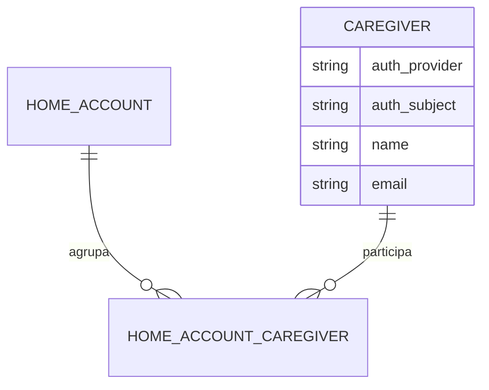
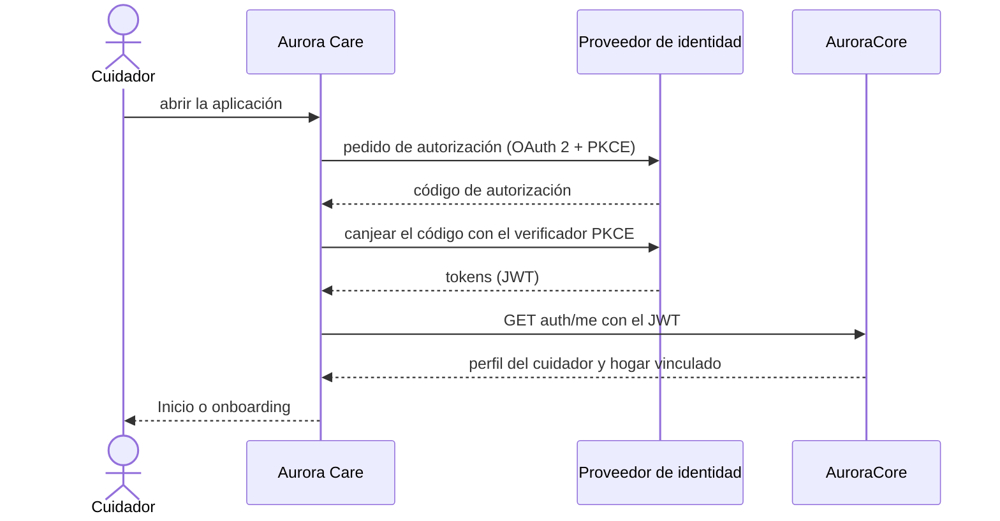

# Artefacto de Trazabilidad — AURA-54 Login y alta de cuenta en Aurora Care

> **Para qué:** conectar esta historia con sus decisiones de diseño, modelo de datos, código y pruebas.
> **Para quién:** equipo (durante el desarrollo) y docente (evaluación de calidad técnica).

| Campo | Valor |
| --- | --- |
| Historia | **AURA-54** — Login y alta de cuenta en Aurora Care |
| Épica | AURA-18 — Panel del Cuidador (Aurora Care) |
| Requerimientos | RF-76 (autenticar cuidadores) y RF-77 (ver [[Requerimientos]] · [[Trazabilidad RF-Épicas]]) |
| Estado en Jira | Finalizada (Sprint 1; Jira «SCRUM Sprint 2») |
| Tareas relacionadas | AURA-68 (vistas de autenticación y onboarding, diseño) |
| Enlace | https://project-aurora-alz.atlassian.net/browse/AURA-54 |

## 1. Historia de usuario
> [!note] Historia derivada
> Esta historia se redactó a posteriori a partir de las tareas de Jira indicadas arriba (modo *task-first*), porque el trabajo se registró en Jira como tareas técnicas. La historia **vive en este artefacto** y no se carga en Jira, que es de uso interno del equipo. Conviene que el equipo revise el texto.

**Como** cuidador **quiero** iniciar sesión, o crear mi cuenta, en Aurora Care con una identidad externa **para** acceder de forma segura a la información de mi familiar sin manejar una contraseña propia en la aplicación.

### Criterios de aceptación
- [x] La pantalla de login y la de creación de cuenta se presentan correctamente (`loginPresentation`, `createAccountPresentation`).
- [x] El inicio de sesión usa OAuth 2 con PKCE contra el proveedor de identidad; la aplicación no guarda contraseñas.
- [x] La sesión se conserva y se refresca el token sin volver a pedir las credenciales (`authSessionCache`).
- [x] El alta de cuenta crea el perfil del cuidador asociado a la identidad (`authSignup`).
- [x] La política de privacidad es accesible desde la aplicación (`privacyPresentation`).
- [x] Tras el login, el cuidador sin hogar vinculado entra al onboarding (`onboardingWelcome`, `onboardingSetup`).

> [!note] Fechas
> Estos tickets figuran finalizados en el Sprint 1 porque la iteración de Jira que los contenía siguió abierta hasta el 02/08/2026. El diseño de las pantallas es del Sprint 1; el código de Aurora Care que las implementa se escribió entre el 18 y el 25/07/2026.

## 2. Decisiones de diseño (ADR)
- **ADR-002** — Aurora Care en React Native con Expo y TypeScript.
- **ADR-005** — Autenticación y autorización. En el Sprint 1 con Auth0; desde el 18/09/2026 con **Supabase Auth** (enmienda del ADR).
- **ADR-012** — Diseño de API: el cliente envía el JWT del cuidador en cada pedido.

> Sin ADR nuevo: la historia se apoya en las decisiones ya registradas en [[Arquitectura y Stack Tecnológico]].

## 3. Modelo de datos (DER)
**Sin cambios en el DER.** El alta usa la entidad ya prevista del cuidador, identificado por su proveedor y su identificador externo, sin contraseña local.

## 4. Diagramas de modelado

### 4.1 Diagrama de clases
> No aplica.

### 4.2 Diagrama de secuencia

### 4.3 Diagrama de estados (DTE)
> DTE no aplica: la sesión se limita a estar iniciada o no, sin un ciclo de vida con estados formales.

## 5. Código relacionado
| Tipo | Ubicación / referencia |
| --- | --- |
| Frontend | `AuroraCare/app/login.tsx`, `create-account.tsx`, `onboarding.tsx`, `privacy.tsx` |
| Frontend | `src/features/auth/` (`hooks/useAuth.ts`, `api/authApi.ts`, caché de sesión), `src/features/session/` (onboarding) |
| Diseño | Pantallas «Auth y Onboarding» del prototipo y de las previews del design system (`Design/previews/screens-01-auth-onboarding.html`) |
| Commit / PR | `6052164` (21/07, flujo de autenticación y onboarding), `27e13e5` (02/08, Auth0 y refresco de token), `33fe15a` (18/09, migración a Supabase Auth) |

## 6. Casos de prueba
| ID | Precondición | Pasos | Resultado esperado | Resultado de ejecución |
| --- | --- | --- | --- | --- |
| CP-AURA-54-01 | Aplicación sin sesión | 1. Abrir la aplicación. | Se muestra la pantalla de login | OK (17/10): `app/__tests__`, 11 pruebas |
| CP-AURA-54-02 | Pantalla de login | 1. Elegir «Crear cuenta». | Se muestra el formulario de alta | OK (17/10): `createAccountPresentation`, dentro de las 11 pruebas |
| CP-AURA-54-03 | Cuidador con sesión iniciada | 1. Cerrar y reabrir la aplicación. | La sesión se recupera sin pedir credenciales | OK (17/10): `authSessionCache`, 4 pruebas del grupo `auth` |
| CP-AURA-54-04 | Cuenta nueva en el proveedor | 1. Completar el alta. | Se crea el perfil del cuidador | OK (17/10): `authSignup`, dentro de las 4 pruebas de `auth` |
| CP-AURA-54-05 | Cuidador sin hogar | 1. Iniciar sesión. | Entra al onboarding de bienvenida y alta del hogar | OK (17/10): `src/features/session`, 58 pruebas |
| CP-AURA-54-06 | Pantalla de privacidad | 1. Abrir la política desde el login. | Se muestra el texto de privacidad | OK (17/10): `privacyPresentation`, dentro de las 11 pruebas |

**Ejecución de AuroraCare (17/10/2026):** las pruebas se corrieron con `npx jest <carpeta>` sobre el código actual de la aplicación. Los módulos nacieron en julio (Sprints 1 y 2) y siguieron evolucionando; las pruebas verifican la versión vigente.

## 7. Matriz de trazabilidad de la historia
| Historia | RF | ADR | DER | Diagramas | Código | Casos de prueba |
| --- | --- | --- | --- | --- | --- | --- |
| AURA-54 (+ AURA-68) | RF-76, 77 | ADR-002, 005, 012 | Sin cambios | Secuencia | `login.tsx`, `src/features/auth/*` | CP-AURA-54-01 a 06 |

## Checklist de completitud (cátedra)
- [x] Historia y criterios de aceptación
- [x] ADR correspondiente (si hubo decisión técnica nueva)
- [x] DER actualizado (si modificó el modelo de datos)
- [x] Diagramas de modelado relevantes (clases/secuencia/estados, según aplique)
- [x] Casos de prueba con precondición, pasos y resultado esperado
- [x] Resultados de ejecución de las pruebas
- [x] Referencias a código (paths/commits/PRs)

> [!todo] Pendiente
> - El proveedor de identidad cambió de Auth0 a Supabase Auth el 18/09/2026; las pruebas verifican la versión vigente.
