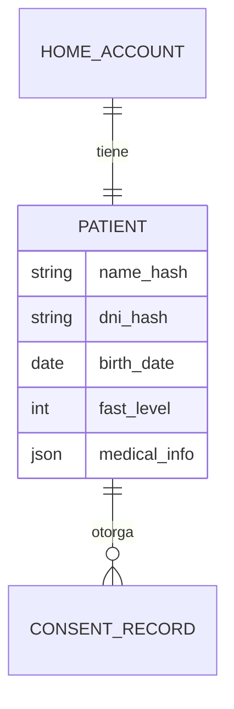
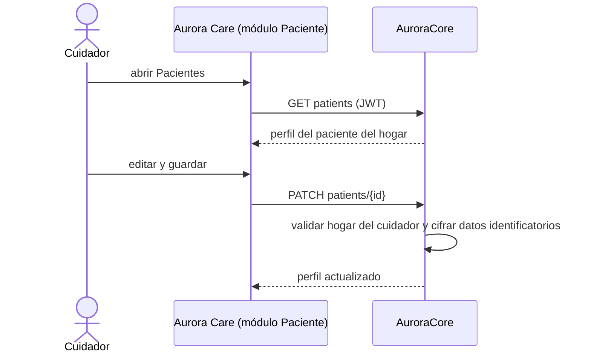

# Artefacto de Trazabilidad — AURA-55 Módulo Paciente de Aurora Care

> **Para qué:** conectar esta historia con sus decisiones de diseño, modelo de datos, código y pruebas.
> **Para quién:** equipo (durante el desarrollo) y docente (evaluación de calidad técnica).

| Campo | Valor |
| --- | --- |
| Historia | **AURA-55** — Módulo Paciente de Aurora Care |
| Épica | AURA-18 — Panel del Cuidador (Aurora Care) |
| Requerimientos | RF-68, RF-74 (ver [[Requerimientos]] · [[Trazabilidad RF-Épicas]]) |
| Estado en Jira | Finalizada (Sprint 1; Jira «SCRUM Sprint 2») |
| Tareas relacionadas | AURA-59 (vistas de Paciente, diseño); backend en AURA-84 (Sprint 3) |
| Enlace | https://project-aurora-alz.atlassian.net/browse/AURA-55 |

## 1. Historia de usuario
> [!note] Historia derivada
> Esta historia se redactó a posteriori a partir de las tareas de Jira indicadas arriba (modo *task-first*), porque el trabajo se registró en Jira como tareas técnicas. La historia **vive en este artefacto** y no se carga en Jira, que es de uso interno del equipo. Conviene que el equipo revise el texto.

**Como** cuidador **quiero** ver y mantener actualizado el perfil de mi familiar (datos personales, etapa de la enfermedad y preferencias) **para** que Aurora lo acompañe con información correcta.

### Criterios de aceptación
- [x] El módulo muestra el perfil del paciente vinculado al hogar y permite editarlo.
- [x] Los datos del paciente se consultan y se guardan a través de la API de AuroraCore, con el token del cuidador.
- [x] El consentimiento de privacidad del paciente se sincroniza con el backend (`privacyConsentSync`).
- [x] Los datos identificatorios (nombre y DNI) se protegen en el backend con cifrado y búsqueda por hash (ADR-010).

> [!note] Fechas
> Estos tickets figuran finalizados en el Sprint 1 porque la iteración de Jira que los contenía siguió abierta hasta el 02/08/2026. El diseño de las pantallas es del Sprint 1; el código de Aurora Care que las implementa se escribió entre el 18 y el 25/07/2026.

## 2. Decisiones de diseño (ADR)
- **ADR-002** — Aurora Care en React Native con Expo.
- **ADR-003** — PostgreSQL como base de datos.
- **ADR-010** — Cifrado de datos identificatorios (PII): el backend guarda hashes de nombre y DNI.
- **ADR-012** — Diseño de API.

> Sin ADR nuevo: la historia se apoya en las decisiones ya registradas en [[Arquitectura y Stack Tecnológico]].

## 3. Modelo de datos (DER)
Entidades del paciente (definidas en el DER del Sprint 1 y vigentes en AuroraCore):

## 4. Diagramas de modelado

### 4.1 Diagrama de clases
> No aplica.

### 4.2 Diagrama de secuencia

### 4.3 Diagrama de estados (DTE)
> DTE no aplica: el perfil se crea y se modifica sin transiciones formalizadas.

## 5. Código relacionado
| Tipo | Ubicación / referencia |
| --- | --- |
| Frontend | `AuroraCare/app/(authenticated)/(tabs)/patients.tsx`, `src/features/patients/` (`api/patientsApi.ts`, `hooks/usePatients.ts`, `usePatientMutations.ts`, `privacyConsentSync.ts`) |
| Backend | `AuroraCore/apps/patients/` (modelos `Patient`, `ConsentRecord`) |
| Diseño | Vistas «Paciente» del prototipo y del design system |
| Commit / PR | `5ba4aac` (20/07, estructura de la app: arquitectura, design system y API), `42ec51d` (24/07, cliente HTTP con token y errores del backend), `c9167fc` (Core, cifrado de PII) |

## 6. Casos de prueba
| ID | Precondición | Pasos | Resultado esperado | Resultado de ejecución |
| --- | --- | --- | --- | --- |
| CP-AURA-55-01 | Cuidador vinculado a un hogar | 1. Abrir la pestaña Pacientes. | Se muestra el perfil del paciente del hogar | Pendiente: la pantalla no tiene prueba automática propia |
| CP-AURA-55-02 | Perfil con datos | 1. Editar un dato. 2. Guardar. | El cambio se persiste a través de la API | Cubierto en el backend por la suite de AuroraCore del 16/10 (1.579 OK)* |
| CP-AURA-55-03 | Alta del hogar con consentimiento | 1. Aceptar el consentimiento. | El consentimiento queda registrado con su versión y fecha | OK (17/10): `privacyConsentSync`, 18 pruebas |
| CP-AURA-55-04 | Paciente con DNI | 1. Guardar el perfil. | El backend almacena el hash y no el dato en claro | Cubierto por la suite de AuroraCore del 16/10 (1.579 OK)* |
| CP-AURA-55-05 | Cuidador de otro hogar | 1. Pedir el paciente. | No obtiene datos de otro hogar | Cubierto por la suite de AuroraCore del 16/10 (1.579 OK)* |

**Ejecución de AuroraCare (17/10/2026):** las pruebas se corrieron con `npx jest <carpeta>` sobre el código actual de la aplicación. Los módulos nacieron en julio (Sprints 1 y 2) y siguieron evolucionando; las pruebas verifican la versión vigente.

\* **Ejecución de AuroraCore:** la suite completa pasó el 16/10/2026 (1.579 pruebas, sin fallas; ejecución del equipo, ver Plan de Testing, sección 4.7). No se registró el resultado de cada caso por separado.

## 7. Matriz de trazabilidad de la historia
| Historia | RF | ADR | DER | Diagramas | Código | Casos de prueba |
| --- | --- | --- | --- | --- | --- | --- |
| AURA-55 (+ AURA-59) | RF-68, 74 | ADR-002, 003, 010, 012 | `Patient`, `ConsentRecord` | Secuencia | `patients.tsx`, `src/features/patients/*` | CP-AURA-55-01 a 05 |

## Checklist de completitud (cátedra)
- [x] Historia y criterios de aceptación
- [x] ADR correspondiente (si hubo decisión técnica nueva)
- [x] DER actualizado (si modificó el modelo de datos)
- [x] Diagramas de modelado relevantes (clases/secuencia/estados, según aplique)
- [x] Casos de prueba con precondición, pasos y resultado esperado
- [ ] Resultados de ejecución de las pruebas
- [x] Referencias a código (paths/commits/PRs)

> [!todo] Pendiente
> - La pantalla del módulo Paciente no tiene prueba automática propia; solo está cubierta la sincronización del consentimiento. Conviene sumar una.
