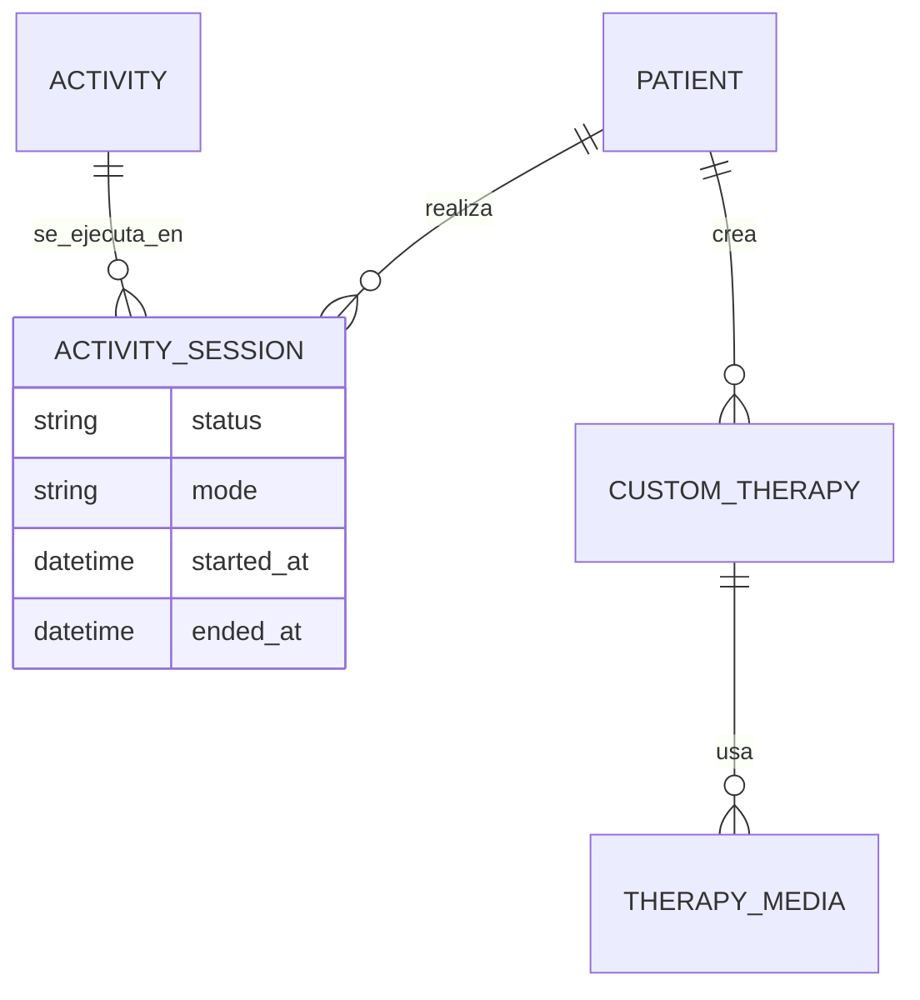
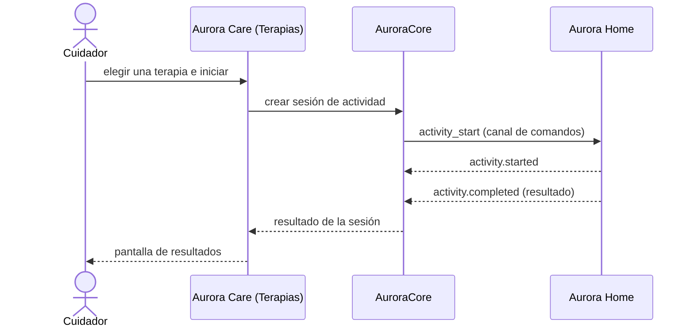

# Artefacto de Trazabilidad — AURA-56 Módulo de Terapias Cognitivas de Aurora Care

> **Para qué:** conectar esta historia con sus decisiones de diseño, modelo de datos, código y pruebas.
> **Para quién:** equipo (durante el desarrollo) y docente (evaluación de calidad técnica).

| Campo | Valor |
| --- | --- |
| Historia | **AURA-56** — Módulo de Terapias Cognitivas de Aurora Care |
| Épica | AURA-18 — Panel del Cuidador (Aurora Care) |
| Requerimientos | RF-09, RF-10, RF-11, RF-12, RF-13 (ver [[Requerimientos]] · [[Trazabilidad RF-Épicas]]) |
| Estado en Jira | Finalizada (Sprint 1; Jira «SCRUM Sprint 2») |
| Tareas relacionadas | AURA-60 (vistas de Terapias, diseño); evolución en AURA-149, AURA-184 y AURA-172 (Sprints 4 y 5) |
| Enlace | https://project-aurora-alz.atlassian.net/browse/AURA-56 |

## 1. Historia de usuario
> [!note] Historia derivada
> Esta historia se redactó a posteriori a partir de las tareas de Jira indicadas arriba (modo *task-first*), porque el trabajo se registró en Jira como tareas técnicas. La historia **vive en este artefacto** y no se carga en Jira, que es de uso interno del equipo. Conviene que el equipo revise el texto.

**Como** cuidador **quiero** ver las terapias cognitivas disponibles para mi familiar, programarlas, iniciarlas y ver sus resultados **para** estimularlo de manera regular y seguir su evolución.

### Criterios de aceptación
- [x] El módulo lista las terapias y juegos disponibles, con su tarjeta y su estado (`therapyCard`, `useTherapiesModule`).
- [x] El cuidador puede programar el horario de las sesiones (`therapySchedule`).
- [x] El cuidador puede iniciar una sesión y verla en curso, con su reproductor paso a paso (`therapyPlayer`, `stepRenderer`).
- [x] Al terminar, se muestran el resultado de la sesión y el del día (`sessionResult`, `todaysSessionResult`).
- [x] El cuidador puede crear terapias propias y juegos con fotos y audios (`customTherapyEditor`, `gameEditor`).
- [x] El cuidador puede iniciar la sesión de voz en Aurora Home desde la aplicación (`homeStart`).

> [!note] Fechas
> Estos tickets figuran finalizados en el Sprint 1 porque la iteración de Jira que los contenía siguió abierta hasta el 02/08/2026. El diseño de las pantallas es del Sprint 1; el código de Aurora Care que las implementa se escribió entre el 18 y el 25/07/2026.

> [!note] Evolución
> En el Sprint 1 se definió el módulo y sus pantallas; las terapias propias, los juegos y el inicio de la sesión en Aurora Home se agregaron en los Sprints 4 y 5. Las pruebas de abajo corresponden a la versión vigente.

## 2. Decisiones de diseño (ADR)
- **ADR-002** — Aurora Care en React Native con Expo.
- **ADR-012** — Diseño de API.
- **ADR-008** — Los planes y los *assets* de las terapias se cachean para operar sin conexión en Aurora Home.

> Sin ADR nuevo: la historia se apoya en las decisiones ya registradas en [[Arquitectura y Stack Tecnológico]].

## 3. Modelo de datos (DER)
Entidades (ya previstas en el DER del Sprint 1, vista de Voz e Interacción):

## 4. Diagramas de modelado

### 4.1 Diagrama de clases
> No aplica.

### 4.2 Diagrama de secuencia

### 4.3 Diagrama de estados (DTE)
> DTE no aplica en este artefacto: el ciclo de vida de la sesión (iniciada, completada) se detalla en el artefacto de las sesiones diarias (AURA-149).

## 5. Código relacionado
| Tipo | Ubicación / referencia |
| --- | --- |
| Frontend | `AuroraCare/app/(authenticated)/(tabs)/therapies.tsx`, `therapy-player.tsx`, `therapy-schedule.tsx`, `therapy-results.tsx`, `therapy-session.tsx`, `custom-therapy-editor.tsx` |
| Frontend | `src/features/therapies/` (55 archivos: tarjetas, reproductor de pasos, editor de juegos, resultados y control de la sesión en Home) |
| Backend | `AuroraCore/apps/interactions/` (`Activity`, `ActivitySession`, `CustomTherapy`, `TherapyMedia`) |
| Commit / PR | `e6fd604` (25/07, terapias y sesiones de interacción), `8cf8300` (frontend de sesiones de dos canales), `1580b1e` (juegos con reglas fijas) |

## 6. Casos de prueba
| ID | Precondición | Pasos | Resultado esperado | Resultado de ejecución |
| --- | --- | --- | --- | --- |
| CP-AURA-56-01 | Hogar con terapias | 1. Abrir la pestaña Terapias. | Se listan las terapias con su tarjeta | OK (17/10): `src/features/therapies`, 289 pruebas |
| CP-AURA-56-02 | Terapia elegida | 1. Programar el horario. | El horario se guarda; si el hogar no tenía uno, se crea | OK (17/10): `therapySchedule`, dentro de las 63 pruebas de `app/(authenticated)` |
| CP-AURA-56-03 | Terapia con pasos | 1. Iniciar. 2. Avanzar por los pasos. | El reproductor muestra cada paso | OK (17/10): `stepRenderer` (289 pruebas) y `therapyPlayer` (63 pruebas de `app/(authenticated)`) |
| CP-AURA-56-04 | Sesión terminada | 1. Terminar la sesión. | Se muestra el resultado de la sesión y el del día | OK (17/10): `sessionResult`, dentro de las 289 pruebas |
| CP-AURA-56-05 | Cuidador creando una terapia | 1. Crear un juego con foto y audio. | La terapia propia queda disponible | OK (17/10): `gameEditor`, dentro de las 289 pruebas |
| CP-AURA-56-06 | Aurora Home disponible | 1. Iniciar la sesión de voz en Home. | Se envía la orden y se informa la disponibilidad del dispositivo | OK (17/10): `homeStart`, dentro de las 289 pruebas |

**Ejecución de AuroraCare (17/10/2026):** las pruebas se corrieron con `npx jest <carpeta>` sobre el código actual de la aplicación. Los módulos nacieron en julio (Sprints 1 y 2) y siguieron evolucionando; las pruebas verifican la versión vigente.

## 7. Matriz de trazabilidad de la historia
| Historia | RF | ADR | DER | Diagramas | Código | Casos de prueba |
| --- | --- | --- | --- | --- | --- | --- |
| AURA-56 (+ AURA-60) | RF-09 a 13 | ADR-002, 008, 012 | `Activity`, `ActivitySession`, `CustomTherapy` | Secuencia | `therapies.tsx`, `src/features/therapies/*` | CP-AURA-56-01 a 06 |

## Checklist de completitud (cátedra)
- [x] Historia y criterios de aceptación
- [x] ADR correspondiente (si hubo decisión técnica nueva)
- [x] DER actualizado (si modificó el modelo de datos)
- [x] Diagramas de modelado relevantes (clases/secuencia/estados, según aplique)
- [x] Casos de prueba con precondición, pasos y resultado esperado
- [x] Resultados de ejecución de las pruebas
- [x] Referencias a código (paths/commits/PRs)
