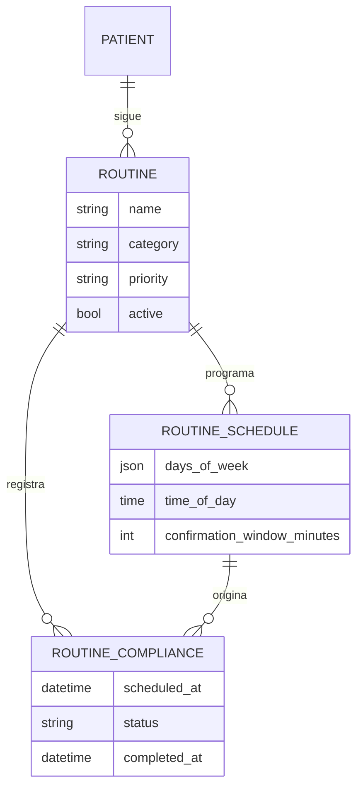
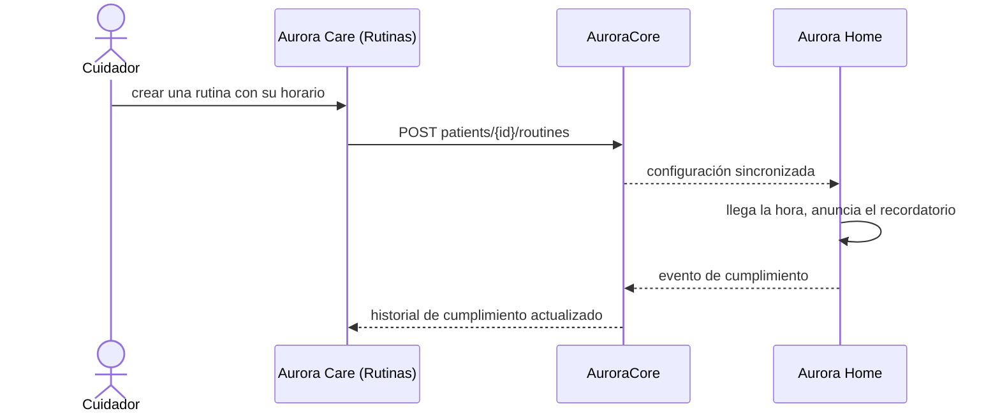
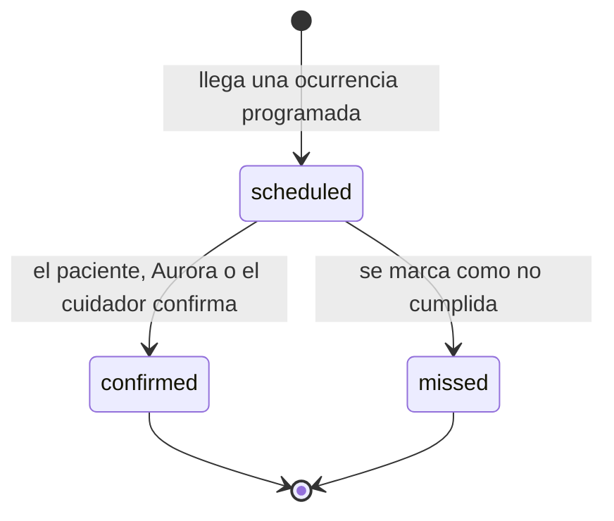

# Artefacto de Trazabilidad — AURA-57 Módulo de Rutinas y Recordatorios de Aurora Care

> **Para qué:** conectar esta historia con sus decisiones de diseño, modelo de datos, código y pruebas.
> **Para quién:** equipo (durante el desarrollo) y docente (evaluación de calidad técnica).

| Campo | Valor |
| --- | --- |
| Historia | **AURA-57** — Módulo de Rutinas y Recordatorios de Aurora Care |
| Épica | AURA-17 — Administración de Rutinas y Medicación |
| Requerimientos | RF-65, RF-82, RF-83, RF-84, RF-90 (ver [[Requerimientos]] · [[Trazabilidad RF-Épicas]]) |
| Estado en Jira | Finalizada (Sprint 1; Jira «SCRUM Sprint 2») |
| Tareas relacionadas | AURA-61 (vistas de Recordatorio, diseño); backend en AURA-87 y AURA-89 (Sprint 3) |
| Enlace | https://project-aurora-alz.atlassian.net/browse/AURA-57 |

## 1. Historia de usuario
> [!note] Historia derivada
> Esta historia se redactó a posteriori a partir de las tareas de Jira indicadas arriba (modo *task-first*), porque el trabajo se registró en Jira como tareas técnicas. La historia **vive en este artefacto** y no se carga en Jira, que es de uso interno del equipo. Conviene que el equipo revise el texto.

**Como** cuidador **quiero** configurar las rutinas diarias de mi familiar (alimentación, descanso, higiene) con sus horarios y ver si las cumplió **para** que Aurora se las recuerde en voz alta y yo pueda seguir su cumplimiento.

### Criterios de aceptación
- [x] El cuidador puede crear, editar y eliminar rutinas, con confirmación antes de borrar (`routinesScreen`, `routinesDeleteConfirmation`).
- [x] Cada rutina tiene días, horario y una ventana de confirmación (`editorsValidation`).
- [x] El cuidador ve el cumplimiento de hoy y el historial de cada rutina (`complianceHistory`, `todayComplianceWindow`, `historyScreens`).
- [x] El cumplimiento se actualiza al instante en la pantalla antes de confirmar con el servidor (`complianceOptimistic`).
- [x] La aplicación usa las rutas reales de la API (`routinesApiPaths`).

> [!note] Fechas
> Estos tickets figuran finalizados en el Sprint 1 porque la iteración de Jira que los contenía siguió abierta hasta el 02/08/2026. El diseño de las pantallas es del Sprint 1; el código de Aurora Care que las implementa se escribió entre el 18 y el 25/07/2026.

## 2. Decisiones de diseño (ADR)
- **ADR-002** — Aurora Care en React Native con Expo.
- **ADR-012** — Diseño de API (rutas anidadas bajo el paciente).
- **ADR-008** — Aurora Home recibe las rutinas y las ejecuta aun sin conexión (recordatorios locales).

> Sin ADR nuevo: la historia se apoya en las decisiones ya registradas en [[Arquitectura y Stack Tecnológico]].

## 3. Modelo de datos (DER)
Entidades (ya previstas en el DER del Sprint 1, vista de Rutinas y Medicación):

## 4. Diagramas de modelado

### 4.1 Diagrama de clases
> No aplica.

### 4.2 Diagrama de secuencia

### 4.3 Diagrama de estados (DTE)

## 5. Código relacionado
| Tipo | Ubicación / referencia |
| --- | --- |
| Frontend | `AuroraCare/app/(authenticated)/(tabs)/routines.tsx`, `routine-editor.tsx`, `routine-history.tsx` |
| Frontend | `src/features/routines/` (15 archivos: módulo, editores, cumplimiento y pantallas de historial) |
| Backend | `AuroraCore/apps/routines/` (`Routine`, `RoutineSchedule`, `RoutineCompliance`) |
| Commit / PR | `d388a86` (25/07, rutinas y medicación), `42ec51d` (24/07, cliente HTTP), `843f998` (22/07, capa de mocks tipada) |

## 6. Casos de prueba
| ID | Precondición | Pasos | Resultado esperado | Resultado de ejecución |
| --- | --- | --- | --- | --- |
| CP-AURA-57-01 | Paciente con rutinas | 1. Abrir la pestaña Rutinas. | Se listan las rutinas con su horario | OK (17/10): `src/features/routines`, 99 pruebas |
| CP-AURA-57-02 | Rutina existente | 1. Eliminarla. | Pide confirmación antes de borrar | OK (17/10): `routinesDeleteConfirmation`, dentro de las 99 pruebas |
| CP-AURA-57-03 | Editor de rutina | 1. Guardar con datos inválidos. | Muestra los errores de validación | OK (17/10): `editorsValidation`, dentro de las 99 pruebas |
| CP-AURA-57-04 | Rutina con ocurrencias de hoy | 1. Confirmar el cumplimiento. | La pantalla se actualiza al instante y se confirma con el servidor | OK (17/10): `complianceOptimistic`, dentro de las 99 pruebas |
| CP-AURA-57-05 | Rutina con historial | 1. Abrir el historial. | Se muestra el cumplimiento de cada ocurrencia | OK (17/10): `complianceHistory`, dentro de las 99 pruebas |
| CP-AURA-57-06 | API de rutinas | 1. Llamar a las rutas de rutinas. | Usan las rutas reales anidadas bajo el paciente | OK (17/10): `routinesApiPaths`, dentro de las 99 pruebas |

**Ejecución de AuroraCare (17/10/2026):** las pruebas se corrieron con `npx jest <carpeta>` sobre el código actual de la aplicación. Los módulos nacieron en julio (Sprints 1 y 2) y siguieron evolucionando; las pruebas verifican la versión vigente.

## 7. Matriz de trazabilidad de la historia
| Historia | RF | ADR | DER | Diagramas | Código | Casos de prueba |
| --- | --- | --- | --- | --- | --- | --- |
| AURA-57 (+ AURA-61) | RF-65, 82 a 84, 90 | ADR-002, 008, 012 | `Routine`, `RoutineSchedule`, `RoutineCompliance` | Secuencia, estados | `routines.tsx`, `src/features/routines/*` | CP-AURA-57-01 a 06 |

## Checklist de completitud (cátedra)
- [x] Historia y criterios de aceptación
- [x] ADR correspondiente (si hubo decisión técnica nueva)
- [x] DER actualizado (si modificó el modelo de datos)
- [x] Diagramas de modelado relevantes (clases/secuencia/estados, según aplique)
- [x] Casos de prueba con precondición, pasos y resultado esperado
- [x] Resultados de ejecución de las pruebas
- [x] Referencias a código (paths/commits/PRs)
