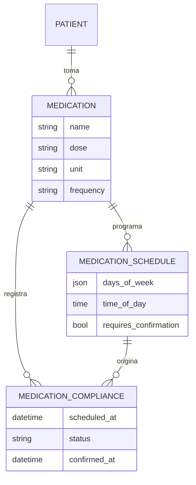
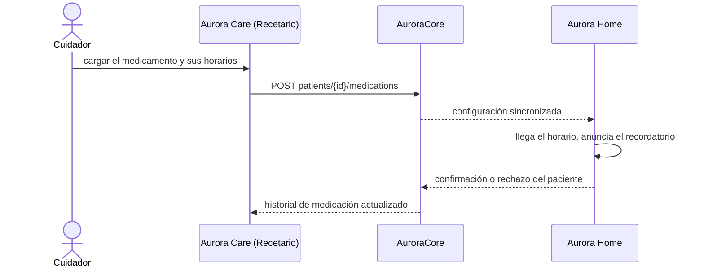
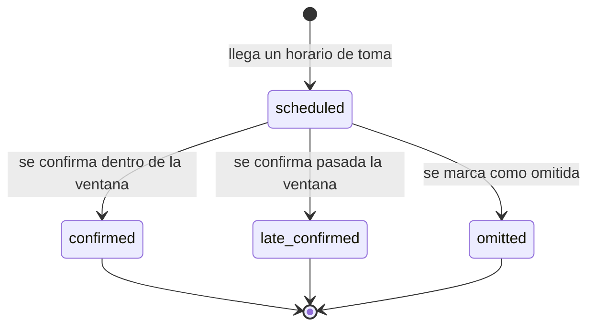

# Artefacto de Trazabilidad — AURA-58 Módulo de Medicación y Recetario de Aurora Care

> **Para qué:** conectar esta historia con sus decisiones de diseño, modelo de datos, código y pruebas.
> **Para quién:** equipo (durante el desarrollo) y docente (evaluación de calidad técnica).

| Campo | Valor |
| --- | --- |
| Historia | **AURA-58** — Módulo de Medicación y Recetario de Aurora Care |
| Épica | AURA-17 — Administración de Rutinas y Medicación |
| Requerimientos | RF-66, RF-85, RF-86, RF-87, RF-88, RF-89, RF-91 (ver [[Requerimientos]] · [[Trazabilidad RF-Épicas]]) |
| Estado en Jira | Finalizada (Sprint 1; Jira «SCRUM Sprint 2») |
| Tareas relacionadas | AURA-62 (vistas de Recetario, diseño); backend en AURA-88 y AURA-89 (Sprint 3) |
| Enlace | https://project-aurora-alz.atlassian.net/browse/AURA-58 |

## 1. Historia de usuario
> [!note] Historia derivada
> Esta historia se redactó a posteriori a partir de las tareas de Jira indicadas arriba (modo *task-first*), porque el trabajo se registró en Jira como tareas técnicas. La historia **vive en este artefacto** y no se carga en Jira, que es de uso interno del equipo. Conviene que el equipo revise el texto.

**Como** cuidador **quiero** cargar los medicamentos de mi familiar con su dosis y sus horarios, y ver si los tomó **para** que Aurora se los recuerde a tiempo y yo pueda avisar al médico si se omite una toma.

### Criterios de aceptación
- [x] El cuidador puede registrar un medicamento con su principio activo, dosis, unidad, frecuencia e instrucciones (`medicationEditorRoute`, `medicationFieldNames`).
- [x] Cada medicamento tiene horarios con cantidad y exige confirmación dentro de una ventana (`editorsValidation`).
- [x] El cuidador puede modificar y dar de baja un medicamento, con confirmación (`routinesDeleteConfirmation`).
- [x] Se registra la toma o la omisión y se ve el historial de cumplimiento de la medicación (`complianceHistory`, `complianceStatus`).
- [x] Los nombres de los campos coinciden con los del backend (`medicationFieldNames`).

> [!note] Fechas
> Estos tickets figuran finalizados en el Sprint 1 porque la iteración de Jira que los contenía siguió abierta hasta el 02/08/2026. El diseño de las pantallas es del Sprint 1; el código de Aurora Care que las implementa se escribió entre el 18 y el 25/07/2026.

## 2. Decisiones de diseño (ADR)
- **ADR-002** — Aurora Care en React Native con Expo.
- **ADR-012** — Diseño de API.
- **ADR-010** — El recetario es información de salud del paciente y queda dentro del aislamiento por hogar.

> Sin ADR nuevo: la historia se apoya en las decisiones ya registradas en [[Arquitectura y Stack Tecnológico]].

## 3. Modelo de datos (DER)
Entidades (ya previstas en el DER del Sprint 1, vista de Rutinas y Medicación):

## 4. Diagramas de modelado

### 4.1 Diagrama de clases
> No aplica.

### 4.2 Diagrama de secuencia

### 4.3 Diagrama de estados (DTE)

## 5. Código relacionado
| Tipo | Ubicación / referencia |
| --- | --- |
| Frontend | `AuroraCare/app/(authenticated)/(tabs)/medications.tsx`, `medication-editor.tsx`, `medication-history.tsx` |
| Frontend | `src/features/medications/` y `src/features/routines/` (editores, cumplimiento e historial de medicación) |
| Backend | `AuroraCore/apps/routines/` (`Medication`, `MedicationSchedule`, `MedicationCompliance`) |
| Commit / PR | `d388a86` (25/07, rutinas y medicación), `42ec51d` (24/07, cliente HTTP) |

## 6. Casos de prueba
| ID | Precondición | Pasos | Resultado esperado | Resultado de ejecución |
| --- | --- | --- | --- | --- |
| CP-AURA-58-01 | Paciente con recetario | 1. Abrir la pestaña Medicación. | Se listan los medicamentos con su horario | OK (17/10): `src/features/routines`, 99 pruebas |
| CP-AURA-58-02 | Editor de medicamento | 1. Cargar nombre, dosis y unidad. 2. Guardar. | Se guarda con los nombres de campo del backend | OK (17/10): `medicationEditorRoute` y `medicationFieldNames`, dentro de las 99 pruebas |
| CP-AURA-58-03 | Editor con datos inválidos | 1. Guardar sin dosis. | Muestra los errores de validación | OK (17/10): `editorsValidation`, dentro de las 99 pruebas |
| CP-AURA-58-04 | Medicamento existente | 1. Darlo de baja. | Pide confirmación antes de eliminar | OK (17/10): `routinesDeleteConfirmation`, dentro de las 99 pruebas |
| CP-AURA-58-05 | Medicación con tomas pasadas | 1. Abrir el historial. | Se muestran las tomas confirmadas y omitidas | OK (17/10): `complianceHistory` y `complianceStatus`, dentro de las 99 pruebas |
| CP-AURA-58-06 | Aislamiento por hogar (backend) | 1. Pedir la medicación de otro hogar. | No se obtienen datos ajenos | Cubierto por la suite de AuroraCore del 16/10 (1.579 OK)* |

**Ejecución de AuroraCare (17/10/2026):** las pruebas se corrieron con `npx jest <carpeta>` sobre el código actual de la aplicación. Los módulos nacieron en julio (Sprints 1 y 2) y siguieron evolucionando; las pruebas verifican la versión vigente.

\* **Ejecución de AuroraCore:** la suite completa pasó el 16/10/2026 (1.579 pruebas, sin fallas; ejecución del equipo, ver Plan de Testing, sección 4.7). No se registró el resultado de cada caso por separado.

## 7. Matriz de trazabilidad de la historia
| Historia | RF | ADR | DER | Diagramas | Código | Casos de prueba |
| --- | --- | --- | --- | --- | --- | --- |
| AURA-58 (+ AURA-62) | RF-66, 85 a 89, 91 | ADR-002, 010, 012 | `Medication`, `MedicationSchedule`, `MedicationCompliance` | Secuencia, estados | `medications.tsx`, `src/features/routines/*` | CP-AURA-58-01 a 06 |

## Checklist de completitud (cátedra)
- [x] Historia y criterios de aceptación
- [x] ADR correspondiente (si hubo decisión técnica nueva)
- [x] DER actualizado (si modificó el modelo de datos)
- [x] Diagramas de modelado relevantes (clases/secuencia/estados, según aplique)
- [x] Casos de prueba con precondición, pasos y resultado esperado
- [x] Resultados de ejecución de las pruebas
- [x] Referencias a código (paths/commits/PRs)
