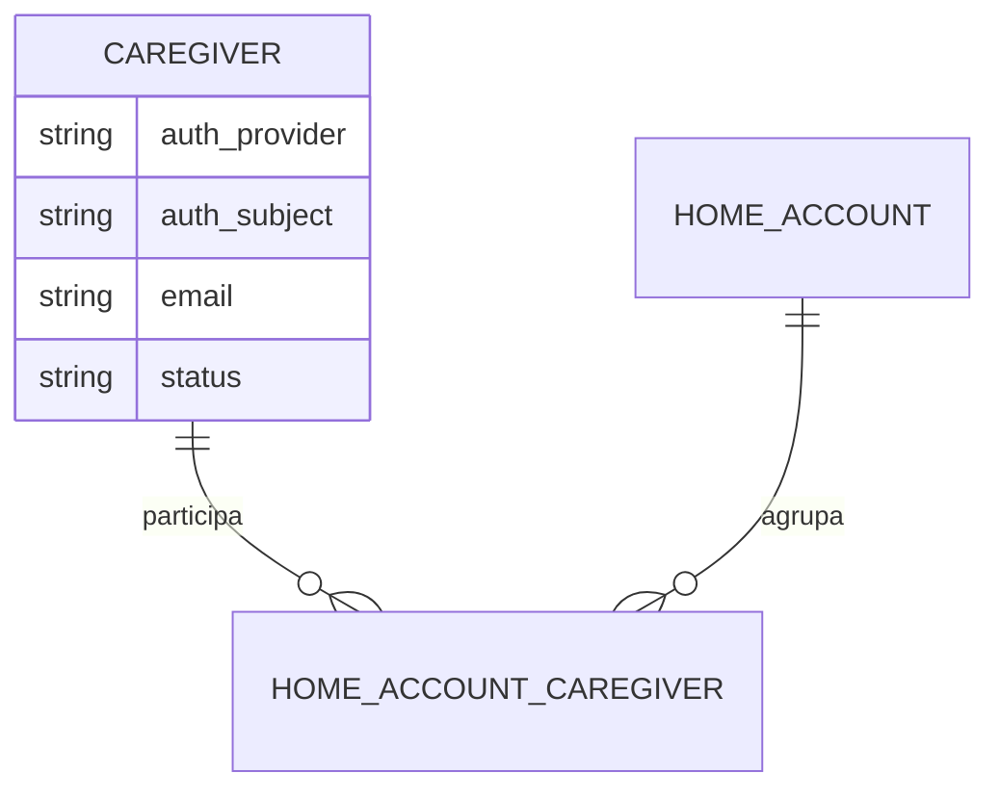
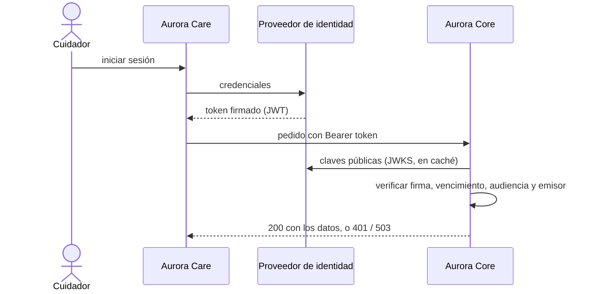

# Artefacto de Trazabilidad — AURA-82 Autenticación por token (JWT) en Aurora Core

> **Para qué:** conectar esta historia con sus decisiones de diseño, modelo de datos, código y pruebas.
> **Para quién:** equipo (durante el desarrollo) y docente (evaluación de calidad técnica).

| Campo | Valor |
| --- | --- |
| Historia | **AURA-82** — Integración Auth0: autenticación JWT en AuroraCore |
| Épica | AURA-20 — Seguridad, Privacidad y Cumplimiento |
| Requerimientos | RF-76, RF-77 (ver [[Requerimientos]] · [[Trazabilidad RF-Épicas]]) |
| Estado en Jira | Finalizada (Sprint 3; Jira «SCRUM Sprint 4») |
| Tareas relacionadas | AURA-94 (`GET /auth/me`, perfil del cuidador autenticado); migración a Supabase Auth del 18/09/2026 |
| Enlace | https://project-aurora-alz.atlassian.net/browse/AURA-82 |

## 1. Historia de usuario
**Como** cuidador **quiero** iniciar sesión con mi cuenta y que la API me reconozca en cada pedido **para** que solo yo, y las personas que cuidan al mismo familiar, accedamos a sus datos.

### Criterios de aceptación
- [x] La API exige `Authorization: Bearer <token>` y, si falta, responde 401 con el desafío `Bearer` (`test_missing_authorization_header_returns_401_with_challenge`).
- [x] La firma del token se valida contra las claves públicas (JWKS) del proveedor de identidad; las claves se guardan en caché y se vuelven a pedir una sola vez si llega un `kid` desconocido (`test_jwks_is_cached_between_requests`, `test_unknown_kid_refetches_the_jwks_once_and_then_rejects`).
- [x] Se rechazan los tokens vencidos, de otro proyecto o emisor y con audiencia ajena.
- [x] Se rechaza un token firmado con HMAC usando la clave pública como secreto (ataque de confusión de algoritmo).
- [x] El identificador del token (`sub`) se asocia a un usuario; si no tiene cuidador vinculado, la sesión queda «sin vincular»; si lo tiene, devuelve su paciente.
- [x] Si el proveedor de identidad no responde, la API contesta 503 y no 401 (para no confundir una caída con una credencial inválida).
- [x] El token de desarrollo solo se acepta con `DEBUG` y el modo de desarrollo activos.

> **Evolución.** En el Sprint 3 el proveedor era Auth0 (firma RS256, `audience` e `issuer` propios, commits del 04 y 08/08). El 18/09/2026 la autenticación se migró a Supabase Auth (firma ES256 o RS256, `audience` fija `authenticated`). La estructura de la validación no cambió; las pruebas de abajo corresponden a la versión vigente.

## 2. Decisiones de diseño (ADR)
- **ADR-005** — Autenticación y autorización: el backend no emite tokens, solo los verifica (Auth0 en este sprint; Supabase Auth desde el 18/09).
- **ADR-012** — Diseño de API: REST bajo `/api/v1/`, autenticación por Bearer y errores tipados.
- **ADR-001** — Backend en Python con Django y Django REST Framework (la autenticación es una clase de DRF).

> Sin ADR nuevo: la historia se apoya en las decisiones ya registradas en [[Arquitectura y Stack Tecnológico]]. El cambio de proveedor se registró como enmienda de ADR-005 el 12/10/2026.

## 3. Modelo de datos (DER)
**Sin cambios en el DER.** La identidad externa del cuidador ya estaba prevista en el modelo (`auth_provider` y `auth_subject`, este último único).

## 4. Diagramas de modelado

### 4.1 Diagrama de clases
> No aplica.

### 4.2 Diagrama de secuencia

### 4.3 Diagrama de estados (DTE)
> DTE no aplica: la autenticación se resuelve en cada pedido y no tiene ciclo de vida propio.

## 5. Código relacionado
| Tipo | Ubicación / referencia |
| --- | --- |
| Backend | `AuroraCore/apps/common/authentication.py` (`SupabaseJWTAuthentication`, antes la validación Auth0), `config/settings/base.py` (`SUPABASE_URL`, `SUPABASE_JWKS_CACHE_TTL`, `AUTH_DEV_*`), `apps/session/` (`GET /api/v1/auth/me/`) |
| Backend (tests) | `apps/common/tests/test_supabase_auth.py` (15 pruebas), `apps/session/tests/test_auth_me.py` (3 pruebas) |
| Frontend | `AuroraCare/src/features/auth/` (inicio de sesión y manejo del token) |
| Commit / PR | `49ebcc6` (04/08, Auth0 como autenticación real), `38c8e69` (08/08, OAuth 2 sobre Auth0), `7545afa` (18/09, migración a Supabase Auth) |

## 6. Casos de prueba
| ID | Precondición | Pasos | Resultado esperado | Resultado de ejecución |
| --- | --- | --- | --- | --- |
| CP-AURA-82-01 | API en marcha | 1. Pedir un recurso sin encabezado `Authorization`. | 401 con desafío `Bearer` | OK (17/10): `test_supabase_auth.py`, 15 pruebas* |
| CP-AURA-82-02 | Token válido (ES256 o RS256) | 1. Pedir un recurso con el token. | Se autentica y se crea el usuario la primera vez | OK (17/10): `test_supabase_auth.py`* |
| CP-AURA-82-03 | Token vencido, de otro proyecto o con audiencia ajena | 1. Pedir un recurso. | 401 | OK (17/10): `test_supabase_auth.py`* |
| CP-AURA-82-04 | Token firmado con HMAC usando la clave pública | 1. Pedir un recurso. | 401 (algoritmo no permitido) | OK (17/10): `test_supabase_auth.py`* |
| CP-AURA-82-05 | `kid` desconocido | 1. Pedir un recurso. | Se vuelve a pedir el JWKS una vez y luego se rechaza | OK (17/10): `test_supabase_auth.py`* |
| CP-AURA-82-06 | El proveedor de identidad no responde | 1. Pedir un recurso con un token cuya clave no está en caché. | 503, no 401 | OK (17/10): `test_supabase_auth.py`* |
| CP-AURA-82-07 | Usuario con y sin cuidador vinculado | 1. Pedir `GET /auth/me/`. | Sin cuidador: sesión sin vincular. Con cuidador: devuelve su paciente | OK (17/10): `test_auth_me.py` (3) y `test_supabase_auth.py`* |
| CP-AURA-82-08 | Modo de desarrollo apagado | 1. Pedir un recurso con el token de desarrollo. | Se ignora | OK (17/10): `test_supabase_auth.py`* |

\* **Ejecución de AuroraCore (17/10/2026):** las pruebas se corrieron con `pytest` sobre SQLite (no se pudo levantar PostgreSQL en la máquina de revisión). La suite completa de AuroraCore pasó el 16/10/2026 sobre PostgreSQL con 1.579 pruebas y sin fallas (ejecución del equipo, ver [[Plan de Testing]], sección 4.7). Repetida el 17/10 sobre SQLite, pasaron 1.574 de 1.579; las 5 restantes usan SQL propio de PostgreSQL (`information_schema` y parámetros `%s`) y no se pueden ejecutar en SQLite.

## 7. Matriz de trazabilidad de la historia
| Historia | RF | ADR | DER | Diagramas | Código | Casos de prueba |
| --- | --- | --- | --- | --- | --- | --- |
| AURA-82 | RF-76, RF-77 | ADR-001, 005, 012 | Sin cambios | Secuencia | `apps/common/authentication.py` | CP-AURA-82-01 a 08 |

## Checklist de completitud (cátedra)
- [x] Historia y criterios de aceptación
- [x] ADR correspondiente (si hubo decisión técnica nueva)
- [x] DER actualizado (si modificó el modelo de datos)
- [x] Diagramas de modelado relevantes (clases/secuencia/estados, según aplique)
- [x] Casos de prueba con precondición, pasos y resultado esperado
- [x] Resultados de ejecución de las pruebas
- [x] Referencias a código (paths/commits/PRs)

> [!todo] Pendiente
> - La caché del JWKS es local a cada proceso (sin caché compartida); un token con `kid` inventado fuerza un pedido de red por cada solicitud. Está anotado como mejora en el código.
