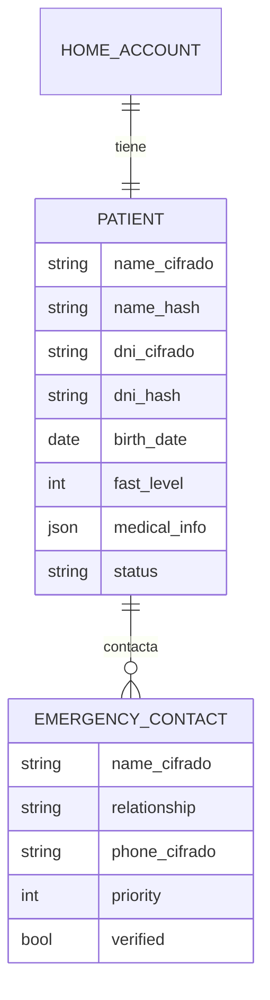
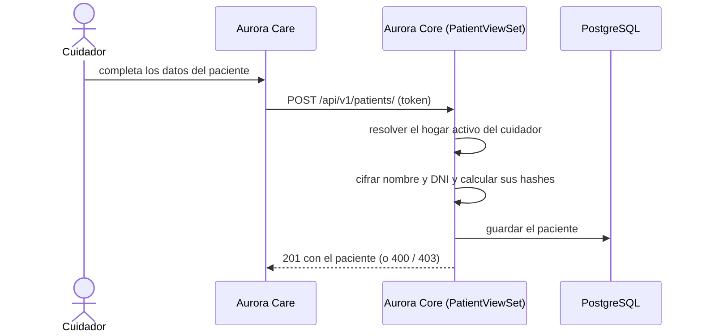

# Artefacto de Trazabilidad — AURA-84 API de Paciente (perfil, cifrado de datos identificatorios y contactos de emergencia)

> **Para qué:** conectar esta historia con sus decisiones de diseño, modelo de datos, código y pruebas.
> **Para quién:** equipo (durante el desarrollo) y docente (evaluación de calidad técnica).

| Campo | Valor |
| --- | --- |
| Historia | **AURA-84** — API REST: CRUD de Paciente (perfil, biografía, preferencias) |
| Épica | AURA-18 — Panel del Cuidador (Aurora Care) |
| Requerimientos | RF-68, RF-74, RF-79 (ver [[Requerimientos]] · [[Trazabilidad RF-Épicas]]) |
| Estado en Jira | Finalizada (Sprint 3; Jira «SCRUM Sprint 4») |
| Tareas relacionadas | AURA-55 (módulo Paciente de Aurora Care, Sprint 1); AURA-93 y AURA-97 (ADR y mecanismo de cifrado de datos personales); AURA-98 (consentimiento informado, Sprint 5) |
| Enlace | https://project-aurora-alz.atlassian.net/browse/AURA-84 |

## 1. Historia de usuario
**Como** cuidador **quiero** crear y mantener el perfil de mi familiar (datos personales, etapa de la enfermedad e información médica) y sus contactos de emergencia **para** que Aurora y el resto de los módulos trabajen con datos correctos y protegidos.

### Criterios de aceptación
- [x] Al dar de alta al paciente, el servidor le asigna automáticamente el hogar del cuidador autenticado; el cliente nunca lo envía (`test_post_patient_assigns_home_account_automatically`).
- [x] Un hogar tiene un solo paciente: un segundo alta responde 400 con un mensaje claro (`test_post_patient_duplicate_home_is_400`).
- [x] Si faltan campos obligatorios, la API devuelve un error tipado (`test_post_patient_returns_typed_error_on_missing_fields`).
- [x] Un cuidador sin hogar activo recibe 403 (`test_post_patient_without_caregiver_home_is_403`).
- [x] Se puede listar y ver el detalle del paciente del hogar.
- [x] El nombre y el DNI se guardan **cifrados** (Fernet) y se buscan por un hash determinístico, sin guardar el dato en claro (ADR-010, `test_encrypted_search.py`).
- [x] Un cuidador solo ve al paciente de su hogar (`test_patient_scoping.py`, 63 pruebas del aislamiento por hogar).
- [ ] El paciente tiene contactos de emergencia ordenados por prioridad, con verificación (implementado, falta una prueba de API propia).

> **Nota sobre el alcance.** El ticket habla de «biografía y preferencias». En el modelo implementado, esos datos viven en la información médica del paciente (un campo JSON) y en los recuerdos del paciente, que se desarrollaron en los Sprints 4 y 5 (ver los artefactos de AURA-105 y AURA-163).

## 2. Decisiones de diseño (ADR)
- **ADR-010** — Cifrado de datos personales identificatorios (PII): nombre y DNI con Fernet y búsqueda por hash determinístico con sal. Se implementó el 23/08/2026.
- **ADR-003** — PostgreSQL como base de datos.
- **ADR-004** — Monolito modular: el paciente es una app de Aurora Core.
- **ADR-012** — Diseño de API: REST bajo `/api/v1/`, errores tipados.

> Sin ADR nuevo: la historia se apoya en las decisiones ya registradas en [[Arquitectura y Stack Tecnológico]].

## 3. Modelo de datos (DER)
**Sin cambios respecto del DER del Sprint 1**, con una precisión de implementación: los campos `name` y `dni` se cifran y se agregan `name_hash` y `dni_hash` para poder buscar.

## 4. Diagramas de modelado

### 4.1 Diagrama de clases
> No aplica.

### 4.2 Diagrama de secuencia

### 4.3 Diagrama de estados (DTE)
> DTE no aplica: el paciente se crea y se modifica sin transiciones formalizadas (tiene un campo `status`, hoy siempre `active`).

## 5. Código relacionado
| Tipo | Ubicación / referencia |
| --- | --- |
| Backend | `AuroraCore/apps/patients/` (`models.py` con `Patient` y `EmergencyContact`, `views.py` con `PatientViewSet`, `serializers.py`, `urls.py`), `apps/common/encryption.py` y `fields.py` (campos cifrados y hash), `apps/common/mixins.py` (aislamiento por hogar) |
| Backend (tests) | `apps/patients/tests/test_patient_viewset.py` (6), `test_encrypted_search.py` (15), `apps/common/tests/test_patient_scoping.py` (63), `test_encrypted_fields.py` |
| Frontend | `AuroraCare/app/(authenticated)/(tabs)/patients.tsx`, `src/features/patients/` |
| Commit / PR | `4f86114` (01/08, contratos MVP), `c9167fc` (23/08, cifrado de PII con Fernet y búsqueda por hash), `01996b0` y `ef271ca` (22/08, aislamiento por hogar y cierre de escrituras entre hogares), `4667b2b` (08/09, asignación automática del hogar) |

## 6. Casos de prueba
| ID | Precondición | Pasos | Resultado esperado | Resultado de ejecución |
| --- | --- | --- | --- | --- |
| CP-AURA-84-01 | Cuidador con hogar activo y sin paciente | 1. `POST /api/v1/patients/` con los datos. | 201 y el paciente queda en el hogar del cuidador | OK (17/10): `test_patient_viewset.py` (6)* |
| CP-AURA-84-02 | Pedido sin los campos obligatorios | 1. `POST` incompleto. | 400 con error tipado | OK (17/10): `test_patient_viewset.py`* |
| CP-AURA-84-03 | El hogar ya tiene paciente | 1. `POST` de otro paciente. | 400 «ya tiene un paciente asociado» | OK (17/10): `test_patient_viewset.py`* |
| CP-AURA-84-04 | Cuidador sin hogar activo | 1. `POST`. | 403 | OK (17/10): `test_patient_viewset.py`* |
| CP-AURA-84-05 | Paciente cargado | 1. `GET` lista y detalle. | 200 con el paciente del hogar | OK (17/10): `test_patient_viewset.py`* |
| CP-AURA-84-06 | Paciente con nombre y DNI | 1. Buscar por DNI o por nombre. | Lo encuentra; con un dato inexistente no devuelve nada | OK (17/10): `test_encrypted_search.py` (15)* |
| CP-AURA-84-07 | Paciente guardado | 1. Leer la fila de la base. | Nombre y DNI están cifrados, no en claro | Parcial: la prueba de `Patient` pasó (17/10); las 4 pruebas de columnas cifradas usan SQL de PostgreSQL y no corren en SQLite (pasaron en la suite del 16/10)* |
| CP-AURA-84-08 | Dos hogares con pacientes | 1. Un cuidador pide los datos del otro hogar. | No los ve ni puede escribirlos | OK (17/10): `test_patient_scoping.py` (63) y `test_cross_tenant_writes.py` (12)* |

\* **Ejecución de AuroraCore (17/10/2026):** las pruebas se corrieron con `pytest` sobre SQLite (no se pudo levantar PostgreSQL en la máquina de revisión). La suite completa de AuroraCore pasó el 16/10/2026 sobre PostgreSQL con 1.579 pruebas y sin fallas (ejecución del equipo, ver [[Plan de Testing]], sección 4.7). Repetida el 17/10 sobre SQLite, pasaron 1.574 de 1.579; las 5 restantes usan SQL propio de PostgreSQL y no se pueden ejecutar en SQLite.

## 7. Matriz de trazabilidad de la historia
| Historia | RF | ADR | DER | Diagramas | Código | Casos de prueba |
| --- | --- | --- | --- | --- | --- | --- |
| AURA-84 | RF-68, RF-74, RF-79 | ADR-003, 004, 010, 012 | `Patient`, `EmergencyContact` | Secuencia | `apps/patients/*`, `apps/common/encryption.py` | CP-AURA-84-01 a 08 |

## Checklist de completitud (cátedra)
- [x] Historia y criterios de aceptación
- [x] ADR correspondiente (si hubo decisión técnica nueva)
- [x] DER actualizado (si modificó el modelo de datos)
- [x] Diagramas de modelado relevantes (clases/secuencia/estados, según aplique)
- [x] Casos de prueba con precondición, pasos y resultado esperado
- [x] Resultados de ejecución de las pruebas
- [x] Referencias a código (paths/commits/PRs)

> [!todo] Pendiente
> - Los endpoints de contactos de emergencia (`emergency-contacts` y su verificación) están implementados pero no tienen una prueba de API propia; solo se ejercitan indirectamente en otras pruebas.
> - La pantalla de Care no muestra los contactos de emergencia (ver el artefacto de AURA-55).
