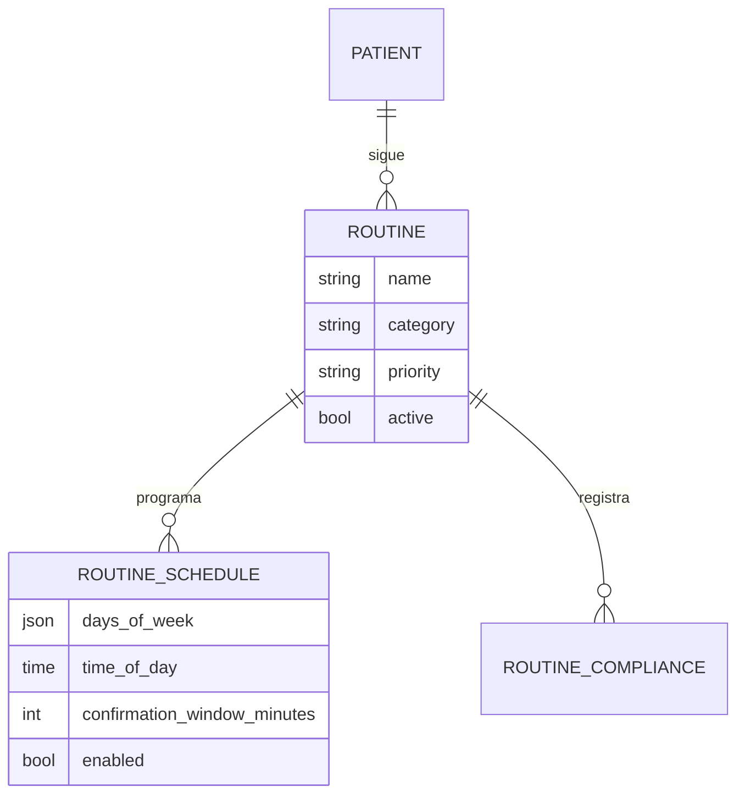
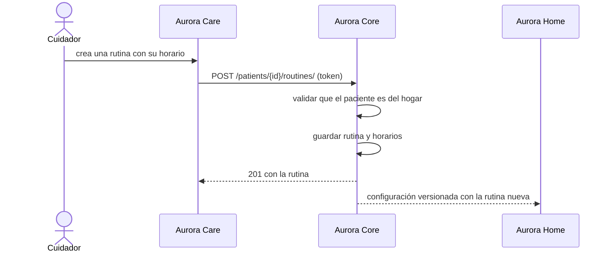

# Artefacto de Trazabilidad — AURA-87 API de Rutinas del paciente

> **Para qué:** conectar esta historia con sus decisiones de diseño, modelo de datos, código y pruebas.
> **Para quién:** equipo (durante el desarrollo) y docente (evaluación de calidad técnica).

| Campo | Valor |
| --- | --- |
| Historia | **AURA-87** — API REST: CRUD de Rutinas del Paciente |
| Épica | AURA-17 — Administración de Rutinas y Medicación |
| Requerimientos | RF-82, RF-83, RF-84 (ver [[Requerimientos]] · [[Trazabilidad RF-Épicas]]) |
| Estado en Jira | Finalizada (Sprint 3; Jira «SCRUM Sprint 4») |
| Tareas relacionadas | AURA-57 y AURA-79 (módulo de Rutinas de Aurora Care, Sprints 1 y 3); AURA-89 (cumplimiento de las rutinas) |
| Enlace | https://project-aurora-alz.atlassian.net/browse/AURA-87 |

## 1. Historia de usuario
**Como** cuidador **quiero** crear, ver, modificar y eliminar las rutinas diarias de mi familiar y programar sus horarios **para** que Aurora se las recuerde en voz alta a la hora indicada.

### Criterios de aceptación
- [x] Las rutinas se gestionan bajo el paciente: `GET` y `POST /api/v1/patients/{id}/routines/`, y `GET`, `PUT`, `PATCH` y `DELETE` sobre `/{rutina}/` (`test_routine_list_via_nested_url`, `…_detail_…`, `…_update_…`, `…_partial_update_…`).
- [x] Una rutina se crea junto con sus horarios (días de la semana, hora y ventana de confirmación) y, al actualizarla, los horarios se reemplazan (`test_routine_create_with_schedules`, `test_routine_update_replaces_schedules`).
- [x] Se puede dar de alta la primera rutina de un paciente (`test_can_create_first_routine_for_patient`).
- [x] No se puede crear una rutina para un paciente de otro hogar ni para uno inexistente.
- [x] Eliminar una rutina es una baja lógica: deja de listarse pero no se pierde su historial (`test_routine_soft_delete_via_nested_url`).
- [x] Cambiar un horario conserva el historial de cumplimiento y cancela las ocurrencias futuras del horario anterior (`test_schedule_replacement.py`, regla incorporada después del sprint).

## 2. Decisiones de diseño (ADR)
- **ADR-012** — Diseño de API: REST bajo `/api/v1/` con recursos anidados bajo el paciente.
- **ADR-004** — Monolito modular: las rutinas son una app de Aurora Core.
- **ADR-008** — Modo offline: Aurora Home recibe las rutinas y las ejecuta aunque no haya conexión.
- **ADR-010** — Las rutinas son información de salud del paciente y quedan dentro del aislamiento por hogar.

> Sin ADR nuevo: la historia se apoya en las decisiones ya registradas en [[Arquitectura y Stack Tecnológico]].

## 3. Modelo de datos (DER)
**Sin cambios respecto del DER del Sprint 1** (módulo de rutinas y medicación). Entidades usadas:

## 4. Diagramas de modelado

### 4.1 Diagrama de clases
> No aplica.

### 4.2 Diagrama de secuencia

### 4.3 Diagrama de estados (DTE)
> DTE no aplica en este artefacto: la rutina solo está activa o dada de baja. El ciclo de vida de cada ocurrencia (programada, confirmada, no cumplida) se detalla en el artefacto de AURA-89.

## 5. Código relacionado
| Tipo | Ubicación / referencia |
| --- | --- |
| Backend | `AuroraCore/apps/routines/` (`models.py`: `Routine`, `RoutineSchedule`; `views.py`: `RoutineViewSet`; `nested_urls.py`; `schedules.py`; `serializers.py`) |
| Backend (tests) | `apps/routines/tests/test_routine_create_api.py` (4), `test_compliance_api.py` (13, incluye las rutas anidadas de rutinas), `test_schedule_replacement.py` (8), `apps/common/tests/test_patient_scoping.py` y `test_cross_tenant_writes.py` |
| Frontend | `AuroraCare/src/features/routines/` (ver el artefacto de AURA-57) |
| Commit / PR | `4f86114` (01/08, contratos MVP), `55a278a` (22/08, endpoints de rutinas anidados bajo `patients/{id}/routines/`), `ef271ca` (22/08, cierre de escrituras entre hogares) |

## 6. Casos de prueba
| ID | Precondición | Pasos | Resultado esperado | Resultado de ejecución |
| --- | --- | --- | --- | --- |
| CP-AURA-87-01 | Paciente del hogar sin rutinas | 1. `POST` de una rutina. | 201 y la rutina queda guardada | OK (17/10): `test_routine_create_api.py` (4)* |
| CP-AURA-87-02 | Rutina existente | 1. Listarla y ver su detalle por la ruta anidada. | 200 con la rutina | OK (17/10): `test_compliance_api.py` (13)* |
| CP-AURA-87-03 | Rutina existente | 1. Modificarla con `PUT` y con `PATCH`. | Los cambios se guardan | OK (17/10): `test_compliance_api.py`* |
| CP-AURA-87-04 | Rutina con horarios | 1. Actualizar con horarios distintos. | Los horarios se reemplazan | OK (17/10): `test_compliance_api.py`* |
| CP-AURA-87-05 | Rutina existente | 1. `DELETE`. | Baja lógica: deja de listarse | OK (17/10): `test_compliance_api.py`* |
| CP-AURA-87-06 | Paciente de otro hogar o inexistente | 1. `POST` de una rutina. | Se rechaza (403/404) | OK (17/10): `test_routine_create_api.py`* |
| CP-AURA-87-07 | Rutina de otro paciente | 1. Pedirla por la ruta de otro paciente. | 404 | OK (17/10): `test_compliance_api.py`* |
| CP-AURA-87-08 | Rutina con historial de cumplimiento | 1. Cambiar el horario. | El historial se conserva y las ocurrencias futuras viejas se cancelan | OK (17/10): `test_schedule_replacement.py` (8)* |

\* **Ejecución de AuroraCore (17/10/2026):** las pruebas se corrieron con `pytest` sobre SQLite (no se pudo levantar PostgreSQL en la máquina de revisión). La suite completa de AuroraCore pasó el 16/10/2026 sobre PostgreSQL con 1.579 pruebas y sin fallas (ejecución del equipo, ver [[Plan de Testing]], sección 4.7). Repetida el 17/10 sobre SQLite, pasaron 1.574 de 1.579; las 5 restantes usan SQL propio de PostgreSQL y no se pueden ejecutar en SQLite.

## 7. Matriz de trazabilidad de la historia
| Historia | RF | ADR | DER | Diagramas | Código | Casos de prueba |
| --- | --- | --- | --- | --- | --- | --- |
| AURA-87 | RF-82 a 84 | ADR-004, 008, 010, 012 | Sin cambios | Secuencia | `apps/routines/*` | CP-AURA-87-01 a 08 |

## Checklist de completitud (cátedra)
- [x] Historia y criterios de aceptación
- [x] ADR correspondiente (si hubo decisión técnica nueva)
- [x] DER actualizado (si modificó el modelo de datos)
- [x] Diagramas de modelado relevantes (clases/secuencia/estados, según aplique)
- [x] Casos de prueba con precondición, pasos y resultado esperado
- [x] Resultados de ejecución de las pruebas
- [x] Referencias a código (paths/commits/PRs)

> [!todo] Pendiente
> - La publicación de la configuración a Aurora Home (última flecha del diagrama de secuencia) se prueba en el artefacto de Aurora Home (AURA-90, 91 y 95) y en el de los comandos seguros (AURA-131), no en las pruebas de esta API.
