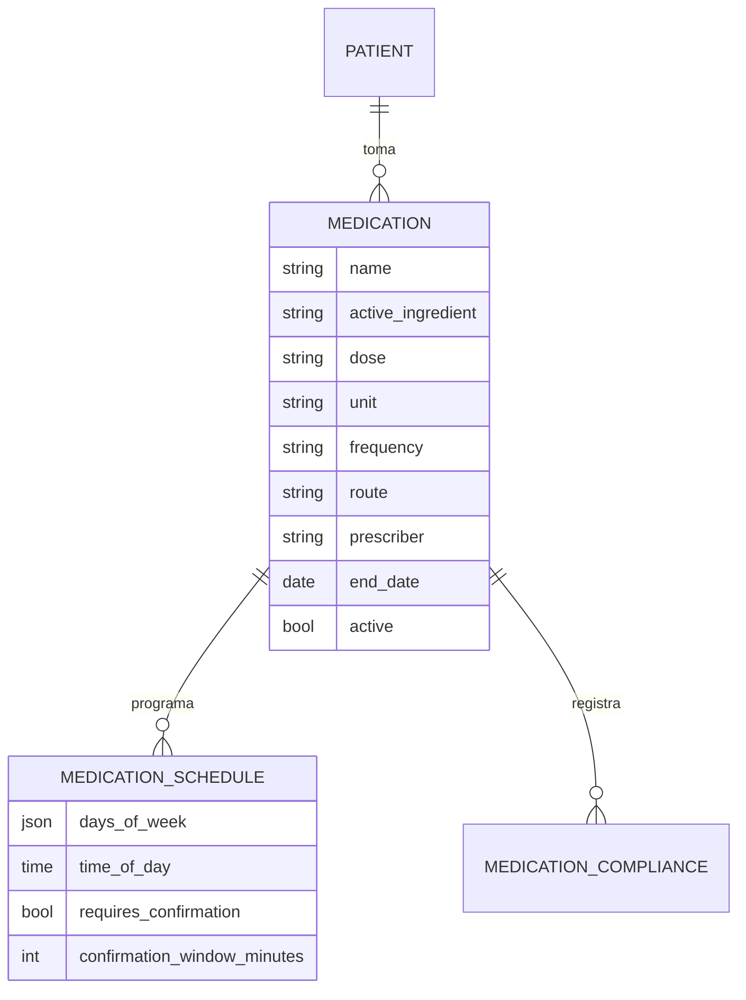
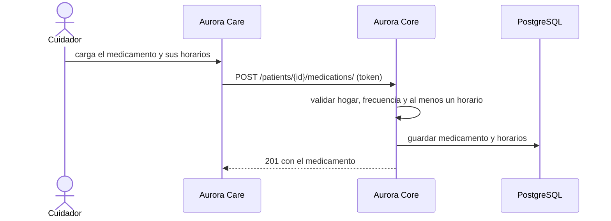

# Artefacto de Trazabilidad — AURA-88 API de Medicación y Recetario del paciente

> **Para qué:** conectar esta historia con sus decisiones de diseño, modelo de datos, código y pruebas.
> **Para quién:** equipo (durante el desarrollo) y docente (evaluación de calidad técnica).

| Campo | Valor |
| --- | --- |
| Historia | **AURA-88** — API REST: CRUD de Medicación y Recetario del Paciente |
| Épica | AURA-17 — Administración de Rutinas y Medicación |
| Requerimientos | RF-85, RF-86, RF-87 (ver [[Requerimientos]] · [[Trazabilidad RF-Épicas]]) |
| Estado en Jira | Finalizada (Sprint 3; Jira «SCRUM Sprint 4») |
| Tareas relacionadas | AURA-58 y AURA-80 (módulo de Medicación de Aurora Care, Sprints 1 y 3); AURA-89 (cumplimiento de las tomas) |
| Enlace | https://project-aurora-alz.atlassian.net/browse/AURA-88 |

## 1. Historia de usuario
**Como** cuidador **quiero** cargar los medicamentos de mi familiar con su dosis, su vía y sus horarios, modificarlos y darlos de baja **para** que Aurora se los recuerde a tiempo y quede registro de lo recetado.

### Criterios de aceptación
- [x] Un medicamento se crea por la ruta anidada (`/patients/{id}/medications/`) o por la plana, con principio activo, dosis, unidad, frecuencia, vía, instrucciones y prescriptor (`test_create_medication_via_nested`, `test_create_medication_via_flat`, `test_caregiver_can_create_medication_with_prescriber_and_schedules`).
- [x] Exige al menos un horario y rechaza una frecuencia inválida (`test_create_requires_at_least_one_schedule`, `test_create_rejects_invalid_frequency`).
- [x] Se puede listar solo los medicamentos del paciente, ver el detalle, modificar parcialmente y reemplazar los horarios al actualizar completo.
- [x] La baja es lógica: el medicamento deja de listarse pero se conserva (`test_soft_delete_medication`).
- [x] Un medicamento con fecha de fin vencida se desactiva solo; con fecha futura sigue activo.
- [x] Un cuidador no puede gestionar medicación de otro hogar ni de un paciente no vinculado; sin acceso activo al hogar no puede crear.

## 2. Decisiones de diseño (ADR)
- **ADR-012** — Diseño de API: REST bajo `/api/v1/` con recursos anidados bajo el paciente.
- **ADR-010** — El recetario es información de salud y queda dentro del aislamiento por hogar.
- **ADR-008** — Modo offline: Aurora Home recibe los horarios y recuerda la toma aunque no haya conexión.
- **ADR-004** — Monolito modular.

> Sin ADR nuevo: la historia se apoya en las decisiones ya registradas en [[Arquitectura y Stack Tecnológico]].

## 3. Modelo de datos (DER)
**Sin cambios respecto del DER del Sprint 1** (módulo de rutinas y medicación). En la implementación el medicamento suma los campos `route` (vía) y `prescriber` (prescriptor).

## 4. Diagramas de modelado

### 4.1 Diagrama de clases
> No aplica.

### 4.2 Diagrama de secuencia

### 4.3 Diagrama de estados (DTE)
> DTE no aplica en este artefacto: el medicamento solo está activo o dado de baja (se desactiva solo al vencer su fecha de fin). El ciclo de vida de cada toma se detalla en el artefacto de AURA-89.

## 5. Código relacionado
| Tipo | Ubicación / referencia |
| --- | --- |
| Backend | `AuroraCore/apps/routines/` (`models.py`: `Medication`, `MedicationSchedule`; `views.py`: `MedicationViewSet`; `nested_urls_medications.py`; `schedules.py`; `serializers.py`) |
| Backend (tests) | `apps/routines/tests/test_medication_crud_api.py` (14), `test_medication_api.py` (2), `test_routine_create_api.py` (1 de medicación), `test_schedule_replacement.py` |
| Frontend | `AuroraCare/src/features/medications/` y `src/features/routines/` (ver el artefacto de AURA-58) |
| Commit / PR | `4f86114` (01/08, contratos MVP), `8090f91` (22/08, CRUD de medicación completo con los campos faltantes y endpoints anidados), `ef271ca` (22/08, cierre de escrituras entre hogares) |

## 6. Casos de prueba
| ID | Precondición | Pasos | Resultado esperado | Resultado de ejecución |
| --- | --- | --- | --- | --- |
| CP-AURA-88-01 | Paciente del hogar | 1. `POST` del medicamento por la ruta anidada y por la plana. | 201 y queda guardado con prescriptor y horarios | OK (17/10): `test_medication_crud_api.py` (14) y `test_medication_api.py` (2)* |
| CP-AURA-88-02 | Medicamento sin horarios o con frecuencia inválida | 1. `POST`. | 400 | OK (17/10): `test_medication_crud_api.py`* |
| CP-AURA-88-03 | Medicamentos de dos pacientes | 1. Listar los de uno. | Solo aparecen los suyos | OK (17/10): `test_medication_crud_api.py`* |
| CP-AURA-88-04 | Medicamento existente | 1. Ver detalle. 2. `PATCH`. 3. `PUT` con otros horarios. | Se ve, se modifica y los horarios se reemplazan | OK (17/10): `test_medication_crud_api.py`* |
| CP-AURA-88-05 | Medicamento existente | 1. `DELETE`. | Baja lógica | OK (17/10): `test_medication_crud_api.py`* |
| CP-AURA-88-06 | Medicamento con fecha de fin pasada o futura | 1. Consultarlo. | El vencido se desactiva; el vigente sigue activo | OK (17/10): `test_medication_crud_api.py`* |
| CP-AURA-88-07 | Cuidador de otro hogar o sin acceso activo | 1. Gestionar o crear medicación. | Se rechaza | OK (17/10): `test_medication_crud_api.py`, `test_medication_api.py`* |

\* **Ejecución de AuroraCore (17/10/2026):** las pruebas se corrieron con `pytest` sobre SQLite (no se pudo levantar PostgreSQL en la máquina de revisión). La suite completa de AuroraCore pasó el 16/10/2026 sobre PostgreSQL con 1.579 pruebas y sin fallas (ejecución del equipo, ver [[Plan de Testing]], sección 4.7). Repetida el 17/10 sobre SQLite, pasaron 1.574 de 1.579; las 5 restantes usan SQL propio de PostgreSQL y no se pueden ejecutar en SQLite.

## 7. Matriz de trazabilidad de la historia
| Historia | RF | ADR | DER | Diagramas | Código | Casos de prueba |
| --- | --- | --- | --- | --- | --- | --- |
| AURA-88 | RF-85 a 87 | ADR-004, 008, 010, 012 | Sin cambios | Secuencia | `apps/routines/*` | CP-AURA-88-01 a 07 |

## Checklist de completitud (cátedra)
- [x] Historia y criterios de aceptación
- [x] ADR correspondiente (si hubo decisión técnica nueva)
- [x] DER actualizado (si modificó el modelo de datos)
- [x] Diagramas de modelado relevantes (clases/secuencia/estados, según aplique)
- [x] Casos de prueba con precondición, pasos y resultado esperado
- [x] Resultados de ejecución de las pruebas
- [x] Referencias a código (paths/commits/PRs)
