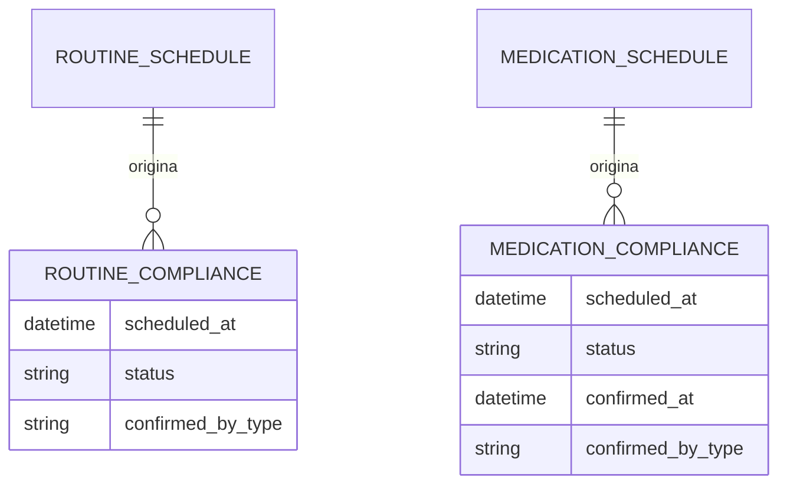
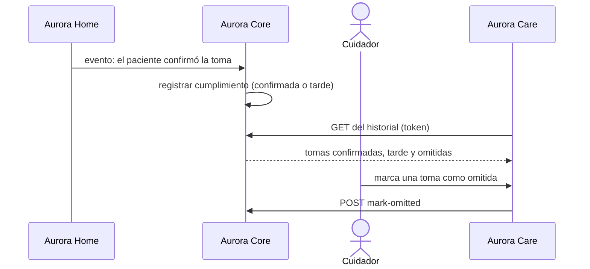
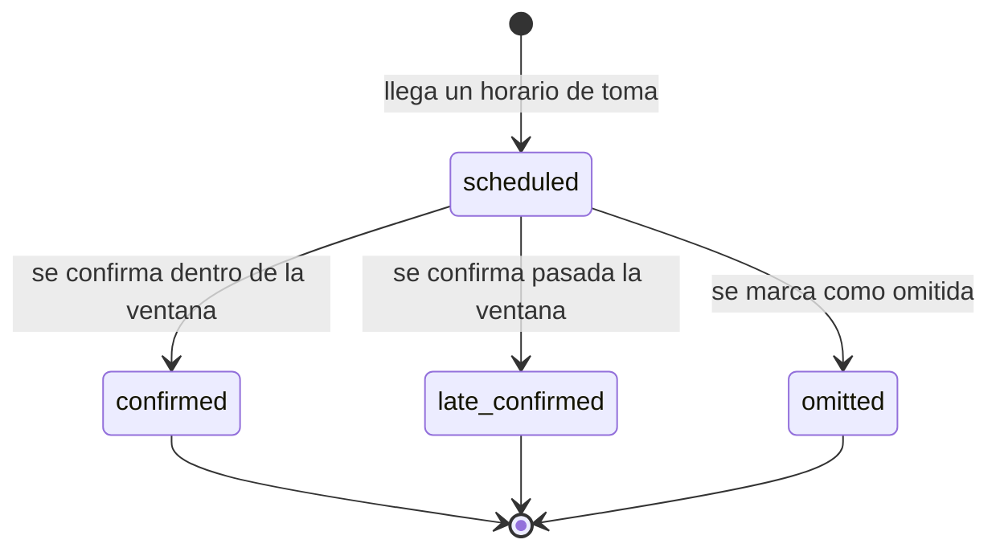

# Artefacto de Trazabilidad — AURA-89 API de cumplimiento de rutinas y toma de medicación

> **Para qué:** conectar esta historia con sus decisiones de diseño, modelo de datos, código y pruebas.
> **Para quién:** equipo (durante el desarrollo) y docente (evaluación de calidad técnica).

| Campo | Valor |
| --- | --- |
| Historia | **AURA-89** — API REST: Registro de Cumplimiento de Rutinas y Toma de Medicación |
| Épica | AURA-17 — Administración de Rutinas y Medicación |
| Requerimientos | RF-88, RF-89, RF-90, RF-91 (ver [[Requerimientos]] · [[Trazabilidad RF-Épicas]]) |
| Estado en Jira | Finalizada (Sprint 3; Jira «SCRUM Sprint 4») |
| Tareas relacionadas | AURA-87 y AURA-88 (rutinas y medicación); AURA-57 y AURA-58 (historial en Aurora Care, Sprint 1); AURA-151 a 156 (recordatorio por voz en Aurora Home, Sprint 4) |
| Enlace | https://project-aurora-alz.atlassian.net/browse/AURA-89 |

## 1. Historia de usuario
**Como** cuidador **quiero** registrar si mi familiar cumplió cada rutina y si tomó cada medicamento, y ver el historial **para** saber cómo viene su día y avisar al médico si se omite una toma.

### Criterios de aceptación
- [x] Cada ocurrencia programada de una rutina tiene un registro de cumplimiento que puede confirmarse o marcarse como no cumplida; repetir la operación no cambia el resultado (`test_routine_compliance_confirm_is_idempotent`, `test_routine_compliance_mark_missed_is_idempotent`).
- [x] Cada toma de medicación tiene un registro que puede confirmarse; si se confirma después de la ventana de tiempo queda como «confirmada tarde» (`test_medication_confirmation_is_idempotent`, `test_home_event_ingestion.py`).
- [x] Quién confirmó (paciente, Aurora o cuidador) y cuándo queda registrado.
- [x] Una toma puede marcarse como omitida (`mark-omitted`).
- [x] Los hechos que informa Aurora Home (por ejemplo, «el paciente confirmó la toma») se transforman en cumplimiento y, si corresponde, en alertas (`test_home_event_ingestion.py`).
- [x] Un cuidador solo ve y modifica el cumplimiento de los pacientes de su hogar.

## 2. Decisiones de diseño (ADR)
- **ADR-012** — Diseño de API: acciones sobre el registro (`confirm`, `mark-missed`, `mark-omitted`) dentro de `/api/v1/`.
- **ADR-008** — Modo offline: Aurora Home registra la confirmación aunque no haya red y la envía después (outbox).
- **ADR-010** — El cumplimiento es información de salud y queda dentro del aislamiento por hogar.

> Sin ADR nuevo: la historia se apoya en las decisiones ya registradas en [[Arquitectura y Stack Tecnológico]].

## 3. Modelo de datos (DER)
**Sin cambios respecto del DER del Sprint 1** (módulo de rutinas y medicación).

## 4. Diagramas de modelado

### 4.1 Diagrama de clases
> No aplica.

### 4.2 Diagrama de secuencia

### 4.3 Diagrama de estados (DTE)
Estados vigentes del cumplimiento de la medicación (el de rutinas es análogo, con `confirmed` y `missed`):

## 5. Código relacionado
| Tipo | Ubicación / referencia |
| --- | --- |
| Backend | `AuroraCore/apps/routines/views.py` (`RoutineComplianceViewSet`, `MedicationComplianceViewSet`), `models.py` (`RoutineCompliance`, `MedicationCompliance`), `apps/events/` (conversión de eventos de Aurora Home en cumplimiento) |
| Backend (tests) | `apps/routines/tests/test_compliance_api.py` (13), `apps/events/tests/test_home_event_ingestion.py`, `apps/common/tests/test_patient_scoping.py` |
| Frontend | `AuroraCare/src/features/routines/` (historial y cumplimiento, ver los artefactos de AURA-57 y AURA-58) |
| Commit / PR | `4f86114` (01/08, contratos MVP), `cec9da1` (11/08, hechos de Aurora Home a cumplimiento y alertas), `ef271ca` (22/08, cierre de escrituras entre hogares) |

## 6. Casos de prueba
| ID | Precondición | Pasos | Resultado esperado | Resultado de ejecución |
| --- | --- | --- | --- | --- |
| CP-AURA-89-01 | Ocurrencia de rutina programada | 1. `POST confirm`. 2. Repetirlo. | Queda confirmada; la segunda vez no cambia nada | OK (17/10): `test_compliance_api.py` (13)* |
| CP-AURA-89-02 | Ocurrencia de rutina programada | 1. `POST mark-missed`. 2. Repetirlo. | Queda no cumplida; es idempotente | OK (17/10): `test_compliance_api.py`* |
| CP-AURA-89-03 | Toma de medicación programada | 1. `POST confirm`. 2. Repetirlo. | Queda confirmada (o tarde) y la repetición no la cambia | OK (17/10): `test_compliance_api.py`* |
| CP-AURA-89-04 | Toma confirmada pasada la ventana | 1. Aurora Home informa la confirmación. | Estado `late_confirmed` | OK (17/10): `test_home_event_ingestion.py`* |
| CP-AURA-89-05 | Evento de Aurora Home sobre una toma | 1. Enviar el lote de eventos. | Se registra el cumplimiento y, si corresponde, la alerta | OK (17/10): `test_home_event_ingestion.py`* |
| CP-AURA-89-06 | Toma programada | 1. `POST mark-omitted`. | Estado `omitted` | Pendiente: el endpoint no tiene prueba propia |
| CP-AURA-89-07 | Cuidador de otro hogar | 1. Pedir o confirmar un registro ajeno. | No lo ve ni lo modifica | OK (17/10): `test_patient_scoping.py` (63)* |

\* **Ejecución de AuroraCore (17/10/2026):** las pruebas se corrieron con `pytest` sobre SQLite (no se pudo levantar PostgreSQL en la máquina de revisión). La suite completa de AuroraCore pasó el 16/10/2026 sobre PostgreSQL con 1.579 pruebas y sin fallas (ejecución del equipo, ver [[Plan de Testing]], sección 4.7). Repetida el 17/10 sobre SQLite, pasaron 1.574 de 1.579; las 5 restantes usan SQL propio de PostgreSQL y no se pueden ejecutar en SQLite.

## 7. Matriz de trazabilidad de la historia
| Historia | RF | ADR | DER | Diagramas | Código | Casos de prueba |
| --- | --- | --- | --- | --- | --- | --- |
| AURA-89 | RF-88 a 91 | ADR-008, 010, 012 | Sin cambios | Secuencia, estados | `apps/routines/views.py`, `apps/events/*` | CP-AURA-89-01 a 07 |

## Checklist de completitud (cátedra)
- [x] Historia y criterios de aceptación
- [x] ADR correspondiente (si hubo decisión técnica nueva)
- [x] DER actualizado (si modificó el modelo de datos)
- [x] Diagramas de modelado relevantes (clases/secuencia/estados, según aplique)
- [x] Casos de prueba con precondición, pasos y resultado esperado
- [ ] Resultados de ejecución de las pruebas (falta el caso de `mark-omitted`)
- [x] Referencias a código (paths/commits/PRs)

> [!todo] Pendiente
> - Agregar una prueba de API para `mark-omitted` (CP-AURA-89-06).
