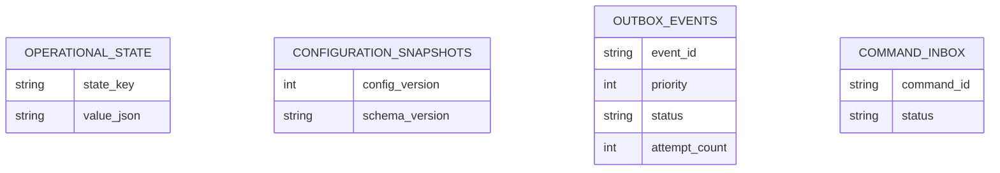
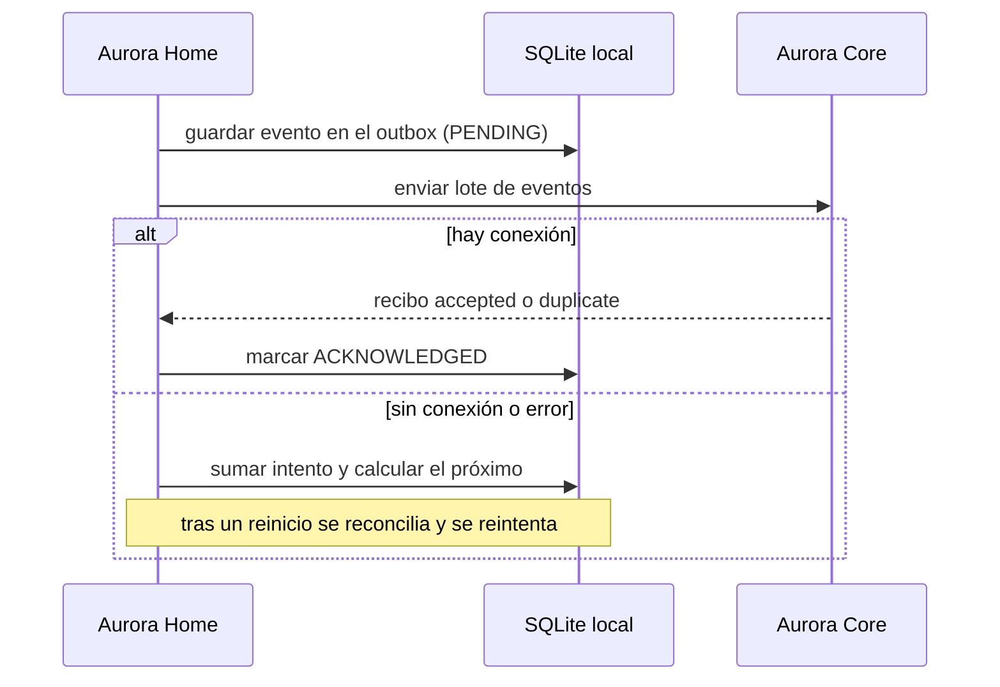
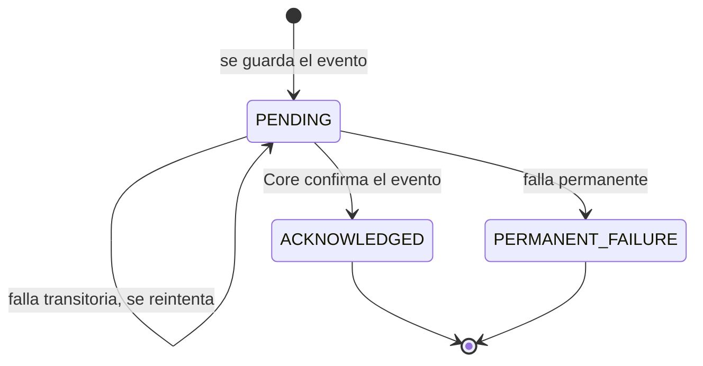

# Artefacto de Trazabilidad — AURA-90, 91 y 95 Aurora Home: base del dispositivo, contrato con Core y persistencia local resiliente

> **Para qué:** conectar esta historia con sus decisiones de diseño, modelo de datos, código y pruebas.
> **Para quién:** equipo (durante el desarrollo) y docente (evaluación de calidad técnica).

| Campo | Valor |
| --- | --- |
| Historia | **AURA-90, 91 y 95** — Aurora Home: base del dispositivo (AH-M01), contratos v1 y simulador Home↔Core (AH-M02) y fundación local resiliente (AH-M03) |
| Épica | AURA-14 — Interacción y Asistencia por Voz (Aurora Home) |
| Requerimientos | RNF-19, RNF-34, RNF-38: disponibilidad y recuperación ante fallas. Es la base técnica de los RF-01 a RF-08 (ver [[Requerimientos]] · [[Trazabilidad RF-Épicas]]) |
| Estado en Jira | Finalizadas (Sprint 4; Jira «SCRUM Sprint 5»). El código de AURA-90 y 91 se mergeó el 02 y 03/08 y el de AURA-95 el 09/08 |
| Tareas relacionadas | AURA-102 y 103 (contratos OpenAPI y pruebas de integración Home↔Core); AURA-131 (heartbeat y comandos seguros); AURA-151 a 156 (recordatorios y conversación local, Sprint 4) |
| Enlace | https://project-aurora-alz.atlassian.net/browse/AURA-95 |

## 1. Historia de usuario
> [!note] Historia derivada
> Esta historia se redactó a posteriori a partir de las tareas de Jira indicadas arriba (modo *task-first*), porque el trabajo se registró en Jira como tareas técnicas. La historia **vive en este artefacto** y no se carga en Jira, que es de uso interno del equipo. Conviene que el equipo revise el texto.

**Como** cuidador **quiero** que Aurora Home siga funcionando aunque se corte internet o se reinicie, y que hable con Aurora Core mediante un contrato estable **para** que los recordatorios, las confirmaciones y las alertas no se pierdan.

### Criterios de aceptación
- [x] El software del dispositivo tiene una estructura hexagonal con puertos abstractos (reloj, red, audio, LED, botón), arranque asíncrono y registro estructurado (AURA-90; `tests/test_main.py`, `test_logging.py`, `test_settings.py`, `test_packaging.py`: 59 pruebas).
- [x] El intercambio con Core está definido como un contrato versionado, con operaciones, modelos JSON (esquema 1.0) y validación estricta (AURA-91; `tests/contract`: 57 pruebas).
- [x] Existe un simulador local de Core que reproduce fallos determinísticos (tiempos de espera, respuestas que no son JSON, duplicados) para desarrollar y probar sin red (AURA-91; `test_core_simulator.py`).
- [x] El estado del dispositivo se guarda en una base SQLite durable (modo WAL) con migraciones versionadas (AURA-95; `test_sqlite_store.py`).
- [x] Los eventos salen por una cola de salida (*outbox*) con reintento exponencial y prioridades; solo se marcan como fallo permanente si el error no es recuperable (AURA-95; `test_outbox_delivery.py`).
- [x] Los comandos entrantes se guardan en una bandeja (*inbox*) con deduplicación, y la configuración llega como instantáneas versionadas.
- [x] Tras un reinicio o un fallo, el dispositivo se reconcilia sin perder ni duplicar eventos (AURA-95; `test_reconciliation.py` y `test_foundation_runtime.py`: 11 pruebas).

> **Evolución.** El contrato empezó con 8 operaciones y hoy tiene 13 (se sumaron la rotación de credenciales, la consulta al paciente y el plan de actividades, entre otras). La tabla de persistencia también creció. Las pruebas de abajo corresponden a la versión vigente.

## 2. Decisiones de diseño (ADR)
- **ADR-008** — Modo offline y operación degradada: persistencia local, cola de salida y reintentos.
- **ADR-012** — Diseño de API: contratos REST versionados con Core.
- **ADR-004** — Arquitectura modular: el dispositivo es un componente propio que se integra por contrato.
- **Decisiones propias de Aurora Home** (serie ADR-HOME, documentadas en el repositorio del dispositivo): arquitectura hexagonal, simulador permanente de Core y base SQLite local.

> Sin ADR nuevo en [[Arquitectura y Stack Tecnológico]]: las decisiones específicas del dispositivo viven en su propio repositorio.

## 3. Modelo de datos (DER)
**Sin cambios en el DER de Core.** El dispositivo tiene su propia base SQLite local, con las tablas de AURA-95:

## 4. Diagramas de modelado

### 4.1 Diagrama de clases
> No aplica.

### 4.2 Diagrama de secuencia

### 4.3 Diagrama de estados (DTE)
Estados de un evento en la cola de salida (tabla `outbox_events`):

## 5. Código relacionado
| Tipo | Ubicación / referencia |
| --- | --- |
| Dispositivo | `AuroraHome/src/aurora_home/` (`ports/` puertos, `contracts/` contrato y matriz de operaciones, `simulator/core.py` simulador, `infrastructure/persistence/` SQLite, migraciones y recuperación, `application/` casos de uso) |
| Pruebas | `tests/contract` (57), `tests/integration/test_sqlite_store.py` y `test_outbox_delivery.py` (22), `tests/unit/test_reconciliation.py` y `test_foundation_runtime.py` (11), `tests/test_main.py`, `test_logging.py`, `test_settings.py`, `test_packaging.py` (59) |
| Commit / PR | `871d977` (AH-M01, 01/08, PR #2), `fef2cfd` (AH-M02, 03/08, PR #3 y #4), `d8a7758`, `13cefe5` y `c926900` (AH-M03, 09/08, PR #6), `3cbc052` (10/08, recuperación ante fallos de SQLite) |

## 6. Casos de prueba
| ID | Precondición | Pasos | Resultado esperado | Resultado de ejecución |
| --- | --- | --- | --- | --- |
| CP-AURA-90-01 | Código del dispositivo instalado | 1. Arrancar el agente. 2. Leer la configuración y el registro. | Arranca, registra de forma estructurada y respeta la configuración | OK (17/10): `test_main.py`, `test_logging.py`, `test_settings.py`, `test_packaging.py` (59) |
| CP-AURA-91-01 | Contrato v1 | 1. Validar los modelos y la matriz de operaciones con casos buenos y malos. | Los inválidos se rechazan; la matriz coincide con el contrato | OK (17/10): `tests/contract` (57) |
| CP-AURA-91-02 | Simulador de Core | 1. Forzar tiempo de espera, respuesta no JSON y duplicado. | El dispositivo reacciona de forma determinística | OK (17/10): `test_core_simulator.py` (dentro de las 57) |
| CP-AURA-95-01 | Base SQLite nueva | 1. Aplicar las migraciones y guardar estado. | Esquema versionado y datos durables | OK (17/10): `test_sqlite_store.py` (dentro de las 22) |
| CP-AURA-95-02 | Eventos pendientes y Core caído | 1. Intentar enviar. 2. Restablecer la conexión. | Se reintenta con espera creciente y se envía respetando la prioridad | OK (17/10): `test_outbox_delivery.py` (dentro de las 22) |
| CP-AURA-95-03 | Comando repetido | 1. Recibir el mismo comando dos veces. | Se ejecuta una sola vez | OK (17/10): `test_sqlite_store.py` y `test_command_dispatcher.py` |
| CP-AURA-95-04 | Reinicio con eventos en curso | 1. Reiniciar el agente. | Se reconcilia sin perder ni duplicar | OK (17/10): `test_reconciliation.py` y `test_foundation_runtime.py` (11) |

**Ejecución de Aurora Home (17/10/2026):** toda la suite del dispositivo se corrió con `pytest` y dio 1.911 pruebas aprobadas y 15 omitidas, sin fallas.

## 7. Matriz de trazabilidad de la historia
| Historia | RF | ADR | DER | Diagramas | Código | Casos de prueba |
| --- | --- | --- | --- | --- | --- | --- |
| AURA-90, 91, 95 | RNF-19, 34, 38 | ADR-004, 008, 012 | SQLite local | Secuencia, estados | `AuroraHome/src/aurora_home/*` | CP-AURA-90-01, CP-AURA-91-01 y 02, CP-AURA-95-01 a 04 |

## Checklist de completitud (cátedra)
- [x] Historia y criterios de aceptación
- [x] ADR correspondiente (si hubo decisión técnica nueva)
- [x] DER actualizado (si modificó el modelo de datos)
- [x] Diagramas de modelado relevantes (clases/secuencia/estados, según aplique)
- [x] Casos de prueba con precondición, pasos y resultado esperado
- [x] Resultados de ejecución de las pruebas
- [x] Referencias a código (paths/commits/PRs)

> [!todo] Pendiente
> - El Sprint 3 incluyó más trabajo de Aurora Home sin ticket propio (emparejamiento sin pantalla, supervisión del servicio, audio, reconocimiento de voz local y recordatorios sin conexión); su trazabilidad está en el artefacto de AURA-151 a 156 (Sprint 4).
