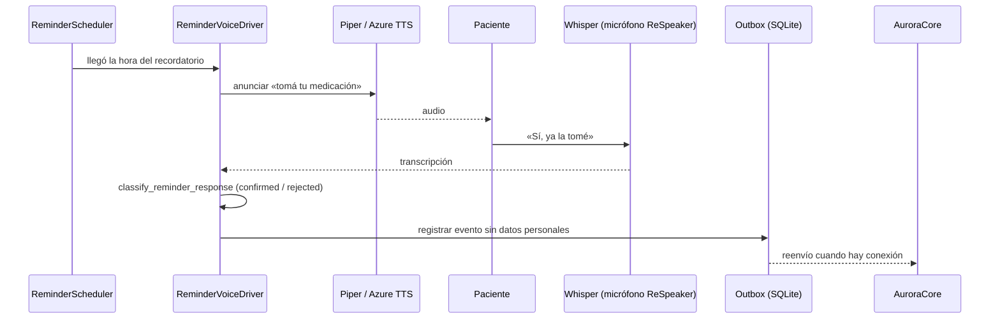

# Artefacto de Trazabilidad — AURA-151-156 Aurora Home conversa y recuerda la medicación de forma local

> **Para qué:** conectar esta historia con sus decisiones de diseño, modelo de datos, código y pruebas.
> **Para quién:** equipo (durante el desarrollo) y docente (evaluación de calidad técnica).

| Campo | Valor |
| --- | --- |
| Historia | **AURA-151-156** — Aurora Home conversa y recuerda la medicación de forma local |
| Épica | AURA-14 — Interacción y Asistencia por Voz (Aurora Home) |
| Requerimientos | RF-02, RF-03, RF-05, RF-07, RF-08 (RF-04 solo con intenciones locales) (ver [[Requerimientos]] · [[Trazabilidad RF-Épicas]]) |
| Estado en Jira | Finalizadas (Sprint 4; Jira «SCRUM Sprint 5») |
| Tareas relacionadas | AURA-151 (recordatorios automáticos y outbox), AURA-152 (HomeRuntime y systemd), AURA-153 (hardware real y diagnósticos), AURA-154 (pipeline de voz local), AURA-155 (conversación e intenciones locales), AURA-156 (recordatorios offline). Pruebas de integración con Core: AURA-102, 103 y 123 |
| Enlace | https://project-aurora-alz.atlassian.net/browse/AURA-155 |

## 1. Historia de usuario
> [!note] Historia derivada
> Esta historia se redactó a posteriori a partir de las tareas de Jira indicadas arriba (modo *task-first*). **No se creó en Jira**: queda como propuesta del equipo.

**Como** paciente con Alzheimer **quiero** que Aurora me recuerde en voz alta mi medicación, escuche mi respuesta y, aunque no haya internet, deje registrado si la tomé **para** no olvidarla y para que mi cuidador pueda saberlo después.

### Criterios de aceptación
- [x] Aurora Home corre como servicio de la Raspberry Pi y se levanta sola al reiniciar (AURA-152; verificado con reinicio físico).
- [x] El dispositivo diagnostica micrófono, parlante, LED y botón (AURA-153; diagnóstico real en `OK`).
- [x] Aurora transcribe la voz y responde hablando con Whisper y Piper locales (AURA-154).
- [x] Aurora entiende «repetir», «cancelar» y «qué hora es» **sin Core ni IA** (AURA-155, ADR-HOME-004).
- [x] Un recordatorio se anuncia por voz, se escucha la respuesta y se registra como *confirmado* o *rechazado* (con reintento) en la cola de salida **sin datos personales**, aun sin conexión (AURA-151 y 156).
- [ ] La respuesta de síntesis de voz cumple el objetivo de latencia de menos de 2 segundos (AURA-154).

> [!warning] Desviación registrada
> En la validación física del pipeline de voz (HOME-06) el percentil 95 de la latencia fue de **8,02 s** para el corpus completo de frases de 1 a 39 palabras; el objetivo de menos de 2 s se cumple hasta unas 9 palabras. La resolución quedó pendiente de decisión del Product Owner. También quedó diferido el HIL de SOS con el botón físico durante una conversación y la demostración del micrófono desconectado (HOME-05).

## 2. Decisiones de diseño (ADR)
- **ADR-008** — Modo offline y operación degradada.
- **ADR-011** — Voz en la nube (Azure) con respaldo local (Whisper.cpp y Piper). Reemplaza al ADR-006.
- **ADR-HOME-004** — Repetir, cancelar y decir la hora funcionan sin Core ni LLM (documentado en `AuroraHome/Docs/`).
- **ADR-012** — Contrato con Core: Home publica eventos y consume configuración por la API de dispositivo.

> Sin ADR nuevo: la historia se apoya en las decisiones ya registradas en [[Arquitectura y Stack Tecnológico]].

## 3. Modelo de datos (DER)
**Sin cambios en el DER de AuroraCore.** Aurora Home usa su propia base local SQLite (estado y *outbox* de eventos pendientes de envío), documentada en `AuroraHome/Docs/04-runtime-offline-seguridad-y-operacion.md` (arranque: ajustes, logging, SQLite y migraciones, hardware).

## 4. Diagramas de modelado

### 4.1 Diagrama de clases
> No aplica.

### 4.2 Diagrama de secuencia

### 4.3 Diagrama de estados (DTE)
> DTE no aplica en este artefacto: los resultados del recordatorio (`confirmed`, `rejected`) se registran en `AuroraHome/Docs/` y en el outbox.

## 5. Código relacionado
| Tipo | Ubicación / referencia |
| --- | --- |
| Home | `AuroraHome/src/aurora_home/application/reminder_runtime.py`, `reminder_voice_driver.py`, `reminder_scheduler.py`, `reminder_execution.py`, `reminder_responses.py` |
| Home | `application/intent_router.py`, `conversation.py`, `diagnostics.py`, `outbox_delivery.py`; carpetas `runtime/`, `hardware/` e `infrastructure/` |
| Documentación | `AuroraHome/Planes/Bloques/HOME-04` a `HOME-08` y `Docs/06-plan-implementacion.md` |
| Commit / PR | `d258a13` (HOME-04, release en la Pi), `4740f1c` (HOME-05), `f5f1a46` (HOME-06), `4ce0d78` y `d75c9b8` (HOME-07/08), `e908a12` (22/09, LED, earcon y latencia de escucha) |

## 6. Casos de prueba
| ID | Precondición | Pasos | Resultado esperado | Resultado de ejecución |
| --- | --- | --- | --- | --- |
| CP-AURA-151-156-01 | Raspberry Pi con la release instalada | 1. Reiniciar el equipo. 2. Consultar el servicio. | El servicio systemd de Aurora Home queda `enabled` y `active` | OK en la Pi (HOME-04): reinicio físico verificado |
| CP-AURA-151-156-02 | Hardware real conectado | 1. Ejecutar `diagnostics` y `audio-test`. | Las 5 capacidades en `OK`; LED y botón confirmados físicamente | OK en la Pi (HOME-05): HIL real 8/8 |
| CP-AURA-151-156-03 | Micrófono y parlante reales | 1. Hablar. 2. Whisper transcribe. 3. Piper responde. | Transcripción y respuesta correctas | OK en la Pi (HOME-06); **desviación de latencia**: p95 = 8,02 s |
| CP-AURA-151-156-04 | Aurora despierta | 1. Pedir «repetir», «cancelar» y la hora. | Responde sin Core ni LLM: `RESPONDED`, `RESPONDED`, `CANCELLED` | OK en la Pi (HOME-07), con voz de Azure, earcon y Whisper reales |
| CP-AURA-151-156-05 | Recordatorio de medicación programado | 1. Esperar el anuncio. 2. Decir «Sí, ya la tomé». | Se registra `confirmed` en el outbox, sin datos personales | OK en la Pi (HOME-08) |
| CP-AURA-151-156-06 | Recordatorio de medicación programado | 1. Decir «No, no la tomé.» tras el reintento. | Se registra `rejected` | OK en la Pi (HOME-08) |
| CP-AURA-151-156-07 | Pruebas automáticas de Home | 1. Ejecutar los grupos `reminder`, `intent or conversation`, `diagnos or runtime`, `voice or speech`, `outbox`. | Todas pasan | OK (17/10): 206, 157 (1 omitida), 92, 153 (4 omitidas) y 19 pruebas |

**Ejecución de AuroraHome (17/10/2026):** las pruebas se corrieron con `python -m pytest tests -k <grupo>` sobre el código actual de la rama principal del repositorio. Las filas «en la Pi» son las validaciones físicas registradas por el equipo en `AuroraHome/Docs/06-plan-implementacion.md`.

## 7. Matriz de trazabilidad de la historia
| Historia | RF | ADR | DER | Diagramas | Código | Casos de prueba |
| --- | --- | --- | --- | --- | --- | --- |
| AURA-151 a 156 | RF-02, 03, 05, 07, 08 | ADR-008, 011, HOME-004, 012 | Sin cambios (SQLite local) | Secuencia | `application/reminder_*`, `intent_router.py` | CP-AURA-151-156-01 a 07 |

## Checklist de completitud (cátedra)
- [x] Historia y criterios de aceptación
- [x] ADR correspondiente (si hubo decisión técnica nueva)
- [x] DER actualizado (si modificó el modelo de datos)
- [x] Diagramas de modelado relevantes (clases/secuencia/estados, según aplique)
- [x] Casos de prueba con precondición, pasos y resultado esperado
- [x] Resultados de ejecución de las pruebas
- [x] Referencias a código (paths/commits/PRs)

> [!todo] Pendiente
> - Decidir cómo resolver la desviación de latencia de voz (p95 de 8,02 s frente a 2 s).
> - Pendientes de HIL: SOS con botón físico durante una conversación y demostración del micrófono desconectado.
> - Si el equipo aprueba la historia derivada, crearla en Jira y enlazar las tareas con «Relates».
