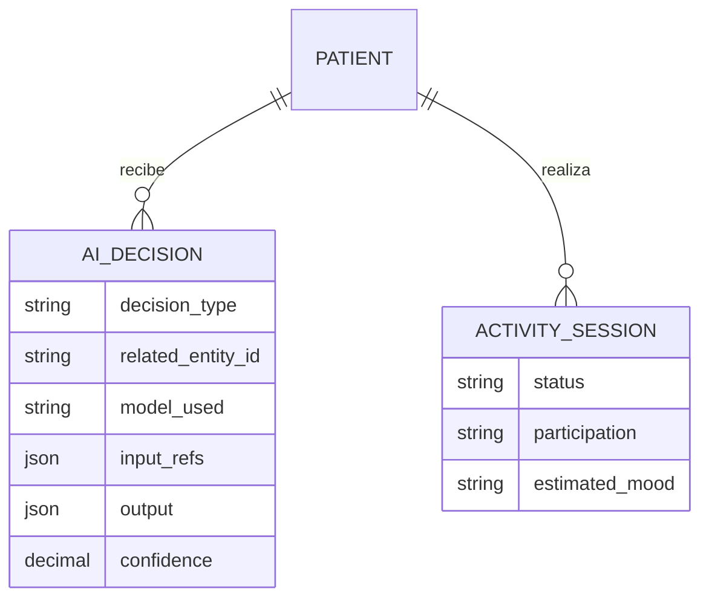
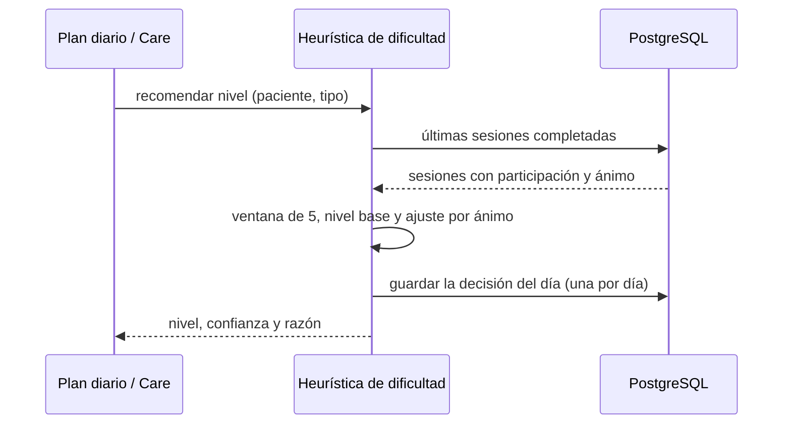

# Artefacto de Trazabilidad — AURA-77 Dificultad adaptativa de las actividades

> **Para qué:** conectar esta historia con sus decisiones de diseño, modelo de datos, código y pruebas.
> **Para quién:** equipo (durante el desarrollo) y docente (evaluación de calidad técnica).

| Campo | Valor |
| --- | --- |
| Historia | **AURA-77** — US-D4 Dificultad adaptativa |
| Épica | AURA-15 — Motor de IA y Memoria del Paciente |
| Requerimientos | RF-14, RF-52 (ver [[Requerimientos]] · [[Trazabilidad RF-Épicas]]) |
| Estado en Jira | Finalizada (Sprint 4; Jira «SCRUM Sprint 5») |
| Tareas relacionadas | AURA-149 (el plan diario de sesiones usa la recomendación de dificultad) |
| Enlace | https://project-aurora-alz.atlassian.net/browse/AURA-77 |

## 1. Historia de usuario
**Como** cuidador **quiero** que Aurora ajuste sola la dificultad de las actividades según cómo participa y cómo se siente mi familiar **para** que no se frustre ni se aburra.

### Criterios de aceptación
- [x] La dificultad recomendada (baja, media o alta) sale de las últimas 5 sesiones completadas con participación reconocida: el nivel base es la media redondeada de la participación.
- [x] Si predomina de forma estricta un ánimo negativo, baja un nivel; si predomina un ánimo positivo y el nivel base ya es alto, se mantiene alto; un ánimo positivo no sube un nivel mediocre; un empate no modifica nada.
- [x] Con menos de 3 sesiones reconocidas (arranque en frío) recomienda nivel medio con confianza baja (0,3); con 3 o 4 sesiones la confianza es 0,6 y con 5, 0,9.
- [x] Entiende los valores en español (baja, media, alta; negativa, neutra, positiva) sin importar mayúsculas ni espacios, y excluye y deja auditados los valores que no reconoce.
- [x] Funciona solo para actividades de trivia y de lógica; cualquier otro tipo, o ninguno, responde 400.
- [x] Un paciente fuera del hogar del cuidador responde 404 (no 403), para no revelar que existe.
- [x] Guarda una decisión por paciente, tipo de actividad y día (UTC): repetir la consulta el mismo día actualiza la misma fila, y el arranque en frío también se registra.
- [x] No usa ni expone el puntaje de las sesiones y nunca modifica el catálogo de actividades.
- [x] El cuidador puede listar las decisiones de su hogar, filtrarlas por tipo y verlas de la más reciente a la más antigua.

## 2. Decisiones de diseño (ADR)
- **ADR-012** — Diseño de API: `GET /api/v1/ai/difficulty-recommendations/` y `GET /api/v1/ai/ai-decisions/`.
- **ADR-004** — Monolito modular: la heurística es una función pura dentro de la app `ai` de Aurora Core.

> [!todo] Decisión sin ADR formal
> La historia introdujo una decisión técnica nueva: usar una **heurística determinista y auditable** (en lugar de un modelo de aprendizaje) para ajustar la dificultad, con registro de cada decisión. Conviene registrarla como ADR en [[Arquitectura y Stack Tecnológico]].

## 3. Modelo de datos (DER)
**Sin entidades nuevas.** Se usa la tabla de decisiones de la IA ya prevista en el DER del Sprint 1 (módulo de inteligencia artificial); la migración 0006 solo agregó un índice por paciente, tipo y fecha.

## 4. Diagramas de modelado

### 4.1 Diagrama de clases
> No aplica.

### 4.2 Diagrama de secuencia

### 4.3 Diagrama de estados (DTE)
> DTE no aplica: la recomendación se calcula en cada consulta y no tiene ciclo de vida.

## 5. Código relacionado
| Tipo | Ubicación / referencia |
| --- | --- |
| Backend | `AuroraCore/apps/ai/difficulty.py` (heurística y registro), `apps/ai/views.py` (`DifficultyRecommendationViewSet`, `AIDecisionViewSet`), `apps/ai/urls.py`, `apps/ai/migrations/0006_…`, `apps/interactions/services.py` (usa la recomendación al armar el plan diario) |
| Backend (tests) | `apps/ai/tests/test_difficulty_recommendations_api.py` (32 pruebas) |
| Commit / PR | `e166640` y `f7bfdd7` (07/09, núcleo puro y sus pruebas de tabla), `1f550c2` y `0de35cb` (07/09, endpoint de recomendación y migración), `98d1622` (07/09, listado de decisiones), `f002734` (09/09, plan diario que la consume) |

## 6. Casos de prueba
| ID | Precondición | Pasos | Resultado esperado | Resultado de ejecución |
| --- | --- | --- | --- | --- |
| CP-AURA-77-01 | Valores de participación y ánimo en español y en inglés | 1. Normalizarlos con mayúsculas y espacios variados. | Se mapean al vocabulario canónico; los desconocidos se excluyen | OK (17/10): `test_difficulty_recommendations_api.py` (32)* |
| CP-AURA-77-02 | Más de 5 sesiones completadas | 1. Armar la ventana. | Se toman las 5 más recientes con participación reconocida y se auditan las excluidas | OK (17/10): mismo archivo* |
| CP-AURA-77-03 | 0 o 2 sesiones reconocidas | 1. Pedir la recomendación. | Nivel medio, razón «datos insuficientes», confianza 0,3 | OK (17/10): mismo archivo* |
| CP-AURA-77-04 | Participación media y ánimo neutral, negativo o positivo | 1. Calcular. | Neutral mantiene; negativo baja; positivo no sube un nivel mediocre; empate sin ajuste | OK (17/10): mismo archivo* |
| CP-AURA-77-05 | Participación alta con mayoría positiva o negativa | 1. Calcular. | Positiva sostiene el nivel alto; negativa lo baja | OK (17/10): mismo archivo* |
| CP-AURA-77-06 | Cuidador vinculado | 1. `GET` de la recomendación para trivia o lógica. | 200 con nivel, confianza y ventana, sin puntaje | OK (17/10): mismo archivo* |
| CP-AURA-77-07 | Tipo de actividad inválido o ausente | 1. `GET`. | 400 | OK (17/10): mismo archivo* |
| CP-AURA-77-08 | Paciente de otro hogar | 1. `GET`. | 404 | OK (17/10): mismo archivo* |
| CP-AURA-77-09 | Misma consulta dos veces el mismo día | 1. `GET` dos veces. | Una sola fila de decisión, mismo resultado | OK (17/10): mismo archivo* |
| CP-AURA-77-10 | Catálogo de actividades | 1. Pedir la recomendación. | El catálogo no se modifica | OK (17/10): mismo archivo* |
| CP-AURA-77-11 | Decisiones de varios pacientes | 1. Listar, filtrar por tipo y ver un detalle ajeno. | Solo las propias, ordenadas; el ajeno da 404 | OK (17/10): mismo archivo* |

\* **Ejecución de AuroraCore (17/10/2026):** las pruebas se corrieron con `pytest` sobre SQLite (no se pudo levantar PostgreSQL en la máquina de revisión). La suite completa de AuroraCore pasó el 16/10/2026 sobre PostgreSQL con 1.579 pruebas y sin fallas (ejecución del equipo, ver [[Plan de Testing]], sección 4.7). Repetida el 17/10 sobre SQLite, pasaron 1.574 de 1.579; las 5 restantes usan SQL propio de PostgreSQL y no se pueden ejecutar en SQLite.

## 7. Matriz de trazabilidad de la historia
| Historia | RF | ADR | DER | Diagramas | Código | Casos de prueba |
| --- | --- | --- | --- | --- | --- | --- |
| AURA-77 | RF-14, RF-52 | ADR-004, 012 | `AIDecision` (índice nuevo) | Secuencia | `apps/ai/difficulty.py`, `apps/ai/views.py` | CP-AURA-77-01 a 11 |

## Checklist de completitud (cátedra)
- [x] Historia y criterios de aceptación
- [ ] ADR correspondiente (falta registrar la decisión de usar una heurística determinista)
- [x] DER actualizado (si modificó el modelo de datos)
- [x] Diagramas de modelado relevantes (clases/secuencia/estados, según aplique)
- [x] Casos de prueba con precondición, pasos y resultado esperado
- [x] Resultados de ejecución de las pruebas
- [x] Referencias a código (paths/commits/PRs)

> [!todo] Pendiente
> - Registrar el ADR de la heurística de dificultad.
> - La recomendación se calcula con las sesiones que informa Aurora Home; con pocas sesiones queda en el nivel medio (arranque en frío).
