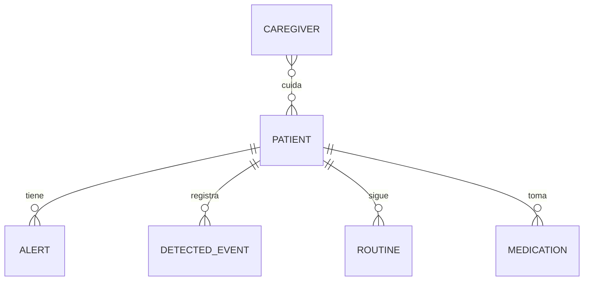
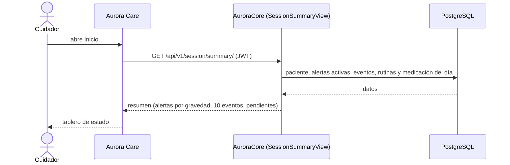

# Artefacto de Trazabilidad — AURA-85 Dashboard del Cuidador (estado actual del paciente)

> **Para qué:** conectar esta historia con sus decisiones de diseño, modelo de datos, código y pruebas.
> **Para quién:** equipo (durante el desarrollo) y docente (evaluación de calidad técnica).

| Campo | Valor |
| --- | --- |
| Historia | **AURA-85** — Dashboard del Cuidador (estado actual del paciente) |
| Épica | AURA-18 — Panel del Cuidador (Aurora Care) |
| Requerimientos | RF-60, RF-63, RF-64, RF-76 (ver [[Requerimientos]] · [[Trazabilidad RF-Épicas]]) |
| Estado en Jira | Finalizada (Sprint 4; Jira «SCRUM Sprint 5») |
| Tareas relacionadas | AURA-177 (etiquetas en inglés) y AURA-178 (duración negativa), errores corregidos sobre este dashboard; AURA-167 y AURA-168 (métricas, en revisión) |
| Enlace | https://project-aurora-alz.atlassian.net/browse/AURA-85 |

## 1. Historia de usuario
**Como** cuidador principal **quiero** ver de un vistazo el estado actual de mi familiar (alertas activas, eventos recientes y las rutinas y medicaciones que le faltan hoy) **para** saber si necesito intervenir sin tener que revisar cada módulo.

### Criterios de aceptación
- [x] El resumen devuelve los datos del paciente, sus alertas, los eventos recientes y las rutinas y medicaciones del día (`test_summary_returns_200_with_full_data`).
- [x] Las alertas ya atendidas o cerradas no aparecen, y las activas se ordenan de mayor a menor gravedad.
- [x] Se muestran como máximo los 10 eventos más recientes.
- [x] Solo se listan las rutinas y medicaciones **pendientes** del día; las ya cumplidas se excluyen.
- [x] Un usuario sin perfil de cuidador recibe 403 y un hogar sin cuenta recibe 404.
- [x] Los textos del dashboard se muestran en español (AURA-177) y las duraciones no son negativas (AURA-178).

## 2. Decisiones de diseño (ADR)
- **ADR-001** — Backend en Python con Django y Django REST Framework.
- **ADR-004** — Monolito modular: el resumen se arma en AuroraCore a partir de varias apps.
- **ADR-012** — Diseño de API: REST bajo `/api/v1/`, esquema OpenAPI y autenticación del cuidador por JWT.
- **ADR-005** — Autenticación (en este sprint con Auth0; el 18/09 se migró a Supabase Auth).

> Sin ADR nuevo: la historia se apoya en las decisiones ya registradas en [[Arquitectura y Stack Tecnológico]].

## 3. Modelo de datos (DER)
**Sin cambios en el DER.** El endpoint solo lee entidades existentes.

## 4. Diagramas de modelado

### 4.1 Diagrama de clases
> No aplica.

### 4.2 Diagrama de secuencia

### 4.3 Diagrama de estados (DTE)
> DTE no aplica: el resumen es una lectura y no tiene ciclo de vida propio.

## 5. Código relacionado
| Tipo | Ubicación / referencia |
| --- | --- |
| Backend | `AuroraCore/apps/session/views.py` (`SessionSummaryView`), `apps/session/urls.py` (`session/summary/`), `apps/session/serializers.py` |
| Backend (tests) | `apps/session/tests/test_session_summary.py` (13 pruebas) |
| Frontend | `AuroraCare/app/(authenticated)/(tabs)/index.tsx`, `src/features/activity/adapters/activityAdapters.ts`, `src/features/metrics/adapters/metricsAdapters.ts` |
| Commit / PR | `d060791` (27/08, endpoint de resumen); `88918fc` (27/09, dashboard alineado al contrato del backend); `866fbc0` (AURA-177); `ddfafb5` y `d2747f5` (AURA-178) |

## 6. Casos de prueba
| ID | Precondición | Pasos | Resultado esperado | Resultado de ejecución |
| --- | --- | --- | --- | --- |
| CP-AURA-85-01 | Cuidador vinculado a un hogar con datos | 1. Autenticarse. 2. `GET /api/v1/session/summary/`. | 200 con paciente, alertas, eventos, rutinas y medicación | OK (17/10): `test_session_summary.py` (13)* |
| CP-AURA-85-02 | El hogar tiene alertas atendidas y cerradas | 1. Pedir el resumen. | Esas alertas no aparecen; las activas vienen de más a menos graves | OK (17/10): `test_session_summary.py` (13)* |
| CP-AURA-85-03 | El hogar tiene más de 10 eventos | 1. Pedir el resumen. | Solo vienen los 10 más recientes | OK (17/10): `test_session_summary.py` (13)* |
| CP-AURA-85-04 | Rutinas y medicaciones, algunas ya cumplidas | 1. Pedir el resumen. | Solo aparecen las pendientes del día | OK (17/10): `test_session_summary.py` (13)* |
| CP-AURA-85-05 | Usuario autenticado sin perfil de cuidador | 1. Pedir el resumen. | 403 | OK (17/10): `test_session_summary.py` (13)* |
| CP-AURA-85-06 | Usuario sin cuenta de hogar | 1. Pedir el resumen. | 404 | OK (17/10): `test_session_summary.py` (13)* |
| CP-AURA-85-07 | Dashboard con etiquetas de evento y ánimo | 1. Abrir Inicio con datos reales. | Las etiquetas se ven en español y la duración media no es negativa | OK (17/10): `metricsAdapters.test.ts` dentro del grupo `metrics` de Care, 47 pruebas |

\* **Ejecución de AuroraCore:** la suite completa pasó el 16/10/2026 (1.579 pruebas, sin fallas; ejecución del equipo, ver [[Plan de Testing]], sección 4.7). No se registró el resultado de cada caso por separado; para hacerlo hay que correr la suite con la base de datos de prueba (Docker).

**Ejecución de AuroraCare (17/10/2026):** las pruebas se corrieron con `npx jest <carpeta>` sobre el código actual.

## 7. Matriz de trazabilidad de la historia
| Historia | RF | ADR | DER | Diagramas | Código | Casos de prueba |
| --- | --- | --- | --- | --- | --- | --- |
| AURA-85 | RF-60, RF-63, RF-64 | ADR-001, 004, 005, 012 | Sin cambios | Secuencia | `apps/session/*`, `index.tsx` | CP-AURA-85-01 a 07 |

## Checklist de completitud (cátedra)
- [x] Historia y criterios de aceptación
- [x] ADR correspondiente (si hubo decisión técnica nueva)
- [x] DER actualizado (si modificó el modelo de datos)
- [x] Diagramas de modelado relevantes (clases/secuencia/estados, según aplique)
- [x] Casos de prueba con precondición, pasos y resultado esperado
- [x] Resultados de ejecución de las pruebas
- [x] Referencias a código (paths/commits/PRs)

> [!todo] Pendiente
> - El indicador de datos desactualizados (*stale*) se basa en lecturas biométricas; con Aurora Band fuera del MVP no aporta información y conviene ocultarlo o redefinirlo.
