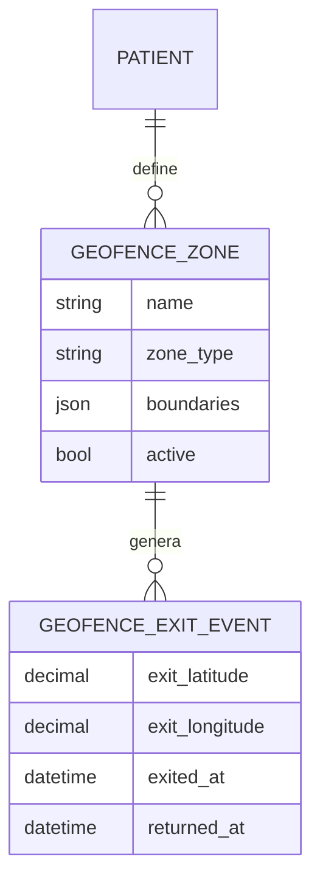
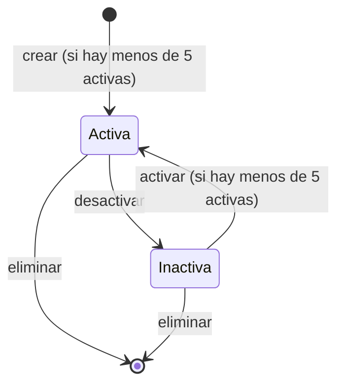

# Artefacto de Trazabilidad — AURA-86 CRUD de Zonas Seguras (geofencing por paciente)

> **Para qué:** conectar esta historia con sus decisiones de diseño, modelo de datos, código y pruebas.
> **Para quién:** equipo (durante el desarrollo) y docente (evaluación de calidad técnica).

| Campo | Valor |
| --- | --- |
| Historia | **AURA-86** — CRUD de Zonas Seguras (geofencing por paciente) |
| Épica | AURA-18 — Panel del Cuidador (Aurora Care) |
| Requerimientos | RF-70, RF-46, RF-78 (ver [[Requerimientos]] · [[Trazabilidad RF-Épicas]]) |
| Estado en Jira | Finalizada (Sprint 4; Jira «SCRUM Sprint 5») |
| Tareas relacionadas | — |
| Enlace | https://project-aurora-alz.atlassian.net/browse/AURA-86 |

## 1. Historia de usuario
**Como** cuidador principal **quiero** definir y administrar hasta 5 zonas seguras alrededor de los lugares habituales de mi familiar **para** que el sistema pueda avisarme cuando salga de ellas.

### Criterios de aceptación
- [x] Se puede crear una zona con límites válidos (latitud, longitud y radio dentro de rango) y un tipo soportado.
- [x] Se rechazan radios, latitudes, longitudes y tipos inválidos.
- [x] Cada paciente puede tener como máximo 5 zonas **activas**; una inactiva libera un lugar.
- [x] Se puede listar, consultar, modificar, eliminar, activar y desactivar una zona; activar una activa (o desactivar una inactiva) devuelve 400.
- [x] Un cuidador no vinculado no ve, crea ni modifica zonas, y las zonas de otro paciente no se listan.
- [x] Existe el registro de salida de zona (`GeofenceExitEvent`).
- [ ] El sistema detecta la salida con ubicaciones reales y avisa al cuidador (RF-46).

> [!warning] Alcance real
> La administración de zonas funciona. **La detección de salidas depende de la ubicación del paciente, que llegaría de Aurora Band**, que quedó fuera del MVP (decisión del 29/08/2026). Por eso el último criterio queda sin cumplir y se documenta como trabajo futuro (riesgo R12 del [[Registro de Riesgos]]).

## 2. Decisiones de diseño (ADR)
- **ADR-001** — Django y Django REST Framework.
- **ADR-004** — Monolito modular (`apps/events`).
- **ADR-012** — Diseño de API (REST `/api/v1/`, OpenAPI).
- **ADR-009** — Protocolo de comunicación con Aurora Band: **sin implementar**, y de él depende la detección de salidas.

> Sin ADR nuevo: la historia se apoya en las decisiones ya registradas en [[Arquitectura y Stack Tecnológico]].

## 3. Modelo de datos (DER)
Entidades afectadas: `GeofenceZone` y `GeofenceExitEvent` (ya previstas en el [[DER - Base de Datos Aurora]]).

## 4. Diagramas de modelado

### 4.1 Diagrama de clases
> No aplica.

### 4.2 Diagrama de secuencia
> No aplica.

### 4.3 Diagrama de estados (DTE)

## 5. Código relacionado
| Tipo | Ubicación / referencia |
| --- | --- |
| Backend | `AuroraCore/apps/events/models.py` (`GeofenceZone`, `GeofenceExitEvent`), `apps/events/views.py`, `apps/events/serializers.py` |
| Backend (tests) | `apps/events/tests/test_geofencing.py` (21 pruebas) |
| Commit / PR | `7651474` (27/08, CRUD completo de zonas seguras) |

## 6. Casos de prueba
| ID | Precondición | Pasos | Resultado esperado | Resultado de ejecución |
| --- | --- | --- | --- | --- |
| CP-AURA-86-01 | Cuidador vinculado al paciente | 1. `POST` de una zona con límites válidos. | 201 y la zona queda activa | OK (17/10): `test_geofencing.py` (21)* |
| CP-AURA-86-02 | Cuidador vinculado | 1. `POST` con radio, latitud, longitud o tipo inválidos. | 400 en cada caso | OK (17/10): `test_geofencing.py` (21)* |
| CP-AURA-86-03 | El paciente ya tiene 5 zonas activas | 1. `POST` una sexta. | Se rechaza (máximo 5 activas) | OK (17/10): `test_geofencing.py` (21)* |
| CP-AURA-86-04 | 5 zonas, una inactiva | 1. Crear una nueva. | Se permite | OK (17/10): `test_geofencing.py` (21)* |
| CP-AURA-86-05 | Zona activa | 1. Activar de nuevo. | 400 | OK (17/10): `test_geofencing.py` (21)* |
| CP-AURA-86-06 | Cuidador no vinculado | 1. Listar, crear o modificar zonas. | No ve ni modifica zonas ajenas | OK (17/10): `test_geofencing.py` (21)* |
| CP-AURA-86-07 | Zona existente | 1. Registrar una salida de zona. | Se crea el evento de salida | OK (17/10): `test_geofencing.py` (21)* |

\* **Ejecución de AuroraCore:** la suite completa pasó el 16/10/2026 (1.579 pruebas, sin fallas; ejecución del equipo, ver [[Plan de Testing]], sección 4.7). No se registró el resultado de cada caso por separado; para hacerlo hay que correr la suite con la base de datos de prueba (Docker).

## 7. Matriz de trazabilidad de la historia
| Historia | RF | ADR | DER | Diagramas | Código | Casos de prueba |
| --- | --- | --- | --- | --- | --- | --- |
| AURA-86 | RF-70, RF-46 (parcial) | ADR-001, 004, 009, 012 | `GeofenceZone`, `GeofenceExitEvent` | Estados | `apps/events/*` | CP-AURA-86-01 a 07 |

## Checklist de completitud (cátedra)
- [x] Historia y criterios de aceptación
- [x] ADR correspondiente (si hubo decisión técnica nueva)
- [x] DER actualizado (si modificó el modelo de datos)
- [x] Diagramas de modelado relevantes (clases/secuencia/estados, según aplique)
- [x] Casos de prueba con precondición, pasos y resultado esperado
- [x] Resultados de ejecución de las pruebas
- [x] Referencias a código (paths/commits/PRs)

> [!todo] Pendiente
> - Detección de salida con ubicación real: depende de Aurora Band (fuera del MVP).
