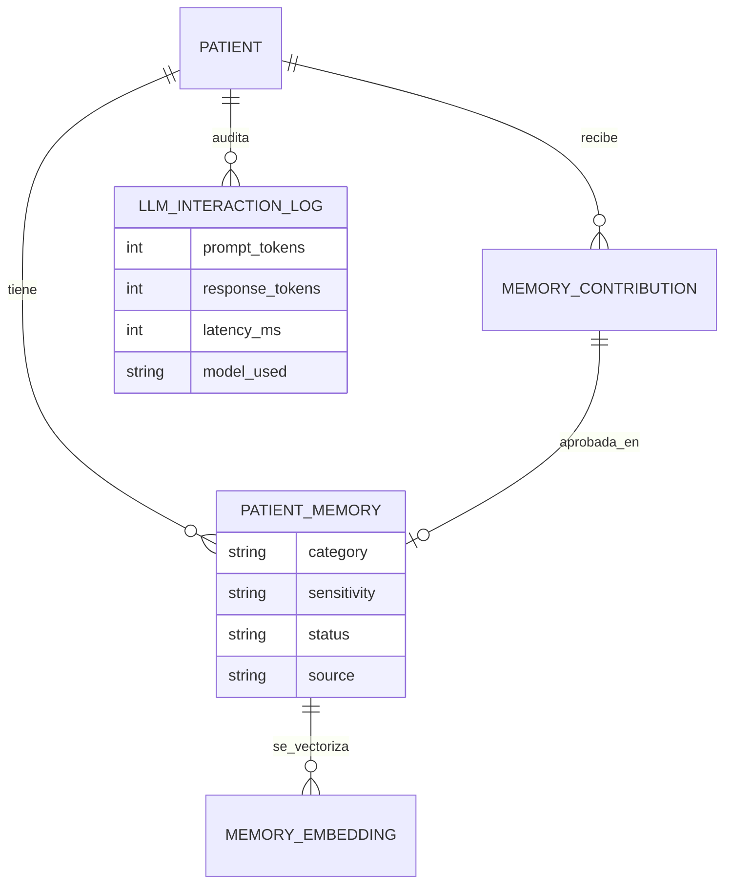
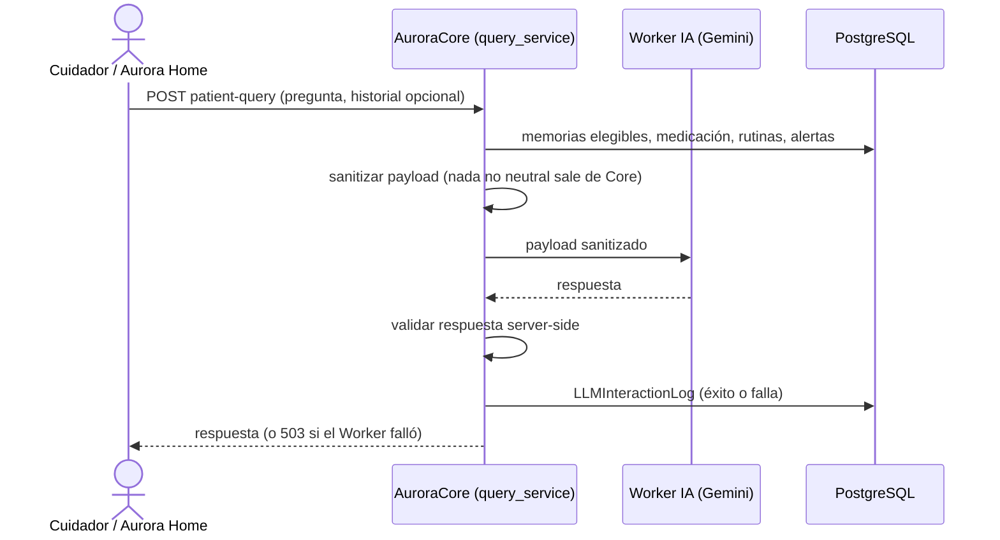
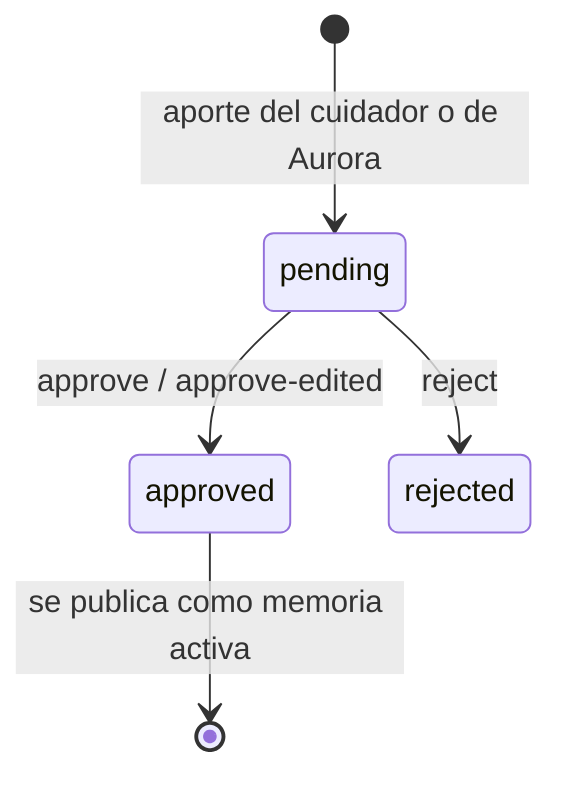

# Artefacto de Trazabilidad — AURA-105 Consulta a la memoria del paciente con IA (RAG)

> **Para qué:** conectar esta historia con sus decisiones de diseño, modelo de datos, código y pruebas.
> **Para quién:** equipo (durante el desarrollo) y docente (evaluación de calidad técnica).

| Campo | Valor |
| --- | --- |
| Historia | **AURA-105** — Consulta a la memoria del paciente con IA (RAG) |
| Épica | AURA-15 — Motor de IA y Memoria del Paciente |
| Requerimientos | RF-47, RF-48, RF-49, RF-50, RF-77 (ver [[Requerimientos]] · [[Trazabilidad RF-Épicas]]) |
| Estado en Jira | Finalizada (Sprint 5; Jira «SCRUM Sprint 6»). AURA-104 (esquema de memoria contextual) sigue en revisión |
| Tareas relacionadas | AURA-104 (esquema de memoria), AURA-171 (Home consume la consulta como responder de conversación) |
| Enlace | https://project-aurora-alz.atlassian.net/browse/AURA-105 |

## 1. Historia de usuario
**Como** cuidador (y como paciente a través de Aurora Home) **quiero** consultar a Aurora sobre mi familiar y recibir respuestas basadas en sus recuerdos, rutinas y medicación registrados **para** obtener información confiable sin que el asistente invente datos.

### Criterios de aceptación
- [x] La consulta devuelve una respuesta y deja auditado cada intento, con éxito o falla (`test_happy_path_returns_answer_and_audits`).
- [x] La memoria que no es neutral nunca sale de Core hacia el Worker IA (`test_non_neutral_memory_never_leaves_core`).
- [x] Consultar por un paciente ajeno o inexistente devuelve 404 y nunca llama al Worker IA.
- [x] Si el Worker IA falla, la respuesta es 503, se audita y se informa si conviene reintentar.
- [x] Una pregunta vacía o ausente devuelve 400.
- [x] El historial de la conversación es opcional; la medicación, las rutinas, el estado y hasta 10 alertas se envían, y los dominios excluidos nunca llegan al Worker.
- [x] Aurora Home usa la consulta como responder de la conversación (AURA-171).

## 2. Decisiones de diseño (ADR)
- **ADR-004** — Core nunca llama al LLM directamente: usa el Worker IA externo (FastAPI).
- **ADR-003** — PostgreSQL con pgvector para la memoria.
- **ADR-010** — Cifrado de datos identificatorios: el payload se sanitiza antes de salir.
- **ADR-012** — Diseño de API (`/api/v1/`, autenticación del cuidador y de dispositivo).

> Sin ADR nuevo: la historia se apoya en las decisiones ya registradas en [[Arquitectura y Stack Tecnológico]].

## 3. Modelo de datos (DER)
Entidades afectadas (ya previstas en el [[DER - Base de Datos Aurora]], vista de Inteligencia Artificial):

## 4. Diagramas de modelado

### 4.1 Diagrama de clases
> No aplica.

### 4.2 Diagrama de secuencia

### 4.3 Diagrama de estados (DTE)

> Este ciclo de vida es el de la validación de recuerdos (AURA-76) y gobierna qué memorias puede usar la consulta.

## 5. Código relacionado
| Tipo | Ubicación / referencia |
| --- | --- |
| Backend | `AuroraCore/apps/ai/query_service.py`, `worker_client.py`, `views.py`, `serializers.py`, `models.py` |
| Backend (rutas) | `config/urls.py`: `patient-query` (Care) y `home/patient-query/` (dispositivo) |
| Backend (tests) | `apps/ai/tests/test_patient_query_api.py` (18 pruebas), `apps/biometrics/tests/test_home_patient_query_serializer.py`, `apps/ai/tests/test_memory_contributions_api.py` |
| Home | `AuroraHome/src/aurora_home/application/patient_query_responder.py` |
| Commit / PR | `68b8bdf` (24/09, endpoint RAG), `a5babef` (24/09, consulta autenticada por dispositivo), `fee68e4` (01/10, historial opcional), `79c2a99` (contexto clínico en la consulta) |

## 6. Casos de prueba
| ID | Precondición | Pasos | Resultado esperado | Resultado de ejecución |
| --- | --- | --- | --- | --- |
| CP-AURA-105-01 | Paciente con memorias y Worker IA simulado | 1. `POST` con una pregunta. | 200 con respuesta y registro de auditoría | Cubierto por la suite del 16/10 (1.579 OK)* |
| CP-AURA-105-02 | Memoria marcada como sensible | 1. Consultar. | La memoria no aparece en el payload enviado al Worker | Cubierto por la suite del 16/10 (1.579 OK)* |
| CP-AURA-105-03 | Paciente de otro hogar | 1. Consultar. | 404 y el Worker no se invoca | Cubierto por la suite del 16/10 (1.579 OK)* |
| CP-AURA-105-04 | El Worker devuelve error | 1. Consultar. | 503, auditoría de la falla e indicador de reintento | Cubierto por la suite del 16/10 (1.579 OK)* |
| CP-AURA-105-05 | Pregunta vacía | 1. `POST` con pregunta vacía. | 400 | Cubierto por la suite del 16/10 (1.579 OK)* |
| CP-AURA-105-06 | Más de 10 alertas activas | 1. Consultar. | Solo se reenvían 10 | Cubierto por la suite del 16/10 (1.579 OK)* |
| CP-AURA-105-07 | Home con el responder de consulta | 1. Ejecutar las pruebas de `patient_query` de Home. | Todas pasan | OK (17/10): grupo `patient_query`, 102 pruebas |

\* **Ejecución de AuroraCore:** la suite completa pasó el 16/10/2026 (1.579 pruebas, sin fallas; ejecución del equipo, ver [[Plan de Testing]], sección 4.7). No se registró el resultado de cada caso por separado; para hacerlo hay que correr la suite con la base de datos de prueba (Docker).

**Ejecución de AuroraHome (17/10/2026):** las pruebas se corrieron con `python -m pytest tests -k <grupo>` sobre el código actual de la rama principal del repositorio.

## 7. Matriz de trazabilidad de la historia
| Historia | RF | ADR | DER | Diagramas | Código | Casos de prueba |
| --- | --- | --- | --- | --- | --- | --- |
| AURA-105 | RF-47 a 50, 77 | ADR-003, 004, 010, 012 | `PatientMemory`, `MemoryContribution`, `MemoryEmbedding`, `LLMInteractionLog` | Secuencia, estados | `apps/ai/query_service.py` | CP-AURA-105-01 a 07 |

## Checklist de completitud (cátedra)
- [x] Historia y criterios de aceptación
- [x] ADR correspondiente (si hubo decisión técnica nueva)
- [x] DER actualizado (si modificó el modelo de datos)
- [x] Diagramas de modelado relevantes (clases/secuencia/estados, según aplique)
- [x] Casos de prueba con precondición, pasos y resultado esperado
- [x] Resultados de ejecución de las pruebas
- [x] Referencias a código (paths/commits/PRs)

> [!todo] Pendiente
> - AURA-104 sigue en revisión: confirmar si el esquema de memoria contextual se cierra o se funde con AURA-105.
> - Demostración de punta a punta de la validación de recuerdos (AURA-76) ante el equipo y la docente.
