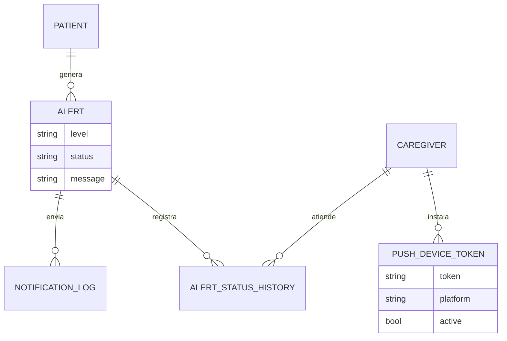
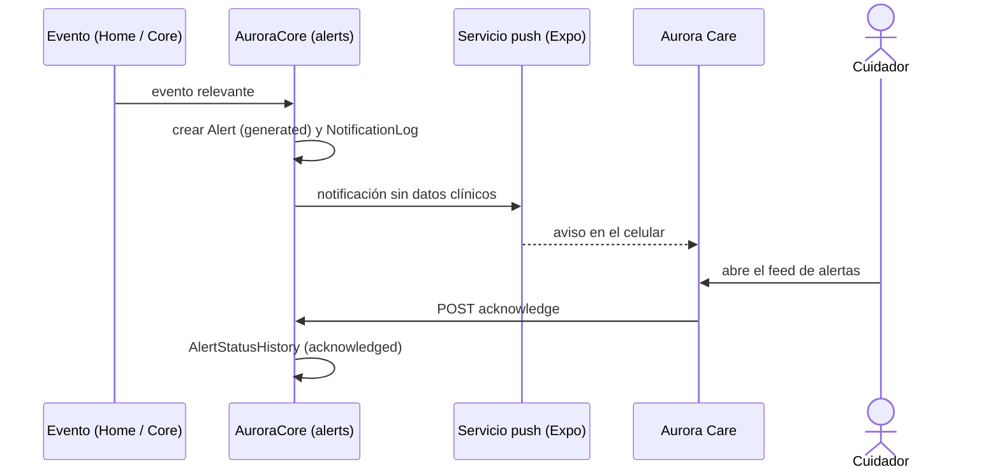
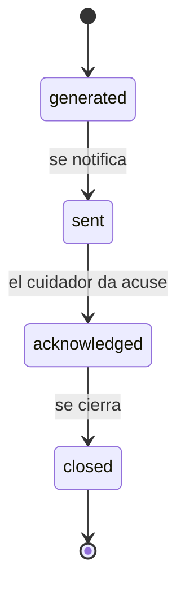

# Artefacto de Trazabilidad — AURA-106 Alertas push y vista de alertas en tiempo real

> **Para qué:** conectar esta historia con sus decisiones de diseño, modelo de datos, código y pruebas.
> **Para quién:** equipo (durante el desarrollo) y docente (evaluación de calidad técnica).

| Campo | Valor |
| --- | --- |
| Historia | **AURA-106** — Alertas push y vista de alertas en tiempo real |
| Épica | AURA-16 — Alertas y Comunicación con el Cuidador |
| Requerimientos | RF-36, RF-37, RF-38, RF-39, RF-43, RF-44, RF-64, RF-72, RF-98 (ver [[Requerimientos]] · [[Trazabilidad RF-Épicas]]) |
| Estado en Jira | Finalizada (Sprint 5; Jira «SCRUM Sprint 6») |
| Tareas relacionadas | AURA-107 (vista de alertas en tiempo real), AURA-108 (conectar las pantallas de Care con los endpoints reales de Core), AURA-175 (botón «Llamar» deshabilitado, abierto) |
| Enlace | https://project-aurora-alz.atlassian.net/browse/AURA-106 |

## 1. Historia de usuario
**Como** cuidador **quiero** recibir en mi celular un aviso apenas ocurre una situación importante, ver las alertas al instante y dejar constancia de que la atendí **para** reaccionar rápido sin tener que estar mirando la aplicación.

### Criterios de aceptación
- [x] Una alerta con regla de push envía la notificación y guarda el ticket del envío (`test_alert_with_push_rule_sends_and_logs_ticket`).
- [x] El texto de la notificación **no incluye datos clínicos** y el SOS sale sin información personal por defecto (RF-98).
- [x] Registrar el mismo token de dispositivo dos veces es idempotente, y un token dado de baja por el proveedor se desactiva.
- [x] Un token solo puede ser usado por su dueño.
- [x] El cuidador puede dar acuse de recibo: queda registrado quién y cuándo, es idempotente y deja historial de estados.
- [x] El listado permite filtrar las alertas activas y expone quién atendió y cuándo.
- [x] Aurora Care muestra el feed de alertas en tiempo real y el detalle con acuse.
- [ ] El botón «Llamar» del detalle de alerta funciona (AURA-175).

> [!warning] Error abierto
> **AURA-175:** el botón «Llamar» del detalle de alerta está siempre deshabilitado. Afecta una función de emergencia y está fuera de todo sprint (riesgo R8 del [[Registro de Riesgos]]).

## 2. Decisiones de diseño (ADR)
- **ADR-012** — Diseño de API.
- **ADR-010** — Los avisos no deben exponer datos identificatorios (RF-98).
- **ADR-002** — Aurora Care en React Native con Expo (notificaciones con `expo-notifications`).
- **ADR-004** — Monolito modular: `apps/alerts` y `apps/notifications` dentro de AuroraCore.

> Sin ADR nuevo: la historia se apoya en las decisiones ya registradas en [[Arquitectura y Stack Tecnológico]].

## 3. Modelo de datos (DER)
Entidades afectadas (ya previstas en el [[DER - Base de Datos Aurora]], vista de Alertas y Escalamiento):

## 4. Diagramas de modelado

### 4.1 Diagrama de clases
> No aplica.

### 4.2 Diagrama de secuencia

### 4.3 Diagrama de estados (DTE)

## 5. Código relacionado
| Tipo | Ubicación / referencia |
| --- | --- |
| Backend | `AuroraCore/apps/alerts/models.py` (`Alert`, `AlertStatusHistory`, `NotificationLog`), `views.py`, `serializers.py`, `services.py` |
| Backend | `apps/notifications/models.py` (`PushDeviceToken`), `services.py`, `views.py` (`push-token/`) |
| Backend (tests) | `apps/alerts/tests/test_alert_acknowledge_api.py` (6), `test_alert_active_filter_api.py` (3), `apps/notifications/test_push_notifications.py` (5), `test_push_token_ownership.py` (4) |
| Frontend | `AuroraCare/src/features/alerts/` (`useAlertsFeed`, `AlertsFeed.tsx`, `AlertFeedCard.tsx`), `app/(authenticated)/alert-detail.tsx`, `src/services/notifications/notificationService.ts` |
| Commit / PR | `1e4ecf6` (24/09, push manual y cuerpo sin dato clínico), `1437ed8` (26/09, feed en tiempo real, AURA-107), `6e0905d` (05/10, alertas por SOS y voz), `492a338` (Care, notificaciones push) |

## 6. Casos de prueba
| ID | Precondición | Pasos | Resultado esperado | Resultado de ejecución |
| --- | --- | --- | --- | --- |
| CP-AURA-106-01 | Alerta con regla de push y token activo | 1. Generar la alerta. | Se envía la notificación y se guarda el ticket | OK (17/10): `test_push_notifications.py` (5)* |
| CP-AURA-106-02 | Alerta clínica | 1. Generar la alerta y revisar el texto del push. | El cuerpo no contiene el mensaje clínico | OK (17/10): mismo archivo* |
| CP-AURA-106-03 | Token ya registrado | 1. Registrar el mismo token otra vez. | No se duplica | OK (17/10): mismo archivo* |
| CP-AURA-106-04 | Cuidador vinculado y alerta activa | 1. `POST` de acuse. 2. Repetirlo. | La primera vez guarda alerta y cuidador y escribe el historial; la segunda no cambia nada | OK (17/10): `test_alert_acknowledge_api.py` (6)* |
| CP-AURA-106-05 | Cuidador de otro hogar | 1. Dar acuse. | Se rechaza | OK (17/10): mismo archivo* |
| CP-AURA-106-06 | Alertas activas y cerradas | 1. Listar con el filtro de activas. | Solo las activas | OK (17/10): `test_alert_active_filter_api.py` (3)* |
| CP-AURA-106-07 | Feed de alertas de Care | 1. Ejecutar las pruebas de `alerts` de Care. | Todas pasan | OK (17/10): `jest src/features/alerts`, 46 pruebas |

\* **Ejecución de AuroraCore (17/10/2026):** las pruebas se corrieron con `pytest` sobre SQLite (no se pudo levantar PostgreSQL en la máquina de revisión). La suite completa de AuroraCore pasó el 16/10/2026 sobre PostgreSQL con 1.579 pruebas y sin fallas (ejecución del equipo, ver [[Plan de Testing]], sección 4.7). Repetida el 17/10 sobre SQLite, pasaron 1.574 de 1.579; las 5 restantes usan SQL propio de PostgreSQL y no se pueden ejecutar en SQLite.

**Ejecución de AuroraCare (17/10/2026):** las pruebas se corrieron con `npx jest <carpeta>` sobre el código actual.

## 7. Matriz de trazabilidad de la historia
| Historia | RF | ADR | DER | Diagramas | Código | Casos de prueba |
| --- | --- | --- | --- | --- | --- | --- |
| AURA-106/107/108 | RF-36 a 39, 43, 44, 64, 72, 98 | ADR-002, 004, 010, 012 | `Alert`, `AlertStatusHistory`, `NotificationLog`, `PushDeviceToken` | Secuencia, estados | `apps/alerts/*`, `apps/notifications/*`, `src/features/alerts/*` | CP-AURA-106-01 a 07 |

## Checklist de completitud (cátedra)
- [x] Historia y criterios de aceptación
- [x] ADR correspondiente (si hubo decisión técnica nueva)
- [x] DER actualizado (si modificó el modelo de datos)
- [x] Diagramas de modelado relevantes (clases/secuencia/estados, según aplique)
- [x] Casos de prueba con precondición, pasos y resultado esperado
- [x] Resultados de ejecución de las pruebas
- [x] Referencias a código (paths/commits/PRs)

> [!todo] Pendiente
> - AURA-175 (botón «Llamar» deshabilitado) sigue abierto.
> - La escalada de alertas (RF-41) y los canales WhatsApp o Telegram (RF-40) no forman parte de esta historia.
