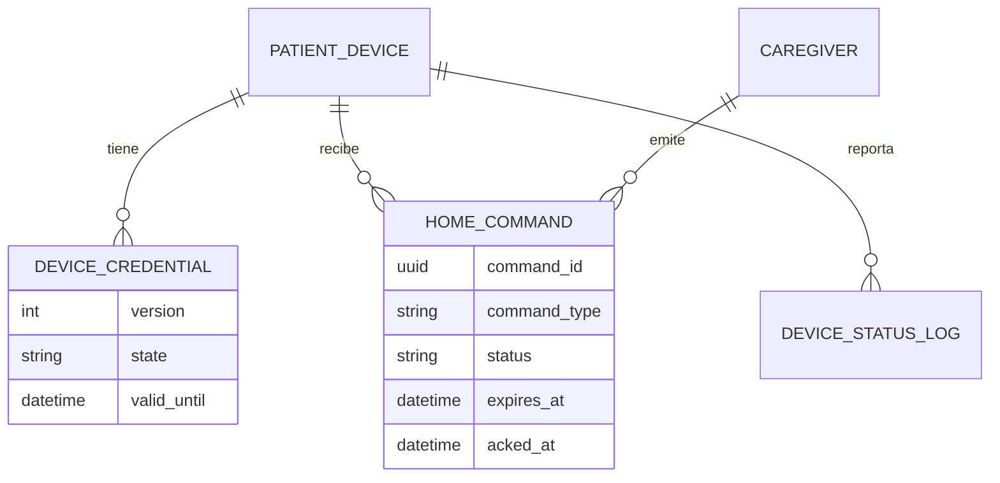
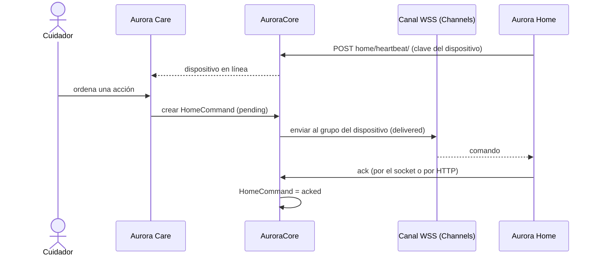
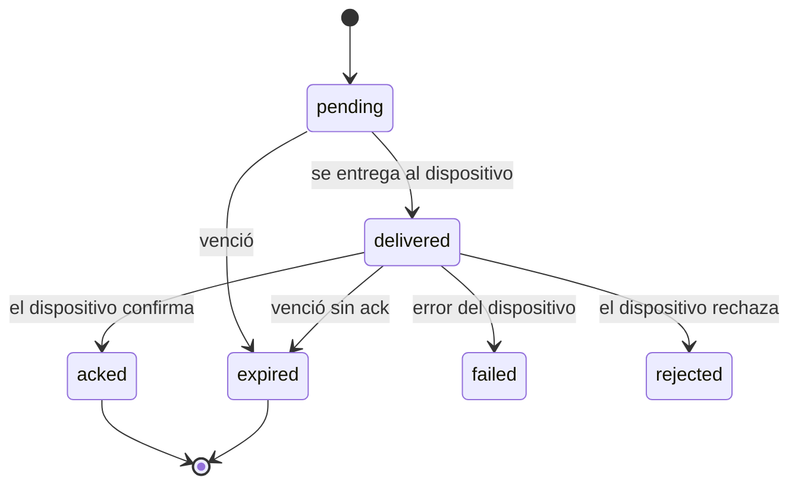

# Artefacto de Trazabilidad — AURA-131 Heartbeat y comandos seguros entre Core y Aurora Home

> **Para qué:** conectar esta historia con sus decisiones de diseño, modelo de datos, código y pruebas.
> **Para quién:** equipo (durante el desarrollo) y docente (evaluación de calidad técnica).

| Campo | Valor |
| --- | --- |
| Historia | **AURA-131** — Heartbeat y comandos seguros entre Core y Aurora Home |
| Épica | AURA-18 — Panel del Cuidador (Aurora Care) |
| Requerimientos | RF-71, RF-80, RF-77 (ver [[Requerimientos]] · [[Trazabilidad RF-Épicas]]) |
| Estado en Jira | Finalizada (Sprint 5; Jira «SCRUM Sprint 6») |
| Tareas relacionadas | AURA-129 (CORE-004, heartbeat), AURA-130 (CORE-011, revocación y rotación de credenciales), AURA-165 (Home publica el heartbeat), AURA-166 (Home consume el canal de comandos) |
| Enlace | https://project-aurora-alz.atlassian.net/browse/AURA-131 |

## 1. Historia de usuario
> [!note] Historia derivada
> Esta historia se redactó a posteriori a partir de las tareas de Jira indicadas arriba (modo *task-first*). **No se creó en Jira**: queda como propuesta del equipo.

**Como** cuidador **quiero** saber si el Aurora Home de mi familiar está conectado y poder enviarle órdenes de forma segura **para** confiar en que el dispositivo responde y que nadie más puede usarlo.

### Criterios de aceptación
- [x] Home publica un *heartbeat* autenticado con telemetría mínima y Core lo registra como presencia del dispositivo.
- [x] Core entrega comandos al dispositivo por un canal WebSocket autenticado con su clave; un socket sin clave o con una ajena se rechaza.
- [x] Cada comando tiene confirmación (*ack*) durable: el primer ack gana y repetirlo no cambia nada; el ack por el socket equivale al ack por HTTP.
- [x] Si el socket se pierde, Home recupera los comandos pendientes por `GET home/commands/`.
- [x] Un comando vencido no se entrega y queda marcado como `expired`.
- [x] Un dispositivo no puede ver ni confirmar los comandos de otro.
- [x] Una credencial revocada pasa al modo seguro y se cierra; la rotación de credenciales funciona en caliente.

## 2. Decisiones de diseño (ADR)
- **ADR-012** — Diseño de API: autenticación de dispositivo con clave (`X-Device-API-Key`).
- **ADR-004** — Monolito con Django Channels para el canal en tiempo real.
- **ADR-008** — Operación degradada: Home recupera lo pendiente al reconectar.
- **ADR-010** — La credencial se guarda cifrada (`secret_ciphertext`).

> Sin ADR nuevo: la historia se apoya en las decisiones ya registradas en [[Arquitectura y Stack Tecnológico]].

## 3. Modelo de datos (DER)
Entidades afectadas (ya previstas en el [[DER - Base de Datos Aurora]], vista de Orquestación y Compliance):

## 4. Diagramas de modelado

### 4.1 Diagrama de clases
> No aplica.

### 4.2 Diagrama de secuencia

### 4.3 Diagrama de estados (DTE)

## 5. Código relacionado
| Tipo | Ubicación / referencia |
| --- | --- |
| Backend | `AuroraCore/apps/biometrics/commands.py`, `consumers.py`, `routing.py`, `control.py`, `device_auth.py`, `presence.py`, `models.py` (`HomeCommand`, `DeviceCredential`) |
| Backend (rutas) | `config/urls.py`: `home/heartbeat/`, `home/commands/`, `home/commands/<id>/ack/`, `home/credential/rotate/` |
| Backend (tests) | `apps/biometrics/tests/test_home_commands_api.py` (19), `test_home_commands_ws.py` (9), `test_home_commands_service.py` (3), `test_device_presence.py`, `test_device_credentials.py` |
| Home | `AuroraHome/src/aurora_home/application/heartbeat.py`, `command_channel.py`, `command_recovery.py`, `credential_lifecycle.py`, `credentials.py` |
| Commit / PR | `35f5489` (27/09, heartbeat real), `13b7b2c` (27/09, canal WS), `9e7ee69` y `cdc7f14` (28/09, recuperación, *safe mode* y rotación), `d932698` (26/09, comandos por WSS, Core) |

## 6. Casos de prueba
| ID | Precondición | Pasos | Resultado esperado | Resultado de ejecución |
| --- | --- | --- | --- | --- |
| CP-AURA-131-01 | Dispositivo con clave válida | 1. Abrir el socket de comandos. | Se une a su grupo y figura en línea | Cubierto por la suite del 16/10 (1.579 OK)* |
| CP-AURA-131-02 | Socket sin clave o con clave ajena | 1. Conectar. | Se rechaza como no autorizado | Cubierto por la suite del 16/10 (1.579 OK)* |
| CP-AURA-131-03 | Comando pendiente | 1. Listar comandos. 2. Confirmar (ack). 3. Repetir el ack. | Pasa a entregado y luego a confirmado; el primer ack gana | Cubierto por la suite del 16/10 (1.579 OK)* |
| CP-AURA-131-04 | Comando vencido | 1. Listar. 2. Confirmar. | No se entrega; el ack devuelve conflicto y queda `expired` | Cubierto por la suite del 16/10 (1.579 OK)* |
| CP-AURA-131-05 | Dispositivo revocado | 1. Conectar el socket. | Recibe *safe mode* y se cierra | Cubierto por la suite del 16/10 (1.579 OK)* |
| CP-AURA-131-06 | Comando de otro dispositivo | 1. Confirmar un comando ajeno. | No se modifica | Cubierto por la suite del 16/10 (1.579 OK)* |
| CP-AURA-131-07 | Home con heartbeat y canal de comandos | 1. Ejecutar los grupos `heartbeat or command or credential` de Home. | Todas pasan | OK (17/10): 245 pruebas |

\* **Ejecución de AuroraCore:** la suite completa pasó el 16/10/2026 (1.579 pruebas, sin fallas; ejecución del equipo, ver [[Plan de Testing]], sección 4.7). No se registró el resultado de cada caso por separado; para hacerlo hay que correr la suite con la base de datos de prueba (Docker).

**Ejecución de AuroraHome (17/10/2026):** las pruebas se corrieron con `python -m pytest tests -k <grupo>` sobre el código actual de la rama principal del repositorio.

## 7. Matriz de trazabilidad de la historia
| Historia | RF | ADR | DER | Diagramas | Código | Casos de prueba |
| --- | --- | --- | --- | --- | --- | --- |
| AURA-129, 130, 131, 165, 166 | RF-71, 77, 80 | ADR-004, 008, 010, 012 | `HomeCommand`, `DeviceCredential`, `PatientDevice` | Secuencia, estados | `apps/biometrics/commands.py`, `consumers.py`, `heartbeat.py` | CP-AURA-131-01 a 07 |

## Checklist de completitud (cátedra)
- [x] Historia y criterios de aceptación
- [x] ADR correspondiente (si hubo decisión técnica nueva)
- [x] DER actualizado (si modificó el modelo de datos)
- [x] Diagramas de modelado relevantes (clases/secuencia/estados, según aplique)
- [x] Casos de prueba con precondición, pasos y resultado esperado
- [x] Resultados de ejecución de las pruebas
- [x] Referencias a código (paths/commits/PRs)

> [!todo] Pendiente
> - Si el equipo aprueba la historia derivada, crearla en Jira y enlazar las tareas con «Relates».
