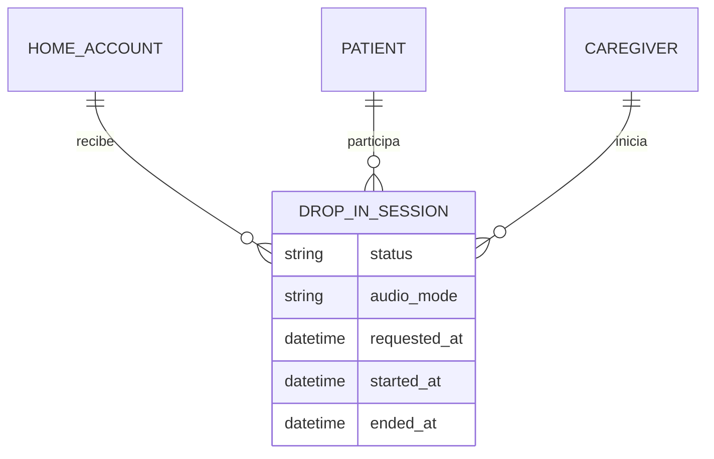
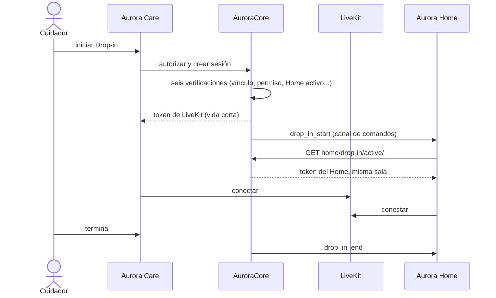
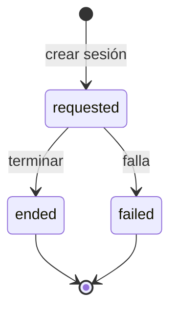

# Artefacto de Trazabilidad — AURA-134 Drop-in en vivo autorizado (LiveKit)

> **Para qué:** conectar esta historia con sus decisiones de diseño, modelo de datos, código y pruebas.
> **Para quién:** equipo (durante el desarrollo) y docente (evaluación de calidad técnica).

| Campo | Valor |
| --- | --- |
| Historia | **AURA-134** — Drop-in en vivo autorizado (LiveKit) |
| Épica | AURA-18 — Panel del Cuidador (Aurora Care) |
| Requerimientos | RF-73, RF-77, RF-80 (ver [[Requerimientos]] · [[Trazabilidad RF-Épicas]]) |
| Estado en Jira | **En revisión** (arrastrada al Sprint 6) |
| Tareas relacionadas | AURA-173 (el cuidador principal se auto-provisiona sin `can_drop_in`; abierto), AURA-174 (UI para autorizar un Aurora Home para Drop-in; finalizada), AURA-182 (pairing en producción por WiFi; finalizada) |
| Enlace | https://project-aurora-alz.atlassian.net/browse/AURA-134 |

## 1. Historia de usuario
> [!note] Historia derivada
> Esta historia se redactó a posteriori a partir de las tareas de Jira indicadas arriba (modo *task-first*). **No se creó en Jira**: queda como propuesta del equipo.

**Como** cuidador autorizado **quiero** escuchar en vivo a mi familiar y hablarle a través de Aurora Home **para** comprobar que está bien sin tener que ir hasta la casa.

### Criterios de aceptación
- [x] Solo un cuidador vinculado y con permiso de Drop-in puede iniciar una sesión; la autorización expone las seis verificaciones.
- [x] Un Aurora Home desactualizado (sin señal reciente) se rechaza para autorizar y crear la sesión.
- [x] Core entrega un token de LiveKit de vida corta y el cuidador y el Home apuntan a la misma sala.
- [x] Al crear, terminar o fallar una sesión, Core envía la orden `drop_in_start` o `drop_in_end` al Home.
- [x] Home obtiene la sesión activa (204 si no hay), y sin configuración de LiveKit la respuesta es 503.
- [x] Aurora Care ofrece la UI para autorizar un Home para Drop-in (AURA-174) y vincularlo por WiFi (AURA-182).
- [ ] El cuidador principal queda con `can_drop_in` al auto-provisionarse (AURA-173).
- [ ] Demostración de punta a punta con audio real documentada.

> [!warning] En revisión
> El ticket sigue **en revisión** y AURA-173 impide usar Drop-in por defecto con el cuidador principal. La demostración con audio real se planifica en AURA-192 y queda pendiente.

## 2. Decisiones de diseño (ADR)
- **ADR-012** — Diseño de API.
- **ADR-004** — Core delega el audio en un servicio de media (LiveKit); Aurora Home actúa como cliente.
- **ADR-005** — Autorización de la sesión según vínculo y permiso del cuidador.
- **ADR-008** — Home mantiene el canal de comandos para recibir la orden.

> **Posible ADR nuevo pendiente:** la elección de LiveKit como proveedor de media no figura como ADR; conviene registrarla como ADR-013.

## 3. Modelo de datos (DER)
Entidad afectada (ya prevista en el [[DER - Base de Datos Aurora]]):

## 4. Diagramas de modelado

### 4.1 Diagrama de clases
> No aplica.

### 4.2 Diagrama de secuencia

### 4.3 Diagrama de estados (DTE)

> Los estados intermedios (por ejemplo, sesión iniciada) deben confirmarse en el código antes de la demostración.

## 5. Código relacionado
| Tipo | Ubicación / referencia |
| --- | --- |
| Backend | `AuroraCore/apps/interactions/models.py` (`DropInSession`), `views.py` (`DropInSessionViewSet`), `apps/interactions/urls.py` (`drop-in`), `config/urls.py` (`home/drop-in/active/`) |
| Backend (tests) | `apps/interactions/tests/test_drop_in_media_api.py` (11), `test_home_drop_in_api.py` (5) |
| Home | `AuroraHome/src/aurora_home/application/drop_in.py`; pruebas `tests/unit/test_drop_in_*.py` |
| Frontend | `AuroraCare/src/features/activity/` (`dropInApi`, `dropInMedia`, `dropInScreen`), provisioning por WiFi en `src/features/provisioning/` |
| Commit / PR | `b40029d` (02/10, documentación de drop-in push y wifi-reconfigure), `51f69ee` (03/10, reconfiguración WiFi desde Care), `13b7b2c` (Home, canal WS reemplaza el polling de Drop-in) |

## 6. Casos de prueba
| ID | Precondición | Pasos | Resultado esperado | Resultado de ejecución |
| --- | --- | --- | --- | --- |
| CP-AURA-134-01 | Cuidador vinculado con permiso, Home activo | 1. Pedir la autorización. | Las seis verificaciones en verde | Cubierto por la suite del 16/10 (1.579 OK)* |
| CP-AURA-134-02 | Cuidador sin permiso de Drop-in | 1. Pedir la autorización. | Informa el permiso faltante | Cubierto por la suite del 16/10 (1.579 OK)* |
| CP-AURA-134-03 | Home sin señal reciente | 1. Autorizar o crear la sesión. | Se rechaza | Cubierto por la suite del 16/10 (1.579 OK)* |
| CP-AURA-134-04 | Sesión creada | 1. Pedir el token de media del cuidador y del Home. | Token de vida corta y misma sala | Cubierto por la suite del 16/10 (1.579 OK)* |
| CP-AURA-134-05 | Sesión terminada o fallida | 1. Terminar o fallar la sesión. | Se envía `drop_in_end` al Home | Cubierto por la suite del 16/10 (1.579 OK)* |
| CP-AURA-134-06 | Home sin sesión activa | 1. `GET home/drop-in/active/`. | 204 | Cubierto por la suite del 16/10 (1.579 OK)* |
| CP-AURA-134-07 | Home y Care con el flujo | 1. Ejecutar `drop_in or livekit` en Home y `dropIn` en Care. | Pasan | OK (17/10): Home 51 pruebas; Care 24 pruebas |

\* **Ejecución de AuroraCore:** la suite completa pasó el 16/10/2026 (1.579 pruebas, sin fallas; ejecución del equipo, ver [[Plan de Testing]], sección 4.7). No se registró el resultado de cada caso por separado; para hacerlo hay que correr la suite con la base de datos de prueba (Docker).

**Ejecución de AuroraHome (17/10/2026):** las pruebas se corrieron con `python -m pytest tests -k <grupo>` sobre el código actual de la rama principal del repositorio.

**Ejecución de AuroraCare (17/10/2026):** las pruebas se corrieron con `npx jest <carpeta>` sobre el código actual.

## 7. Matriz de trazabilidad de la historia
| Historia | RF | ADR | DER | Diagramas | Código | Casos de prueba |
| --- | --- | --- | --- | --- | --- | --- |
| AURA-134, 173, 174, 182 | RF-73, 77, 80 | ADR-004, 005, 008, 012 (+ ADR-013 propuesto) | `DropInSession` | Secuencia, estados | `apps/interactions/*`, `drop_in.py`, `src/features/activity/*` | CP-AURA-134-01 a 07 |

## Checklist de completitud (cátedra)
- [x] Historia y criterios de aceptación
- [ ] ADR correspondiente (si hubo decisión técnica nueva)
- [x] DER actualizado (si modificó el modelo de datos)
- [x] Diagramas de modelado relevantes (clases/secuencia/estados, según aplique)
- [x] Casos de prueba con precondición, pasos y resultado esperado
- [ ] Resultados de ejecución de las pruebas
- [x] Referencias a código (paths/commits/PRs)

> [!todo] Pendiente
> - Cerrar AURA-173 y la revisión de AURA-134.
> - Demostración con audio real entre Care y Home (AURA-192).
> - Registrar el ADR de LiveKit como proveedor de media.
