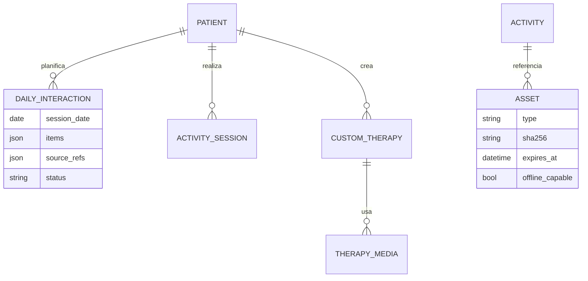
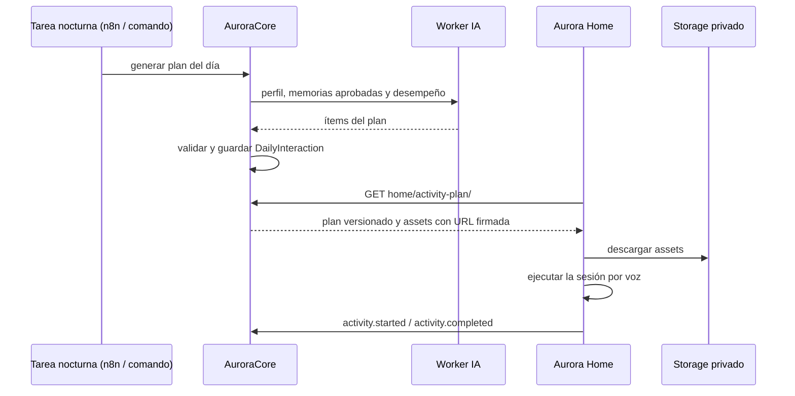

# Artefacto de Trazabilidad — AURA-149 Sesiones diarias de terapia generadas por Core y ejecutadas por Aurora Home

> **Para qué:** conectar esta historia con sus decisiones de diseño, modelo de datos, código y pruebas.
> **Para quién:** equipo (durante el desarrollo) y docente (evaluación de calidad técnica).

| Campo | Valor |
| --- | --- |
| Historia | **AURA-149** — Sesiones diarias de terapia generadas por Core y ejecutadas por Aurora Home |
| Épica | AURA-14 — Interacción y Asistencia por Voz (Aurora Home) |
| Requerimientos | RF-09, RF-10, RF-11, RF-12, RF-13, RF-14, RF-52 (ver [[Requerimientos]] · [[Trazabilidad RF-Épicas]]) |
| Estado en Jira | Finalizada (Sprint 5; Jira «SCRUM Sprint 6») |
| Tareas relacionadas | AURA-137 (planes de terapia y assets versionados), AURA-157 (contrato `ActivityPlan`), AURA-172 (Home ejecuta las sesiones y reporta `activity.*`), AURA-184 (catálogo de la psicopedagoga) |
| Enlace | https://project-aurora-alz.atlassian.net/browse/AURA-149 |

## 1. Historia de usuario
**Como** paciente **quiero** que Aurora me proponga cada día actividades y recuerdos adecuados a mí y me guíe por voz **para** estimularme sin que mi cuidador tenga que armarlas una por una.

### Criterios de aceptación
- [x] Core genera **un plan por paciente y día**; repetir la generación el mismo día actualiza la fila y no la duplica.
- [x] La generación deja registrado el log del modelo y la decisión de IA, y la falla de un paciente no frena a los demás.
- [x] El cuidador puede ver y editar el plan, e incorporar terapias propias.
- [x] Aurora Home descarga el plan versionado con sus *assets* (audio e imágenes) con URL firmada de vida corta, y los re-verifica.
- [x] Home ejecuta la sesión, valida las respuestas del paciente y reporta `activity.started` y `activity.completed`.
- [x] Existe un catálogo de terapias validado por la psicopedagoga (AURA-184).
- [x] El Worker IA genera el plan diario (repositorio nuevo desde el 14/09).

## 2. Decisiones de diseño (ADR)
- **ADR-004** — Core orquesta y delega la generación en el Worker IA.
- **ADR-012** — Contrato de dispositivo: `home/activity-plan/` con versionado.
- **ADR-008** — Los assets se cachean para operar sin conexión.
- **ADR-003** — Persistencia en PostgreSQL y almacenamiento privado para los assets.

> **Sin ADR nuevo.** El contrato `ActivityPlan` (CORE-009) está especificado en `AuroraCore/openspec/changes/core-009-home-therapy-assets/`.

## 3. Modelo de datos (DER)
Entidades afectadas (ya previstas en el [[DER - Base de Datos Aurora]]):

## 4. Diagramas de modelado

### 4.1 Diagrama de clases
> No aplica.

### 4.2 Diagrama de secuencia

### 4.3 Diagrama de estados (DTE)
> DTE no aplica: `DailyInteraction.status` está reservado y solo registra el éxito de la generación.

## 5. Código relacionado
| Tipo | Ubicación / referencia |
| --- | --- |
| Backend | `AuroraCore/apps/interactions/models.py` (`DailyInteraction`, `ActivitySession`, `CustomTherapy`, `TherapyMedia`), `apps/biometrics/assets.py`, `apps/biometrics/models.py` (`Asset`) |
| Backend (tests) | `apps/interactions/tests/test_daily_interactions_generation.py` (19), `test_daily_plan_api.py` (31), `test_daily_plan_editing.py` (35), `test_daily_plan_outcomes.py` (16), `apps/biometrics/tests/test_home_activity_plan.py` (19), `test_assets.py` (24) |
| Worker IA | `Aurora-Worker-IA` — plan diario de sesiones cognitivas (commit `feat(worker-ia)` del 14/09) |
| Home | `AuroraHome/src/aurora_home/application/activity_plan.py`, `activity_runtime.py`, `activity_execution.py`, `activity_session.py`, `asset_cache.py` |
| Commit / PR | `7822c72` (28/09, planes versionados con assets, CORE-009), `9c657ae` (URL firmada, AURA-163), `9d5ac5d` (29/09, Home ejecuta las sesiones, AURA-172), `61c68ca` (23/09, API del plan diario para Care) |

## 6. Casos de prueba
| ID | Precondición | Pasos | Resultado esperado | Resultado de ejecución |
| --- | --- | --- | --- | --- |
| CP-AURA-149-01 | Paciente con datos, Worker IA simulado | 1. Generar el plan del día. 2. Repetir la generación. | Una sola fila para ese día, actualizada | OK (17/10): `test_daily_interactions_generation.py` (19)* |
| CP-AURA-149-02 | Dos pacientes, uno falla | 1. Ejecutar la generación nocturna. | El que falla no impide el plan del otro | OK (17/10): mismo archivo* |
| CP-AURA-149-03 | Generación exitosa | 1. Revisar los registros. | Hay log del modelo y decisión de IA | OK (17/10): mismo archivo* |
| CP-AURA-149-04 | Plan generado | 1. Editar el plan como cuidador. | El cambio se guarda y el plan conserva su versión | OK (17/10): `test_daily_plan_editing.py` (35)* |
| CP-AURA-149-05 | Asset vencido o revocado | 1. Pedir el asset. | No se activa ni resuelve una URL | OK (17/10): `test_assets.py` (24)* |
| CP-AURA-149-06 | Plan sintético en Home | 1. Ejecutar las pruebas de `activity` de Home. | Todas pasan | OK (17/10): grupo `activity`, 218 pruebas |
| CP-AURA-149-07 | Aurora Care con el plan | 1. Ejecutar las pruebas de terapias de Care. | Pasan | OK (17/10): `jest src/features/therapies`, 289 pruebas (26 archivos) |
| CP-AURA-149-08 | Worker IA con el generador del plan diario | 1. Ejecutar `tests/test_daily_plan.py` del Worker IA. | Todas pasan | OK (17/10): 47 pruebas (suite completa del Worker IA: 196) |

\* **Ejecución de AuroraCore (17/10/2026):** las pruebas se corrieron con `pytest` sobre SQLite (no se pudo levantar PostgreSQL en la máquina de revisión). La suite completa de AuroraCore pasó el 16/10/2026 sobre PostgreSQL con 1.579 pruebas y sin fallas (ejecución del equipo, ver [[Plan de Testing]], sección 4.7). Repetida el 17/10 sobre SQLite, pasaron 1.574 de 1.579; las 5 restantes usan SQL propio de PostgreSQL y no se pueden ejecutar en SQLite.

**Ejecución de AuroraHome (17/10/2026):** las pruebas se corrieron con `python -m pytest tests -k <grupo>` sobre el código actual de la rama principal del repositorio.

**Ejecución de AuroraCare (17/10/2026):** las pruebas se corrieron con `npx jest <carpeta>` sobre el código actual.

**Ejecución del Worker IA (17/10/2026):** `python -m pytest tests` sobre el código actual del servicio.

## 7. Matriz de trazabilidad de la historia
| Historia | RF | ADR | DER | Diagramas | Código | Casos de prueba |
| --- | --- | --- | --- | --- | --- | --- |
| AURA-149, 137, 157, 172 | RF-09 a 14, 52 | ADR-003, 004, 008, 012 | `DailyInteraction`, `ActivitySession`, `Asset` | Secuencia | `apps/interactions/*`, `activity_*.py` | CP-AURA-149-01 a 08 |

## Checklist de completitud (cátedra)
- [x] Historia y criterios de aceptación
- [x] ADR correspondiente (si hubo decisión técnica nueva)
- [x] DER actualizado (si modificó el modelo de datos)
- [x] Diagramas de modelado relevantes (clases/secuencia/estados, según aplique)
- [x] Casos de prueba con precondición, pasos y resultado esperado
- [x] Resultados de ejecución de las pruebas
- [x] Referencias a código (paths/commits/PRs)

> [!todo] Pendiente
> - La adaptación de dificultad según el desempeño (RF-52, AURA-77) se documenta en su propio artefacto.
