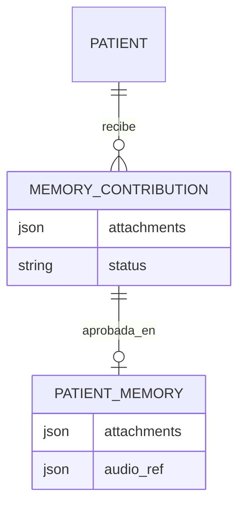
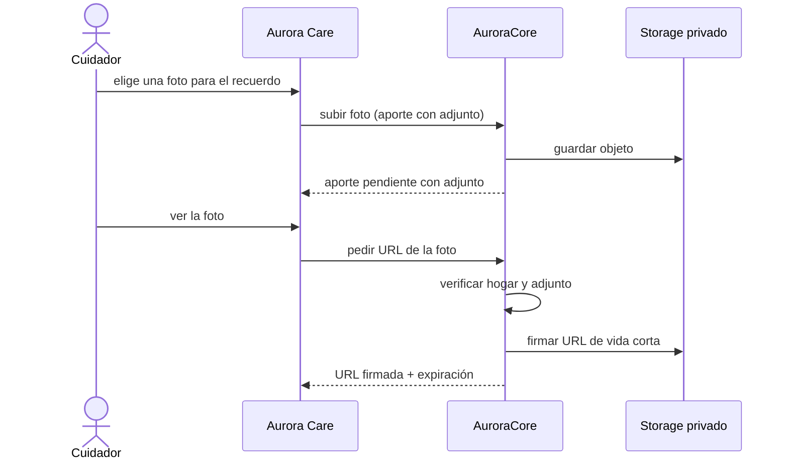

# Artefacto de Trazabilidad — AURA-163 Recuerdos con fotos

> **Para qué:** conectar esta historia con sus decisiones de diseño, modelo de datos, código y pruebas.
> **Para quién:** equipo (durante el desarrollo) y docente (evaluación de calidad técnica).

| Campo | Valor |
| --- | --- |
| Historia | **AURA-163** — Recuerdos con fotos |
| Épica | AURA-15 — Motor de IA y Memoria del Paciente |
| Requerimientos | RF-09, RF-50, RF-68, RF-77 (ver [[Requerimientos]] · [[Trazabilidad RF-Épicas]]) |
| Estado en Jira | Finalizada (Sprint 5; Jira «SCRUM Sprint 6») |
| Tareas relacionadas | AURA-162 (el alta del hogar acepta varios recuerdos iniciales), AURA-183 (conectar la carga de fotos entre Care y Core) |
| Enlace | https://project-aurora-alz.atlassian.net/browse/AURA-163 |

## 1. Historia de usuario
> [!note] Historia derivada
> Esta historia se redactó a posteriori a partir de las tareas de Jira indicadas arriba (modo *task-first*), porque el trabajo se registró en Jira como tareas técnicas. La historia **vive en este artefacto** y no se carga en Jira, que es de uso interno del equipo. Conviene que el equipo revise el texto.

**Como** cuidador **quiero** cargar fotos en los recuerdos de mi familiar **para** que Aurora las use en las terapias de reminiscencia y le resulten familiares.

### Criterios de aceptación
- [x] El alta del hogar acepta varios recuerdos iniciales (AURA-162).
- [x] Las fotos se suben a un almacenamiento **privado** y quedan adjuntas al recuerdo o al aporte (AURA-163).
- [x] Al aprobar un aporte (con o sin edición) se copian sus adjuntos a la memoria.
- [x] Una foto se sirve con una URL firmada de vida corta; el vencimiento es coherente con la duración declarada.
- [x] Una foto de otro hogar, inexistente o sin adjuntos devuelve 404 **sin tocar el almacenamiento**.
- [x] Si el almacenamiento falla, la respuesta es 503 con indicador de reintento.
- [x] Aurora Care conecta la carga de fotos con Core (AURA-183).

## 2. Decisiones de diseño (ADR)
- **ADR-003** — Persistencia en PostgreSQL y almacenamiento de objetos (Supabase Storage).
- **ADR-010** — Los datos del paciente se protegen; las fotos no se exponen con URL públicas.
- **ADR-012** — Diseño de API.

> Sin ADR nuevo: la historia se apoya en las decisiones ya registradas en [[Arquitectura y Stack Tecnológico]].

## 3. Modelo de datos (DER)
Entidades afectadas: los adjuntos se guardan como lista en `attachments` de `PatientMemory` y de `MemoryContribution` (sin tabla nueva); los assets de terapia usan `Asset`.

## 4. Diagramas de modelado

### 4.1 Diagrama de clases
> No aplica.

### 4.2 Diagrama de secuencia

### 4.3 Diagrama de estados (DTE)
> DTE no aplica: el ciclo de vida del aporte (`pending`, `approved`, `rejected`) está en el artefacto de AURA-105.

## 5. Código relacionado
| Tipo | Ubicación / referencia |
| --- | --- |
| Backend | `AuroraCore/apps/ai/views.py`, `serializers.py`, `models.py` (`attachments`), `apps/biometrics/assets.py` |
| Backend (tests) | `apps/ai/tests/test_memory_attachment_signed_url.py` (9), `test_memory_contributions_api.py` (3) |
| Frontend | `AuroraCare/src/features/memories/` (API, adaptadores, validación y alta de recuerdos) |
| Documentación | `AuroraCore/docs/agent-lessons.md` (storage de fotos y sus *gotchas*) |
| Commit / PR | `e212e12` (28/09, subir fotos con storage privado), `9c657ae` (URL firmada), `364d3ae` (01/10, snapshots de adjuntos y URLs firmadas), `5ba5f73` (documentación) |

## 6. Casos de prueba
| ID | Precondición | Pasos | Resultado esperado | Resultado de ejecución |
| --- | --- | --- | --- | --- |
| CP-AURA-163-01 | Aporte pendiente con foto | 1. Aprobar el aporte. | Los adjuntos se copian a la memoria | Cubierto por la suite del 16/10 (1.579 OK)* |
| CP-AURA-163-02 | Aporte con foto, aprobado con edición | 1. Aprobar editando. | Los adjuntos se copian igual | Cubierto por la suite del 16/10 (1.579 OK)* |
| CP-AURA-163-03 | Recuerdo con foto del hogar | 1. Pedir la URL de la foto. | URL firmada con el TTL configurado | Cubierto por la suite del 16/10 (1.579 OK)* |
| CP-AURA-163-04 | Foto de otro hogar | 1. Pedir la URL. | 404 y el almacenamiento no se toca | Cubierto por la suite del 16/10 (1.579 OK)* |
| CP-AURA-163-05 | Recuerdo sin adjuntos | 1. Pedir la URL. | 404 | Cubierto por la suite del 16/10 (1.579 OK)* |
| CP-AURA-163-06 | Storage caído | 1. Pedir la URL. | 503 con indicador de reintento | Cubierto por la suite del 16/10 (1.579 OK)* |
| CP-AURA-163-07 | Pantallas de recuerdos de Care | 1. Ejecutar las pruebas de `memories` de Care. | Pasan | OK (17/10): `jest src/features/memories`, 27 pruebas |

\* **Ejecución de AuroraCore:** la suite completa pasó el 16/10/2026 (1.579 pruebas, sin fallas; ejecución del equipo, ver [[Plan de Testing]], sección 4.7). No se registró el resultado de cada caso por separado; para hacerlo hay que correr la suite con la base de datos de prueba (Docker).

**Ejecución de AuroraCare (17/10/2026):** las pruebas se corrieron con `npx jest <carpeta>` sobre el código actual.

## 7. Matriz de trazabilidad de la historia
| Historia | RF | ADR | DER | Diagramas | Código | Casos de prueba |
| --- | --- | --- | --- | --- | --- | --- |
| AURA-162, 163, 183 | RF-09, 50, 68, 77 | ADR-003, 010, 012 | `attachments` de `PatientMemory` y `MemoryContribution` | Secuencia | `apps/ai/*`, `src/features/memories/*` | CP-AURA-163-01 a 07 |

## Checklist de completitud (cátedra)
- [x] Historia y criterios de aceptación
- [x] ADR correspondiente (si hubo decisión técnica nueva)
- [x] DER actualizado (si modificó el modelo de datos)
- [x] Diagramas de modelado relevantes (clases/secuencia/estados, según aplique)
- [x] Casos de prueba con precondición, pasos y resultado esperado
- [x] Resultados de ejecución de las pruebas
- [x] Referencias a código (paths/commits/PRs)

> [!todo] Pendiente
> - Confirmar si hay límite de tamaño y de tipos de archivo para las fotos y documentarlo.
