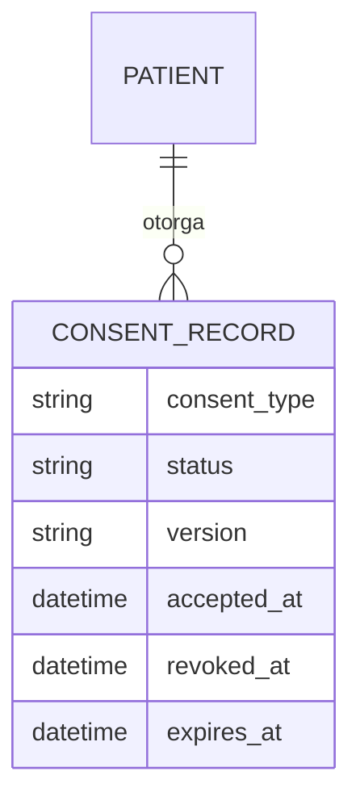
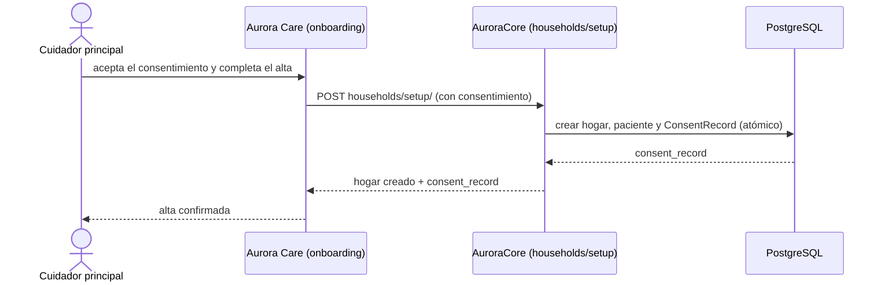
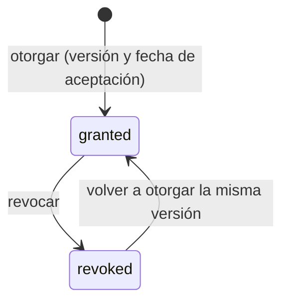

# Artefacto de Trazabilidad — AURA-98 Consentimiento informado obligatorio en el alta del hogar

> **Para qué:** conectar esta historia con sus decisiones de diseño, modelo de datos, código y pruebas.
> **Para quién:** equipo (durante el desarrollo) y docente (evaluación de calidad técnica).

| Campo | Valor |
| --- | --- |
| Historia | **AURA-98** — Consentimiento informado obligatorio en el alta del hogar |
| Épica | AURA-20 — Seguridad, Privacidad y Cumplimiento (Ley 25.326) |
| Requerimientos | RF-81, RF-92, RF-77 (ver [[Requerimientos]] · [[Trazabilidad RF-Épicas]]) |
| Estado en Jira | Finalizada (cerrada el 17/10/2026 tras la revisión; Sprints 4 y 5) |
| Tareas relacionadas | AURA-160 (Core registra el consentimiento con el alta), AURA-169 (Care lo envía y confirma con `consent_record`), AURA-170 (consentimiento obligatorio), AURA-179 (onboarding que no se traba sin consentimiento), AURA-109 (pantalla de Privacidad, en revisión) |
| Enlace | https://project-aurora-alz.atlassian.net/browse/AURA-98 |

## 1. Historia de usuario
> [!note] Historia derivada
> Esta historia se redactó a posteriori a partir de las tareas de Jira indicadas arriba (modo *task-first*), porque el trabajo se registró en Jira como tareas técnicas. La historia **vive en este artefacto** y no se carga en Jira, que es de uso interno del equipo. Conviene que el equipo revise el texto.

**Como** cuidador principal **quiero** aceptar el consentimiento informado cuando doy de alta a mi familiar **para** que el sistema solo trate sus datos con una autorización registrada y verificable.

### Criterios de aceptación
- [x] El alta del hogar registra el consentimiento **junto con el paciente**, en la misma operación.
- [x] Repetir un alta ya completada devuelve el mismo consentimiento y no crea otro; el onboarding en dos llamadas conserva uno solo.
- [x] El consentimiento es **obligatorio** en el alta.
- [x] Cada consentimiento guarda tipo, versión de la política y fecha de aceptación (solo lectura desde la API).
- [x] Una versión otorgada no se puede duplicar, pero puede volver a otorgarse tras revocarla.
- [x] El consentimiento se puede listar, otorgar y revocar; revocar uno ya revocado devuelve 400 y uno inexistente, 404.
- [x] Aurora Care envía el consentimiento en el alta y confirma con el `consent_record` devuelto (AURA-169).
- [ ] La revocación desde Aurora Care con sus efectos definidos (RF-93) está disponible.

> [!warning] Alcance pendiente
> La pantalla de Privacidad y datos (AURA-109) sigue **en revisión** y la revocación con efectos sobre el tratamiento (RF-93) no está demostrada. Los textos legales (política de privacidad, consentimientos) requieren validación de una persona con matrícula (ver `Correcciones - 12-10-2026/09`).

## 2. Decisiones de diseño (ADR)
- **ADR-010** — Cifrado de datos identificatorios (PII).
- **ADR-005** — Autenticación y autorización.
- **ADR-012** — Diseño de API.
- > Referencia legal: [[Investigación — Almacenamiento de Datos y Ley 25.326]].

> Sin ADR nuevo: el consentimiento aplica la Ley 25.326 con los tres consentimientos definidos en el Plan de Proyecto.

## 3. Modelo de datos (DER)
Entidad afectada (ya prevista en el [[DER - Base de Datos Aurora]], vista de Compliance):

## 4. Diagramas de modelado

### 4.1 Diagrama de clases
> No aplica.

### 4.2 Diagrama de secuencia

### 4.3 Diagrama de estados (DTE)

## 5. Código relacionado
| Tipo | Ubicación / referencia |
| --- | --- |
| Backend | `AuroraCore/apps/patients/models.py` (`ConsentRecord`), `apps/patients/views.py` y `serializers.py`, `apps/session/views.py` (alta del hogar) |
| Backend (tests) | `apps/patients/tests/test_consent_api.py` (17), `apps/session/tests/test_setup_consent.py` (14) |
| Frontend | `AuroraCare/app/onboarding.tsx`, `src/features/patients/api/` (`privacyConsentSync`) |
| Commit / PR | `e4aaacf` (API de consentimiento, RF-81), `c3bbaf3` y `a9f03fe` (AURA-160), `e529371` y PR #77 (AURA-170, obligatorio) |

## 6. Casos de prueba
| ID | Precondición | Pasos | Resultado esperado | Resultado de ejecución |
| --- | --- | --- | --- | --- |
| CP-AURA-98-01 | Alta de hogar con consentimiento | 1. `POST households/setup/`. | Se crean paciente y consentimiento en la misma operación | Cubierto por la suite del 16/10 (1.579 OK)* |
| CP-AURA-98-02 | Alta ya completada | 1. Reintentar el alta. | Devuelve el mismo consentimiento | Cubierto por la suite del 16/10 (1.579 OK)* |
| CP-AURA-98-03 | Alta sin consentimiento | 1. `POST` sin consentimiento. | Se rechaza (obligatorio) | Cubierto por la suite del 16/10 (1.579 OK)* |
| CP-AURA-98-04 | Consentimiento otorgado | 1. Intentar otorgar la misma versión otra vez. | Se rechaza | Cubierto por la suite del 16/10 (1.579 OK)* |
| CP-AURA-98-05 | Consentimiento otorgado | 1. Revocar. 2. Revocar de nuevo. | La primera funciona; la segunda devuelve 400 | Cubierto por la suite del 16/10 (1.579 OK)* |
| CP-AURA-98-06 | Usuario sin sesión | 1. Pedir los consentimientos. | No autorizado | Cubierto por la suite del 16/10 (1.579 OK)* |
| CP-AURA-98-07 | Care envía el consentimiento | 1. Ejecutar `privacyConsentSync` de Care. | Pasa | OK (17/10): 18 pruebas |

\* **Ejecución de AuroraCore:** la suite completa pasó el 16/10/2026 (1.579 pruebas, sin fallas; ejecución del equipo, ver [[Plan de Testing]], sección 4.7). No se registró el resultado de cada caso por separado; para hacerlo hay que correr la suite con la base de datos de prueba (Docker).

**Ejecución de AuroraCare (17/10/2026):** las pruebas se corrieron con `npx jest <carpeta>` sobre el código actual.

## 7. Matriz de trazabilidad de la historia
| Historia | RF | ADR | DER | Diagramas | Código | Casos de prueba |
| --- | --- | --- | --- | --- | --- | --- |
| AURA-98, 160, 169, 170 | RF-81, 92, 77 | ADR-005, 010, 012 | `ConsentRecord` | Secuencia, estados | `apps/patients/*`, `apps/session/*`, `onboarding.tsx` | CP-AURA-98-01 a 07 |

## Checklist de completitud (cátedra)
- [x] Historia y criterios de aceptación
- [x] ADR correspondiente (si hubo decisión técnica nueva)
- [x] DER actualizado (si modificó el modelo de datos)
- [x] Diagramas de modelado relevantes (clases/secuencia/estados, según aplique)
- [x] Casos de prueba con precondición, pasos y resultado esperado
- [x] Resultados de ejecución de las pruebas
- [x] Referencias a código (paths/commits/PRs)

> [!todo] Pendiente
> - Cerrar AURA-109 (pantalla de Privacidad) y demostrar la revocación (RF-93).
> - Validación legal de los textos de consentimiento por una persona con matrícula.
