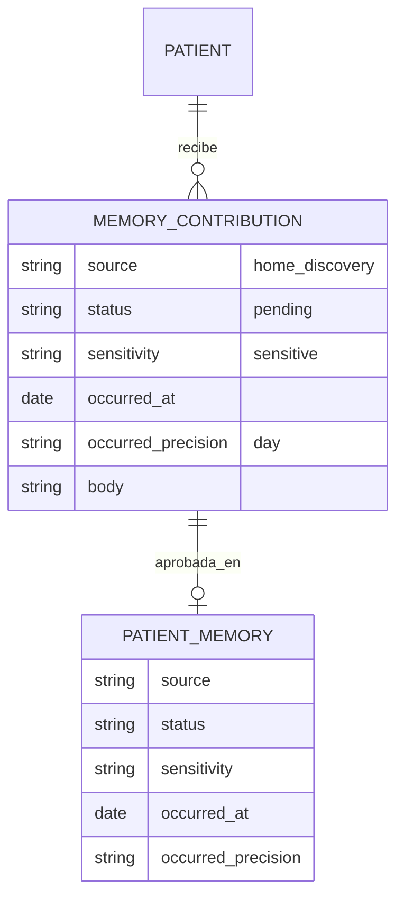
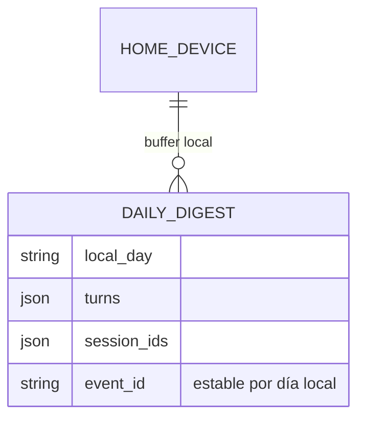
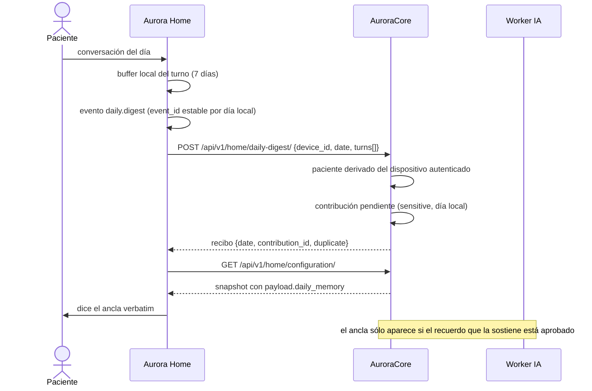
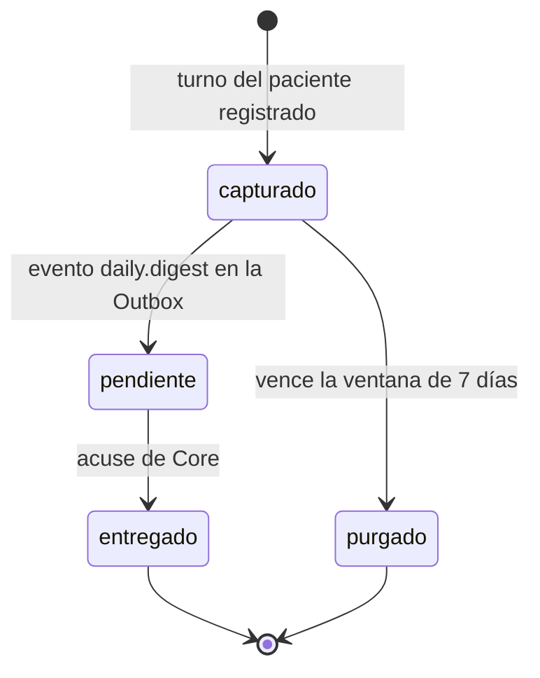

# Artefacto de Trazabilidad — AURA-195 Recuerdo del día (digest diario, extremo Core)

> **Para qué:** conectar esta historia con sus decisiones de diseño, modelo de datos, código y pruebas.
> **Para quién:** equipo (durante el desarrollo) y docente (evaluación de calidad técnica).

| Campo | Valor |
| --- | --- |
| Historia | **AURA-195** — `CORE-024` · Endpoint `daily-digest` y conversión a contribución pendiente · US-D7 |
| Épica | AURA-15 — Motor de IA y Memoria del Paciente |
| Requerimientos | RF-09, RF-14, RNF-20, RNF-22 (ver [[Requerimientos]] · [[Trazabilidad RF-Épicas]]) |
| Estado en Jira | Historia creada el 21/10/2026; **decisión aceptada (ADR-016), sin implementación en Core** |
| Tareas relacionadas | AURA-196 (`CORE-025`, `payload.daily_memory` en el snapshot), AURA-200 (`CORE-MEM03`, Worker IA: `/v1/daily-memory`), AURA-203 (`HOME-20`, buffer de corto plazo y digest en Aurora Home), AURA-194 (`CORE-023`, taxonomía y anclaje temporal, dependencia) |
| Enlace | https://project-aurora-alz.atlassian.net/browse/AURA-195 |

## 1. Historia de usuario
> [!note] Historia de diseño
> La historia vive en [[Handoff y Backlog de Diseño]] §3 (**US-D7 — Recuerdo del día**) y se detalla acá. En Jira el trabajo se registró como tareas técnicas; las historias de producto viven en el vault y en estos artefactos.

**Como** paciente **quiero** que Aurora me ancle el presente con un recuerdo breve y verificado —propio o de mi historia— y poder dejar mi propio recuerdo del día para el día siguiente, **para** que mi presente no se me pierda.

### Criterios de aceptación
- [x] La decisión de diseño está tomada y registrada: **ADR-016** (digest diario, ancla del día, repertorio de corto plazo, antialucinación, endpoint de dispositivo).
- [x] **Aurora Home** captura los turnos del paciente y los transporta: buffer local con purga por ventana de 7 días, evento `daily.digest` con identificador estable por día local y entrega diferida al cierre del día (PR #92).
- [x] **Aurora Home** dice el ancla **verbatim**, con tope local por día, idempotencia por día y sin persistir el texto del ancla (PR #92).
- [x] **Aurora Worker IA** redacta el ancla en `POST /v1/daily-memory`: sin memorias no llama al modelo y devuelve el texto neutro; las referencias se filtran contra la allow-list; el contrato rechaza nombres propios; el cliente del modelo envía `temperature` y `max_tokens` (PR #21).
- [x] La ruta del digest hacia Core está declarada como **PROPOSED** en la matriz de contratos de Aurora Home, porque el endpoint todavía no fue publicado.
- [ ] **Aurora Core** expone `POST /api/v1/home/daily-digest/` con autenticación de dispositivo, cuerpo `{device_id, schema_version, date, turns[], session_ids[]}` y paciente **derivado del dispositivo autenticado** — **no implementado**.
- [ ] **Aurora Core** convierte el digest en una **contribución pendiente** con `source='home_discovery'`, `sensitivity='sensitive'` y `occurred_at` = día local del hogar, y **ninguna** memoria publicada — **no implementado**.
- [ ] **Aurora Core** garantiza la idempotencia por `(patient, día local del hogar, device_id)` y responde con recibo (`date`, `contribution_id`, `duplicate`) — **no implementado**.
- [ ] **Aurora Core** publica `payload.daily_memory` en el snapshot con la allow-list de referencias y la regla de que el ancla sólo se sirve si el recuerdo que la sostiene está aprobado (AURA-196 / `CORE-025`) — **no implementado**.
- [ ] **Aurora Care** valida uno a uno las contribuciones del digest (AURA-202) — **no implementado**.
- [x] El buffer local del dispositivo está **apagado por defecto** (`AURORA_HOME_DAILY_MEMORIES_ENABLED=false`) porque no hay cifrado en reposo a nivel de aplicación para ese buffer.

> [!warning] Lo que falta para cerrar el circuito
> Del lado de Home y del Worker IA el circuito está construido; **del lado de Core no hay nada**: no existe el endpoint, ni la conversión a contribución, ni la idempotencia, ni el campo del snapshot. Por eso la ruta de Aurora Home hacia Core figura como propuesta y no como publicada. No hay scaffolding: no es un módulo a medio construir.

## 2. Decisiones de diseño (ADR)
- **ADR-016** — Recuerdos diarios de corto plazo: la decisión propia de esta historia (los tres artefactos separados, el endpoint de dispositivo, la antialucinación, el modo offline y quién agenda).
- **ADR-014** — Taxonomía de dos niveles y anclaje temporal: define `source`, `sensitivity`, `occurred_at` y `occurred_precision`, que son los campos que usa la conversión del digest a contribución pendiente.
- **ADR-008** — Modo offline: sin snapshot no hay ancla y el dispositivo no improvisa; el digest que no se pudo enviar queda en la cola durable.
- **ADR-004** — Patrón arquitectónico: n8n es la autoridad de schedule; Core no agenda ni programa nada.
- **ADR-012** — Diseño de API: el endpoint de digest es aditivo sobre la superficie de dispositivo y no rompe el contrato publicado.

> Del lado de Aurora Home, la decisión equivalente es **ADR-HOME-029** (captura de corto plazo, no réplica de la biografía, anclas configurables) y **ADR-HOME-019** (el texto hablable lo redacta Core y el dispositivo lo dice verbatim). Ambas viven en el repositorio de Aurora Home, no en este vault.

## 3. Modelo de datos (DER)
Del lado de Core, la conversión del digest **no tiene modelo nuevo**: reutiliza `MemoryContribution` y `PatientMemory` de ADR-014. Lo que sí es nuevo del lado de Home es la tabla del buffer local.

> `DAILY_DIGEST` es la tabla local de Aurora Home (migración 9 en `src/aurora_home/infrastructure/persistence/migrations.py`), escrita en la misma transacción que el evento de Outbox. El modelo de Core para el digest es **el mismo** `MemoryContribution`: no hay entidad nueva.

## 4. Diagramas de modelado

### 4.1 Diagrama de clases
> No aplica: el vault no mantiene diagramas de clases para esta feature.

### 4.2 Diagrama de secuencia

> El paso `POST /api/v1/home/daily-digest/` y el `payload.daily_memory` **no existen todavía en Core**: son AURA-195 y AURA-196. El diagrama describe el circuito acordado.

### 4.3 Diagrama de estados (DTE)
El ciclo del digest, del lado del dispositivo:

> `capturado` y `pendiente` están implementados en Aurora Home (PR #92). El estado `entregado` depende del acuse de Core, que no existe todavía porque el endpoint no está publicado.

## 5. Código relacionado
| Tipo | Ubicación / referencia |
| --- | --- |
| Backend (Core, a implementar) | `AuroraCore/apps/biometrics/views.py` y `apps/biometrics/urls.py` (endpoint de digest), `apps/ai/` (conversión a contribución pendiente e idempotencia), `apps/biometrics/home_configuration.py` (`payload.daily_memory`, AURA-196), `contracts/home/contract-fixtures.json` y `scripts/check_home_contract_compatibility.py` |
| Backend (Core, ya implementado y reutilizado) | `AuroraCore/apps/ai/models.py` (`MemoryContribution` con `source`, `sensitivity`, `occurred_at`, `occurred_precision`), `apps/events/home_event_mapping.py` (cotas de `turns[]`: cantidad máxima de turnos y de caracteres por turno) |
| Backend (tests, Core) | `AuroraCore/apps/ai/tests/test_memory_taxonomy.py`, `test_memory_publication.py` |
| Home | `AuroraHome/src/aurora_home/application/daily_digest.py`, `daily_anchor.py`, `conversation.py`, `runtime.py`; `src/aurora_home/contracts/daily_memory.py`; `src/aurora_home/contracts/matrix.py` (ruta `PROPOSED` hacia Core); `src/aurora_home/infrastructure/persistence/sqlite_store.py` y `migrations.py` (tabla del buffer); `src/aurora_home/config/settings.py` (`DailyMemoriesSettings`) |
| Home (tests) | `AuroraHome/tests/unit/test_daily_digest.py`, `test_daily_anchor.py`, `test_daily_memories_composition.py`, `test_conversation_turn_capture.py`; `tests/integration/test_daily_digest_store.py`; `tests/contract/test_published_core_simulator.py` |
| Worker IA | `AuroraWorkerIA/app/main.py` (`POST /v1/daily-memory`), `app/models.py` (`Memory` extendida, `Person`), `app/llm.py` (`temperature`, `max_tokens`, `seed`), `tests/test_daily_memory.py`, `README.md` (contrato del endpoint) |
| Frontend | `AuroraCare/src/features/memories/`: la validación uno a uno del digest **no existe** (AURA-202) |
| Documentación | `AuroraCore/docs/adr/ADR-013-recuerdos-diarios-corto-plazo.md`, `docs/handoff-recuerdos-taxonomia-personas-anclas.md`; en el vault: [[Arquitectura y Stack Tecnológico]] (ADR-016, §6.3) y [[Handoff y Backlog de Diseño]] (US-D7) |
| Commit / PR | Core PR #120 (`8ef55c3`, parte de taxonomía reutilizada) · Worker IA PR #21 (`3f2a0b2`) · Aurora Home PR #92 (`5640f0f`) · **AURA-195 (Core) no tiene implementación ni PR** |

## 6. Casos de prueba
| ID | Precondición | Pasos | Resultado esperado | Resultado de ejecución |
| --- | --- | --- | --- | --- |
| CP-AURA-195-01 | Intercambio completado del día | 1. Registrar el turno. | El día queda con un solo digest | OK (21/10): `AuroraHome/tests/unit/test_daily_digest.py::test_given_a_completed_exchange_when_recorded_then_the_day_gets_one_digest` |
| CP-AURA-195-02 | El mismo día reescrito | 1. Volver a registrar. | El `event_id` es estable | OK (21/10): mismo archivo, `test_given_the_same_day_when_the_buffer_is_rewritten_then_the_event_id_is_stable` |
| CP-AURA-195-03 | Otro día local | 1. Registrar. | El `event_id` cambia | OK (21/10): mismo archivo, `test_given_another_local_day_when_recorded_then_the_event_id_changes` |
| CP-AURA-195-04 | Turno que supera el máximo de turnos o de caracteres | 1. Fusionar los turnos. | El excedente se descarta y el turno se conserva íntegro | OK (21/10): mismo archivo, `test_given_more_turns_than_the_bound_when_merged_then_the_surplus_is_dropped` y `test_given_a_turn_over_the_core_bound_when_merged_then_it_is_dropped_whole` |
| CP-AURA-195-05 | Intercambio sin palabras | 1. Registrar. | No se escribe nada | OK (21/10): mismo archivo, `test_given_an_exchange_without_words_when_recorded_then_nothing_is_written` |
| CP-AURA-195-06 | Sin red | 1. Registrar el digest. | Queda pendiente y se entrega cuando vuelve la conexión | OK (21/10): `AuroraHome/tests/integration/test_daily_digest_store.py::test_given_the_network_is_down_when_the_digest_is_recorded_then_it_stays_pending` |
| CP-AURA-195-07 | Turno registrado y releído | 1. Leer el buffer. | El buffer y el evento existen | OK (21/10): mismo archivo, `test_given_a_recorded_turn_when_it_is_read_back_then_the_buffer_and_the_event_exist` |
| CP-AURA-195-08 | El mismo día registrado dos veces | 1. Leer los eventos. | Hay un solo evento | OK (21/10): mismo archivo, `test_given_the_same_day_recorded_twice_when_the_events_are_read_then_there_is_one_event` |
| CP-AURA-195-09 | Día fuera de la ventana | 1. Reiniciar el dispositivo. | No queda nada | OK (21/10): mismo archivo, `test_given_a_day_outside_the_window_when_the_device_restarts_then_nothing_is_left` |
| CP-AURA-195-10 | Escritura que falla | 1. Forzar el error. | La transacción aborta y no se escribe nada | OK (21/10): mismo archivo, `test_given_a_failing_write_when_the_transaction_aborts_then_nothing_is_written` |
| CP-AURA-195-11 | Snapshot con un ancla | 1. Anunciarla. | Se dice **verbatim** | OK (21/10): `AuroraHome/tests/unit/test_daily_anchor.py::test_given_a_snapshot_with_one_anchor_when_it_is_announced_then_it_is_spoken_verbatim` |
| CP-AURA-195-12 | Snapshot sin ancla o sin snapshot | 1. Anunciar. | No se dice nada: el dispositivo no improvisa | OK (21/10): mismo archivo, `test_given_a_snapshot_without_an_anchor_when_it_is_announced_then_nothing_is_spoken` y `test_given_no_snapshot_at_all_when_it_is_announced_then_nothing_is_spoken` |
| CP-AURA-195-13 | Ancla ya dicha hoy | 1. Anunciar de nuevo. | No se repite | OK (21/10): mismo archivo, `test_given_an_anchor_already_spoken_today_when_announced_then_it_is_not_repeated` |
| CP-AURA-195-14 | Ancla no decible | 1. Anunciar. | No se dice nada | OK (21/10): mismo archivo, `test_given_a_anchor_that_is_not_speakable_when_it_is_announced_then_nothing_is_spoken` |
| CP-AURA-195-15 | Sin memorias del día | 1. Pedir el ancla. | No se llama al modelo y se devuelve el texto neutro | OK (21/10): `AuroraWorkerIA/tests/test_daily_memory.py::test_empty_memories_do_not_call_the_llm` |
| CP-AURA-195-16 | Referencia desconocida en la respuesta | 1. Procesar la respuesta. | La referencia se descarta y se deduplica | OK (21/10): mismo archivo, `test_unknown_refs_are_dropped_and_deduped` |
| CP-AURA-195-17 | El modelo inventa un nombre propio | 1. Procesar la respuesta. | No se emite y se degrada al texto neutro | OK (21/10): mismo archivo, `test_invented_proper_name_is_not_emitted` |
| CP-AURA-195-18 | Ventana de escucha abierta por una actividad | 1. Hablar. | El audio sale hacia el proveedor de voz, **sólo** durante esa ventana; el digest transporta texto, nunca audio | **Pendiente de evidencia end-to-end**: la verificación del audio es del circuito de voz (ADR-011 del vault), no de esta historia |
| CP-AURA-195-19 | Dispositivo autenticado | 1. Enviar el digest a Core. | Responde con recibo y el paciente se deriva del dispositivo, no del cuerpo | **Pendiente**: el endpoint de Core no existe |
| CP-AURA-195-20 | Mismo digest reenviado | 1. Procesar el segundo envío. | No se crea una segunda contribución y la respuesta indica `duplicate` | **Pendiente**: la idempotencia de Core no está implementada |
| CP-AURA-195-21 | Digest con turnos del paciente | 1. Procesarlo. | Existe una contribución pendiente y **ninguna** memoria publicada | **Pendiente**: la conversión no está implementada |
| CP-AURA-195-22 | Recuerdo pendiente que sostiene un ancla | 1. Armar el snapshot. | El dispositivo no recibe ninguna ancla que lo sostenga | **Pendiente**: AURA-196 / `CORE-025` |
| CP-AURA-195-23 | Cuidador con la cola de pendientes | 1. Validar un aporte. | Queda validado con trazabilidad de quién aprobó | **Pendiente**: AURA-202 (Aurora Care) |

\* **Ejecución de AuroraHome (21/10/2026, equipo):** **1980 pruebas pasaron** (1924 del baseline + 56), mypy estricto limpio, cobertura **89 %** (los módulos nuevos: 100 %, 95 % y 94 %).
\* **Ejecución de AuroraWorkerIA (21/10/2026, equipo):** **245 pruebas pasaron** (201 del baseline + 44), lint limpio.
\* **Ejecución de AuroraCore (21/10/2026, equipo):** CI en verde sobre PostgreSQL; corrida local sobre SQLite con **1710 pruebas pasaron y 6 fallaron** (preexistentes y ambientales de SQLite); cobertura **95,84 %**; **43 pruebas nuevas**.

## 7. Matriz de trazabilidad de la historia
| Historia | RF | ADR | DER | Diagramas | Código | Casos de prueba |
| --- | --- | --- | --- | --- | --- | --- |
| AURA-195, 196, 200, 203, 194 | RF-09, 14, RNF-20, 22 | ADR-004, 008, 012, 014, 016 | `MemoryContribution`, `PatientMemory`, `DAILY_DIGEST` (local) | Secuencia, estados | `apps/biometrics/*` y `apps/ai/*` (a implementar), `daily_digest.py`, `daily_anchor.py`, `app/main.py` del Worker | CP-AURA-195-01 a 17 (OK), 18 a 23 (pendientes) |

## Checklist de completitud (cátedra)
- [x] Historia y criterios de aceptación
- [x] ADR correspondiente (si hubo decisión técnica nueva)
- [x] DER actualizado (si modificó el modelo de datos)
- [x] Diagramas de modelado relevantes (clases/secuencia/estados, según aplique)
- [x] Casos de prueba con precondición, pasos y resultado esperado
- [x] Resultados de ejecución de las pruebas
- [x] Referencias a código (paths/commits/PRs)

> [!todo] Pendiente
> - Implementar en Aurora Core el endpoint `POST /api/v1/home/daily-digest/` con la derivación del paciente desde el dispositivo, la conversión a contribución pendiente y la idempotencia (AURA-195).
> - Publicar `payload.daily_memory` en el snapshot con la allow-list de referencias y la regla de que el ancla sólo se sirve con un recuerdo aprobado (AURA-196).
> - Actualizar `contracts/home/contract-fixtures.json` y correr `scripts/check_home_contract_compatibility.py` en la misma entrega, y cambiar la ruta de Home de `PROPOSED` a publicada.
> - Implementar en Aurora Care la validación uno a uno de las contribuciones del digest (AURA-202).
> - Mantener el buffer del dispositivo apagado por defecto hasta que se acepte la protección a nivel de sistema de archivos o se resuelva el cifrado en reposo: es una brecha de privacidad declarada, no un control cumplido.
