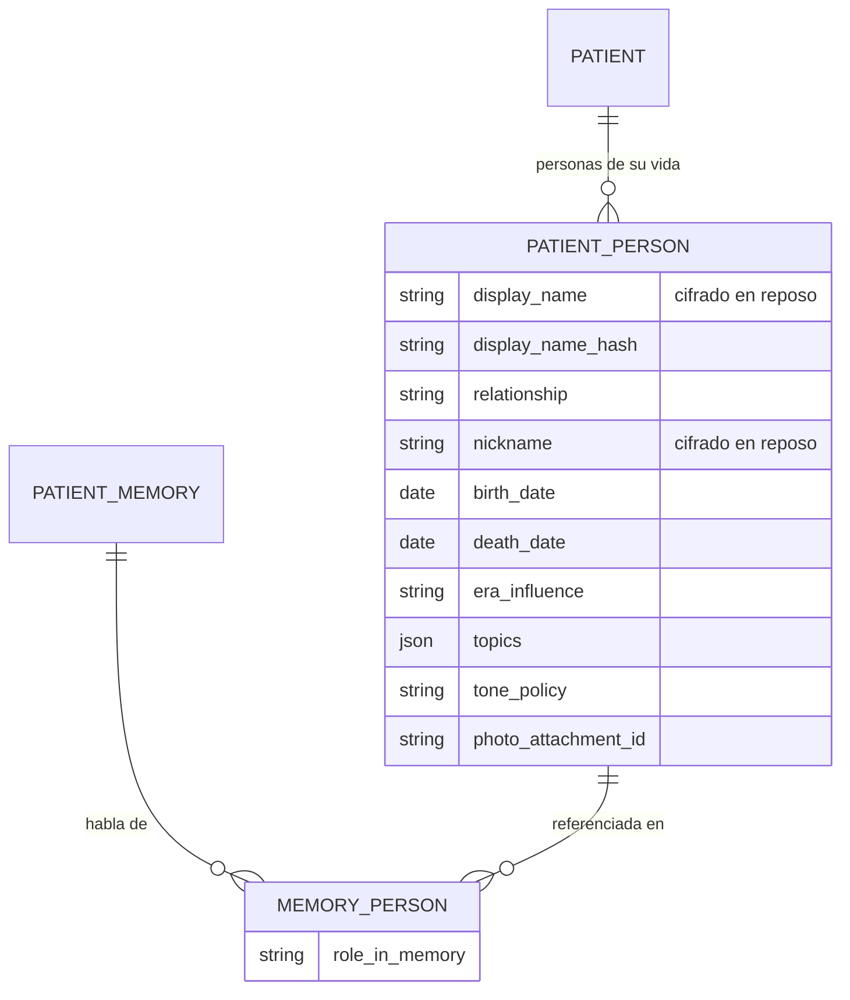
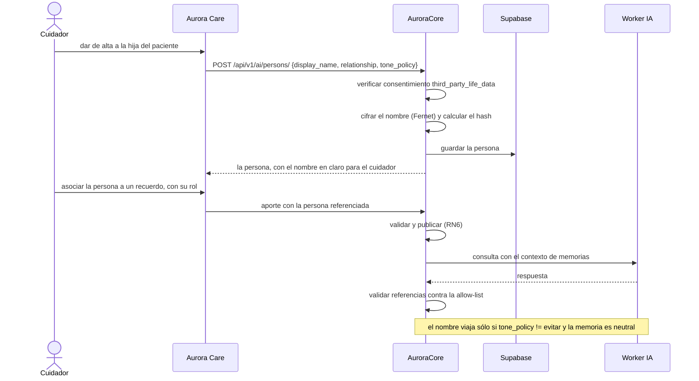
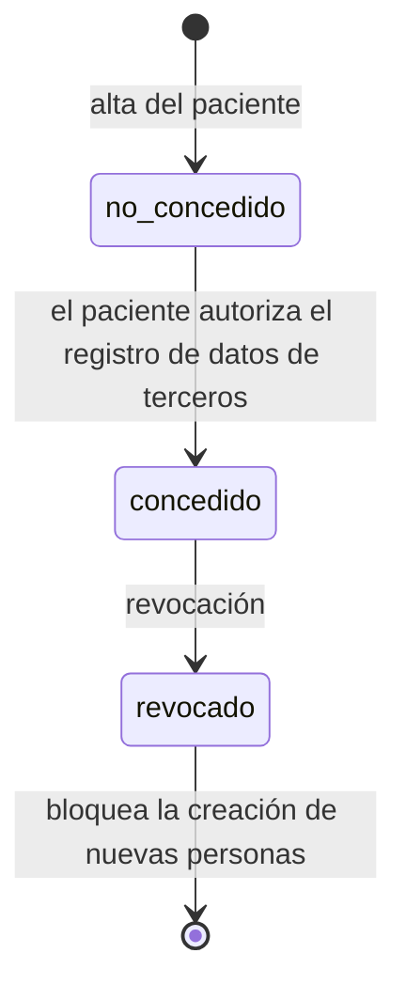

# Artefacto de Trazabilidad — AURA-197 Personas de la vida del paciente

> **Para qué:** conectar esta historia con sus decisiones de diseño, modelo de datos, código y pruebas.
> **Para quién:** equipo (durante el desarrollo) y docente (evaluación de calidad técnica).

| Campo | Valor |
| --- | --- |
| Historia | **AURA-197** — `CORE-026` · Modelo de personas de la vida del paciente · US-D6 |
| Épica | AURA-15 — Motor de IA y Memoria del Paciente |
| Requerimientos | RF-49, RF-50, RF-81, RNF-25 (ver [[Requerimientos]] · [[Trazabilidad RF-Épicas]]) |
| Estado en Jira | Historia creada el 21/10/2026; **decisión aceptada (ADR-015), sin implementación** |
| Tareas relacionadas | AURA-199 (`CORE-028`, guardia de sanitización ampliada a nombres de terceros), AURA-202 (ficha de persona y validación uno a uno en Aurora Care), AURA-194 (`CORE-023`, taxonomía y anclaje temporal, dependencia), AURA-198 (`CORE-027`, lectura para Care, dependencia) |
| Enlace | https://project-aurora-alz.atlassian.net/browse/AURA-197 |

## 1. Historia de usuario
> [!note] Historia de diseño
> La historia vive en [[Handoff y Backlog de Diseño]] §3 (**US-D6 — Personas de la vida del paciente**) y se detalla acá. En Jira el trabajo se registró como tareas técnicas; las historias de producto viven en el vault y en estos artefactos.

**Como** cuidador **quiero** registrar y cuidar a las personas de la vida del paciente (incluidas las fallecidas) con su parentesco, su era y el tono con que Aurora debe tratarlas, **para** que las therapies usen datos reales y con consentimiento.

### Criterios de aceptación
- [x] La decisión de diseño está tomada y registrada: **ADR-015** (modelo, cifrado en reposo, consentimiento de terceros, regla de salida al modelo de lenguaje, cero push para personas fallecidas).
- [x] El patrón de cifrado en reposo con hash determinístico que se va a reutilizar ya existe y está auditado (ADR-010: `Patient.name` + `name_hash` + `deterministic_hash`).
- [x] El mecanismo de consentimiento versionado y revocable que se va a reutilizar ya existe (`ConsentRecord`, con unicidad por paciente, tipo y versión en estado concedido).
- [x] El aislamiento por hogar de los recursos de paciente ya existe (consulta acotada al hogar del cuidador y verificación de acceso en escritura).
- [x] El Worker IA ya rechaza los nombres propios en el payload de personas: viaja el **rol** y un nombre propio es error 422 (PR #21, `AuroraWorkerIA`).
- [ ] El modelo de persona con nombre cifrado, hash, vínculo, etapa de la vida, temas y política de tono — **no implementado**.
- [ ] La relación con los recuerdos, con el rol `protagonista` | `participante` | `lugar` y unicidad por memoria, persona y rol — **no implementado**.
- [ ] El consentimiento de terceros (`third_party_life_data`) exigido antes de permitir crear personas — **no implementado**.
- [ ] Los endpoints de personas (`GET`/`POST` y detalle) con el aislamiento por hogar — **no implementados**.
- [ ] La ampliación de la guarda de redacción con los nombres de las personas excluidas (AURA-199 / `CORE-028`) — **no implementada**.
- [ ] La regla de cero notificaciones push para personas con fecha de fallecimiento (RNF-35) — **no implementada**.
- [ ] La ficha de persona en Aurora Care y el mapeo final de las etiquetas de la interfaz («Tema alegre / Con cuidado / Evitar») a los tres valores de `tone_policy` (AURA-202) — **no implementados**.

> [!warning] Dependencia
> El vocabulario de vínculo de la persona es el mismo conjunto de nivel 2 que la subcategoría `person` de ADR-014 (`pareja`, `hijo`, `hija`, `nieto`, `nieta`, `padre`, `madre`, `hermano`, `hermana`, `primo`, `prima`, `abuelo`, `abuela`, `amigo`, `vecino`, `cuidador`, `otro`). Por eso AURA-197 depende de AURA-194 (`CORE-023`, ya implementado).

## 2. Decisiones de diseño (ADR)
- **ADR-015** — Personas de la vida del paciente: la decisión propia de esta historia (modelo, cifrado, consentimiento de terceros, regla de salida al modelo de lenguaje, API y alcance).
- **ADR-010** — Cifrado de datos personales identificables: patrón `EncryptedCharField` + hash determinístico que se reutiliza para el nombre de la persona.
- **ADR-014** — Taxonomía de dos niveles y anclaje temporal: define el vocabulario de vínculo de nivel 2 y los campos `sensitivity` y `source` con vocabulario cerrado, que son la base de la regla de salida al modelo de lenguaje.
- **ADR-012** — Diseño de API: la superficie de personas es aditiva y respeta el versionado por ruta y el aislamiento de los recursos de paciente.

> El marco de consentimiento y sus efectos ante la revocación está en [[Arquitectura y Stack Tecnológico]] §6.5. La redacción legal del texto de consentimiento de terceros queda **abierta** y la define el equipo de Core con apoyo legal.

## 3. Modelo de datos (DER)
Entidades **decididas en ADR-015 y todavía inexistentes en el código**. Se dibujan con la forma que fija la decisión, marcada como no implementada.

> `PATIENT_PERSON` y `MEMORY_PERSON` **no existen todavía**: no hay migración, ni serializer, ni endpoints. El modelo de consentimiento (`ConsentRecord`, en `apps/patients/models.py`) ya existe y es donde se agrega el tipo `third_party_life_data`.

## 4. Diagramas de modelado

### 4.1 Diagrama de clases
> No aplica: el vault no mantiene diagramas de clases para esta feature.

### 4.2 Diagrama de secuencia

> Las rutas del diagrama son el contrato objetivo de ADR-015; todavía no están publicadas.

### 4.3 Diagrama de estados (DTE)
La persona no tiene estados: su condición relevante es la fecha de fallecimiento, que no es un estado del ciclo de vida. El estado que sí hay es el del **consentimiento de terceros**:

> El borrado de las personas ya cargadas tras la revocación queda **abierto** y lo define el equipo de Core con apoyo legal (ADR-015).

## 5. Código relacionado
| Tipo | Ubicación / referencia |
| --- | --- |
| Backend (a implementar) | `AuroraCore/apps/ai/models.py` (tablas `ai_patient_persons` y `ai_patient_persons_memories`), `apps/ai/serializers.py`, `apps/ai/views.py`, `apps/ai/urls.py`, `apps/patients/models.py` (tipo de consentimiento `third_party_life_data`), `apps/ai/worker_client.py` (ampliación de `forbidden_tokens_for`) |
| Backend (patrones reutilizados) | `AuroraCore/apps/common/encryption.py`, `apps/patients/models.py` (`Patient.name` + `name_hash` + `deterministic_hash`), `apps/common/mixins.py` (consulta acotada al hogar), `apps/common/viewsets.py` (verificación de acceso en escritura) |
| Backend (guarda existente) | `AuroraCore/apps/ai/worker_client.py` (`forbidden_tokens_for`: bloquea los identificadores del paciente y el contenido de toda memoria cuya sensibilidad no sea exactamente `neutral`, y **falla cerrado**) |
| Backend (tests) | `AuroraCore/apps/ai/tests/test_worker_payload.py` (`TestNeutralOnlyPayload`, `TestRedactionGuard`) |
| Worker IA | `AuroraWorkerIA/app/models.py` (`Person` con `role` y `tone_policy`; `Memory.people` por rol), `app/main.py` (`POST /v1/daily-memory`), `tests/test_daily_memory.py` |
| Frontend | `AuroraCare/src/features/memories/`: la ficha de persona **no existe** |
| Documentación | `AuroraCore/docs/adr/ADR-012-personas-vida-del-paciente.md`, `docs/handoff-recuerdos-taxonomia-personas-anclas.md`; en el vault: [[Arquitectura y Stack Tecnológico]] (ADR-015, §6.3) y [[Handoff y Backlog de Diseño]] (US-D6) |
| Commit / PR | **Ninguno**: la decisión es un documento (ADR-015) y el código todavía no existe |

## 6. Casos de prueba
| ID | Precondición | Pasos | Resultado esperado | Resultado de ejecución |
| --- | --- | --- | --- | --- |
| CP-AURA-197-01 | Persona con `tone_policy='alegre'` o `'con_cuidado'` y memoria `neutral` | 1. Armar el payload al Worker. | El nombre viaja: es la reminiscencia funcionando | **Pendiente**: la regla y la ampliación de la guarda no están implementadas |
| CP-AURA-197-02 | Persona con `tone_policy='evitar'` | 1. Armar el payload al Worker. | El nombre no aparece en el JSON serializado y la guarda aborta si aparece | **Pendiente**: AURA-199 / `CORE-028` |
| CP-AURA-197-03 | Memoria con sensibilidad `sensitive` o `avoid` | 1. Armar el payload al Worker. | El contenido de esa memoria no entra a la serialización | OK (21/10): `test_worker_payload.py::TestNeutralOnlyPayload::test_avoid_and_sensitive_memory_content_never_enters_serialization` (comportamiento preexistente) |
| CP-AURA-197-04 | Payload con un identificador del paciente o un texto sensible | 1. Pasarlo por la guarda de redacción. | La guarda lo rechaza y el intento queda auditado | OK (21/10): mismo archivo, `TestRedactionGuard::test_guard_rejects_sensitive_and_pii_tokens` (comportamiento preexistente) |
| CP-AURA-197-05 | Payload de personas con un nombre propio | 1. Enviarlo al Worker IA. | Error 422: el contrato no admite nombres propios | OK (21/10): `AuroraWorkerIA/tests/test_daily_memory.py::test_person_with_a_proper_name_is_422` y `test_memory_people_with_a_proper_name_is_422` |
| CP-AURA-197-06 | Persona marcada para evitar en el payload | 1. Generar el ancla del día. | Esa persona no se nombra en el relato | OK (21/10): `AuroraWorkerIA/tests/test_daily_memory.py::test_person_marked_to_avoid_is_not_sent_to_the_llm` |
| CP-AURA-197-07 | Paciente sin consentimiento `third_party_life_data` | 1. Intentar crear una persona. | La API lo rechaza | **Pendiente**: el tipo de consentimiento no existe |
| CP-AURA-197-08 | Dos personas con el mismo nombre | 1. Guardarlas. | Los hashes coinciden y el nombre queda cifrado en la columna | **Pendiente**: el modelo no existe |
| CP-AURA-197-09 | El mismo par (memoria, persona, rol) | 1. Insertarlo dos veces. | La segunda inserción la rechaza la base | **Pendiente**: la relación no existe |
| CP-AURA-197-10 | Cuidador de otro hogar | 1. Pedir el listado de personas. | No ve ninguna persona | **Pendiente**: el endpoint no existe |
| CP-AURA-197-11 | Evento sobre una persona fallecida | 1. Procesarlo. | No se crea ninguna alerta activa | **Pendiente**: la regla no está implementada |

\* **Ejecución de AuroraWorkerIA (21/10/2026, equipo):** **245 pruebas pasaron** (201 del baseline + 44), lint limpio.
\* **Ejecución de AuroraCore (21/10/2026, equipo):** CI en verde sobre PostgreSQL; corrida local sobre SQLite con **1710 pruebas pasaron y 6 fallaron** (preexistentes y ambientales de SQLite); cobertura **95,84 %**; **43 pruebas nuevas**.

## 7. Matriz de trazabilidad de la historia
| Historia | RF | ADR | DER | Diagramas | Código | Casos de prueba |
| --- | --- | --- | --- | --- | --- | --- |
| AURA-197, AURA-199, AURA-202 | RF-49, 50, 81, RNF-25 | ADR-010, 012, 014, 015 | `PatientPerson`, `PatientMemoryPerson` (a implementar) | Secuencia, estados (consentimiento) | `apps/ai/*` (a implementar), `app/models.py` del Worker | CP-AURA-197-01, 02, 07 a 11 (pendientes), 03 a 06 (OK) |

## Checklist de completitud (cátedra)
- [x] Historia y criterios de aceptación
- [x] ADR correspondiente (si hubo decisión técnica nueva)
- [x] DER actualizado (si modificó el modelo de datos)
- [x] Diagramas de modelado relevantes (clases/secuencia/estados, según aplique)
- [x] Casos de prueba con precondición, pasos y resultado esperado
- [x] Resultados de ejecución de las pruebas
- [x] Referencias a código (paths/commits/PRs)

> [!todo] Pendiente
> - Implementar el modelo de personas, su relación con los recuerdos, el consentimiento de terceros y los endpoints (AURA-197).
> - Extender la guarda de redacción con los nombres de las personas excluidas: es **parte** de la entrega, no una mejora posterior (AURA-199).
> - Implementar la regla de cero push para personas fallecidas (RNF-35).
> - Cerrar con el equipo de Care el mapeo entre las etiquetas de la interfaz y los tres valores de `tone_policy`, y la redacción legal del consentimiento de terceros.
> - Implementar en Aurora Care la ficha de persona y la validación uno a uno (AURA-202).
