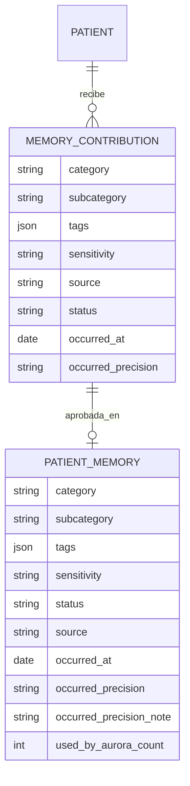
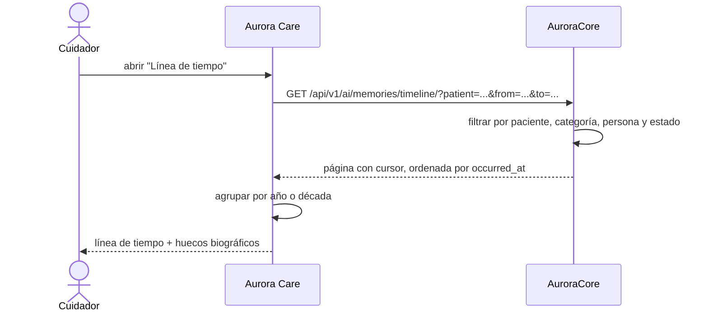
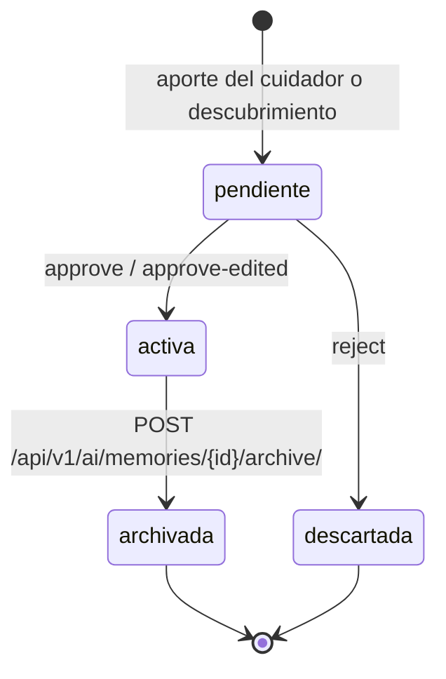

# Artefacto de Trazabilidad — AURA-201 Línea de tiempo de recuerdos (Aurora Care)

> **Para qué:** conectar esta historia con sus decisiones de diseño, modelo de datos, código y pruebas.
> **Para quién:** equipo (durante el desarrollo) y docente (evaluación de calidad técnica).

| Campo | Valor |
| --- | --- |
| Historia | **AURA-201** — Vista de línea de tiempo de recuerdos (Aurora Care) · US-D5 |
| Épica | AURA-18 — Panel del Cuidador (Aurora Care) |
| Requerimientos | RF-09, RF-49, RF-68, RNF-31 (ver [[Requerimientos]] · [[Trazabilidad RF-Épicas]]) |
| Estado en Jira | Historia creada el 21/10/2026; **implementada** en Aurora Core (AURA-198, PR #126) y en Aurora Care (PR #110) |
| Tareas relacionadas | AURA-198 (`CORE-027`, lectura para Care en Aurora Core), AURA-197 (`CORE-026`, personas), AURA-202 (ficha de persona, cobertura y fecha del suceso en Aurora Care), AURA-194 (`CORE-023`, taxonomía y anclaje temporal) |
| Enlace | https://project-aurora-alz.atlassian.net/browse/AURA-201 |

## 1. Historia de usuario
> [!note] Historia de diseño
> La historia vive en [[Handoff y Backlog de Diseño]] §3 (**US-D5 — Línea de tiempo de recuerdos**) y se detalla acá. En Jira el trabajo se registró como tareas técnicas; las historias de producto viven en el vault y en estos artefactos.

**Como** cuidador **quiero** recorrer la vida del paciente en una línea de tiempo agrupada por año o década, con filtro por persona y por categoría, **para** ver los huecos biográficos y orientar la recolección de recuerdos.

### Criterios de aceptación
- [x] El recuerdo tiene **fecha del suceso** (`occurred_at`) con su precisión declarada (`day` | `month` | `year` | `decade` | `unknown`) y una nota opcional, y una taxonomía de dos niveles con vocabulario cerrado (AURA-194 / ADR-014, implementado en Aurora Core, PR #120).
- [x] El listado de recuerdos acepta filtros por `category`, `subcategory`, `source` y rango de `occurred_at`, y ordena por `occurred_at` con desempate estable; los recuerdos sin ancla se listan al final (Core PR #120).
- [x] Los recuerdos se pueden **archivar** sin borrarlos: salen de la vista operativa y del contexto del modelo, y siguen accesibles por el filtro de estado.
- [x] Los valores sueltos de categoría que ya circulaban (`familia`, `family`, `persona`, `lenguaje`, `ejercicio`) quedaron normalizados, con rastro del valor anterior en `metadata.normalized_from` (migración `0009`).
- [x] El endpoint de **línea de tiempo con cursor** en Core (`CORE-027`, AURA-198) con filtros `patient`, `from`, `to`, `category`, `subcategory`, `person`, `status`, `source` — implementado en Core, PR #126 (`5b64cf1`, merge `55e3400`).
- [x] El endpoint de **cobertura biográfica** (qué décadas, personas y temas tienen huecos) en Core — implementado en el mismo PR #126.
- [x] La vista de línea de tiempo en Aurora Care, con agrupación por año o década, filtro por persona y por categoría, y la sección aparte de los recuerdos sin fecha — implementada en Care, PR #110.
- [x] Paginación por cursor en la vista: `useInfiniteQuery` pide la página siguiente con el `cursor` de `next`, así que insertar en el medio del histórico no duplica ni pierde filas.
- [x] El circuito de validación RN6 ya existe en Aurora Care (módulo `src/features/memories/`, con pruebas de flujo de validación y de permisos).
- [x] Filtro por persona en la vista: el catálogo sale de `GET /ai/persons/` y el filtro se resuelve en el servidor (Care, PR #111). Los vínculos recuerdo→persona existen en Core pero todavía no hay endpoint que los escriba.

> [!warning] Alcance del display del dispositivo
> La línea de tiempo vive en **Aurora Care**. En el dispositivo se recorre **por voz**: el display del dispositivo queda fuera del alcance de esta feature, aunque su diseño siga existiendo en el vault. Ver la contradicción documentada en [[VUI — Diseño Conversacional]] §5 y en la cabecera de [[Accesibilidad]].

## 2. Decisiones de diseño (ADR)
- **ADR-014** — Taxonomía de dos niveles y anclaje temporal de los recuerdos: es lo que hace posible agrupar por década y filtrar por categoría (implementado en Aurora Core, PR #120).
- **ADR-012** — Diseño de API: el contrato de recuerdos (filtros, orden y paginación) se publica en el OpenAPI y es la fuente de verdad de Aurora Care.
- **ADR-010** — Cifrado de datos personales identificables: los nombres de las personas de la vida del paciente se cifran en reposo y se descifran de forma transparente para la vista.
- **ADR-008** — Modo offline: la línea de tiempo requiere conexión; sin ella, Care no inventa datos ni muestra una línea de tiempo con información de otra época.

> Sin ADR nuevo para esta historia: se apoya en decisiones ya registradas en [[Arquitectura y Stack Tecnológico]]. La decisión propia de la feature de recuerdos es **ADR-014**, y el ADR-013 del vault queda reservado para la elección de LiveKit como proveedor de media.

## 3. Modelo de datos (DER)
Entidades afectadas: `PatientMemory` y `MemoryContribution` (`AuroraCore/apps/ai/models.py`). Las entidades de persona **todavía no existen**: `PatientPerson` y `PatientMemoryPerson` están decididas en ADR-015 y son trabajo pendiente (AURA-197).

> Las entidades de persona (`PATIENT_PERSON`, `PATIENT_MEMORY_PERSON`) y su relación con los recuerdos están definidas en ADR-015 y **no implementadas**; no se dibujan para no sugerir código existente.

## 4. Diagramas de modelado

### 4.1 Diagrama de clases
> No aplica: el vault no mantiene diagramas de clases para esta feature.

### 4.2 Diagrama de secuencia

> La ruta `/api/v1/ai/memories/timeline/` está publicada en el OpenAPI de Core desde el PR #126. El diagrama describe el flujo implementado.

### 4.3 Diagrama de estados (DTE)

> Estados implementados en Aurora Core (PR #120). «Descartada» corresponde a una contribución rechazada.

## 5. Código relacionado
| Tipo | Ubicación / referencia |
| --- | --- |
| Frontend | `AuroraCareFront/src/features/memories/`: `hooks/useMemoryTimeline.ts` (cursor con `useInfiniteQuery`), `utils/memoryTimeline.ts` (agrupado por década, etiqueta de fecha y lectura del cursor), `components/MemoryCard.tsx`, `api/memoriesApi.ts` (`getMemoryTimeline`, `getMemoryCoverage`), `adapters/memoriesAdapters.ts` |
| Frontend (pantallas) | `AuroraCareFront/app/(authenticated)/(tabs)/memories.tsx` (línea de tiempo, filtros, cobertura), `app/(authenticated)/memory-detail.tsx` (detalle con fotos firmadas) |
| Frontend (tests) | `AuroraCareFront/src/features/memories/__tests__/`: `memoryTimelineUtils.test.ts` (26), `memoryDetailRoute.test.tsx` (6), `memoryNewRoute.test.tsx` (7), `memoriesAdapters.test.ts`; y `app/(authenticated)/(tabs)/__tests__/memoriesScreen.test.tsx` (14) |
| Backend | `AuroraCore/apps/ai/pagination.py` (cursor propio), `apps/ai/coverage.py` (cobertura), `apps/ai/views.py` (`timeline`, `coverage`), `apps/ai/filters.py` (`MemoryTimelineFilter`), `apps/ai/serializers.py` |
| Backend (tests) | `apps/ai/tests/test_memory_timeline.py` (31) y `apps/ai/tests/test_memory_coverage.py` (20) |
| Contrato | `AuroraCore/api-openapi.yaml` (PR #126, +334 líneas) |
| Documentación | `AuroraCore/docs/adr/ADR-011-taxonomia-y-ancla-temporal-de-recuerdos.md`, `docs/handoff-recuerdos-taxonomia-personas-anclas.md`; en el vault: [[Arquitectura y Stack Tecnológico]] (ADR-014) y [[Handoff y Backlog de Diseño]] (US-D5) |
| Commit / PR | Core: PR #126 (`5b64cf1`). Care: PR #110 (`c3c6dda`). La cobertura en la vista y el alta con fecha llegan en Care PR #111 (AURA-202) |

## 6. Casos de prueba
| ID | Precondición | Pasos | Resultado esperado | Resultado de ejecución |
| --- | --- | --- | --- | --- |
| CP-AURA-201-01 | Recuerdos con fechas distintas | 1. Pedir el listado con filtro de rango. | Devuelve exactamente los del rango, ordenados por `occurred_at` | OK (21/10): `test_memory_taxonomy.py::TestListingFilters::test_range_filter_returns_exactly_the_memories_of_the_range` |
| CP-AURA-201-02 | Recuerdos con y sin ancla temporal | 1. Listar los recuerdos. | Los que no tienen fecha se listan al final, no intercalados | OK (21/10): mismo archivo, `test_memories_without_anchor_are_listed_last` |
| CP-AURA-201-03 | Recuerdos de varias categorías | 1. Filtrar por categoría, subcategoría y origen. | Devuelve sólo los que coinciden | OK (21/10): mismo archivo, `test_filters_by_category_subcategory_and_source` |
| CP-AURA-201-04 | Recuerdo archivado | 1. Listar los recuerdos. | El archivado sale de la vista operativa y sigue accesible por el filtro de estado | OK (21/10): `test_memory_publication.py::TestArchive` |
| CP-AURA-201-05 | Categoría fuera del vocabulario | 1. Crear un recuerdo con una categoría suelta. | La API lo rechaza listando el vocabulario permitido | OK (21/10): `test_memory_taxonomy.py::TestClosedVocabulary::test_category_outside_the_vocabulary_is_rejected_listing_it` |
| CP-AURA-201-06 | Recuerdos con fechas en tres décadas | 1. Pedir la línea de tiempo. | Devuelve los recuerdos ordenados por `occurred_at` | OK (26/10): `test_memory_timeline.py::test_el_order_by_no_deja_los_nulos_al_motor` y `test_el_keyset_es_explicito_para_los_dos_bloques` (Core, PR #126) |
| CP-AURA-201-07 | Paciente con recuerdos sólo de una década | 1. Pedir la cobertura biográfica. | Devuelve los huecos de las demás décadas | OK (26/10): `test_memory_coverage.py::test_las_decadas_vacias_son_las_que_no_tienen_ningun_recuerdo` (Core, PR #126) |
| CP-AURA-201-08 | Historial de 500 recuerdos | 1. Recorrer todas las páginas del cursor. | Ningún recuerdo aparece dos veces y ninguno se pierde | OK (26/10): `test_memory_timeline.py::test_recorrer_500_recuerdos_no_repite_ni_pierde_ninguno` (Core, PR #126) |
| CP-AURA-201-09 | Recuerdos con personas asociadas | 1. Filtrar por persona. | Devuelve sólo los recuerdos de esa persona | OK (26/10): `test_memory_timeline.py::test_filtros_combinados_de_rango_categoria_y_persona` (Core) y el cruce del filtro en `memoriesScreen.test.tsx` (Care, PR #110). Los vínculos se crean del lado de Core: no hay endpoint de escritura todavía |
| CP-AURA-201-10 | Vista de línea de tiempo de Care | 1. Ejecutar las pruebas de la vista. | Pasan | OK (26/10): `memoryTimelineUtils.test.ts` (26), `memoriesScreen.test.tsx` (14), `memoryDetailRoute.test.tsx` (6), `memoriesAdapters.test.ts` y `memoryNewRoute.test.tsx` (7) en AuroraCareFront. Suite completa: **1499 pruebas en verde** en el PR #110 |

\* **Ejecución de AuroraCore (21/10/2026, equipo):** CI en verde sobre PostgreSQL. Corrida local sobre SQLite: **1710 pruebas pasaron y 6 fallaron**; las 6 son preexistentes y ambientales de SQLite. Cobertura **95,84 %**; **43 pruebas nuevas** en esta entrega.

\* **Ejecución de Core del PR #126 (25/10/2026):** **2029 pruebas pasaron**, 5 fallos preexistentes y ambientales de SQLite (`test_encrypted_fields`, `test_device_credentials`), cobertura **96.19 %**. CI en verde y OpenAPI regenerado sin deriva de `int64`. Incluye el arreglo de un test flaky de fecha UTC que venía de #125.

\* **Ejecución de AuroraCareFront (26/10/2026):** `tsc --noEmit` en verde, **1499 pruebas** en verde (40 nuevas) en el PR #110 y **1536** (37 nuevas) con el PR #111. Los 14 errores de `npm run lint` son preexistentes: `import/no-unresolved` sobre módulos instalados, una limitación del resolver de ESLint en local; `npx eslint app src` no reporta errores.

## 7. Matriz de trazabilidad de la historia
| Historia | RF | ADR | DER | Diagramas | Código | Casos de prueba |
| --- | --- | --- | --- | --- | --- | --- |
| AURA-201, AURA-198, AURA-202, AURA-194 | RF-09, 49, 68, RNF-31 | ADR-008, 010, 012, 014 | `PatientMemory`, `MemoryContribution` | Secuencia, estados | `apps/ai/*`, `src/features/memories/*` | CP-AURA-201-01 a 10 (OK) |

## Checklist de completitud (cátedra)
- [x] Historia y criterios de aceptación
- [x] ADR correspondiente (si hubo decisión técnica nueva)
- [x] DER actualizado (si modificó el modelo de datos)
- [x] Diagramas de modelado relevantes (clases/secuencia/estados, según aplique)
- [x] Casos de prueba con precondición, pasos y resultado esperado
- [x] Resultados de ejecución de las pruebas
- [x] Referencias a código (paths/commits/PRs)

> [!todo] Pendiente
> - **Core**: escribir los vínculos recuerdo↔persona. `PatientMemoryPerson` existe y se lee, pero no hay endpoint que los cree: hasta entonces el subtítulo «con Roberto» y el filtro por persona sólo se llenan cuando el Worker IA o un alta explícita los escriba. Propuesta adicional: expandir `display_name` en `PatientMemoryPerson` para que el recuerdo se lea solo.
> - **Core**: decidir la paginación del resto de los endpoints de recuerdos (el listado sigue por número de página; la línea de tiempo ya usa cursor).
> - **Care**: unificar la fecha de carga con la fecha del suceso en los recuerdos que llegan por descubrimiento de Aurora (hoy el alta manual ya la pide, AURA-202).
> - **Vault**: el artefacto de AURA-197 sigue describiendo el modelo de personas como «sin implementación»; corresponde actualizarlo con el PR #121 de Core.
