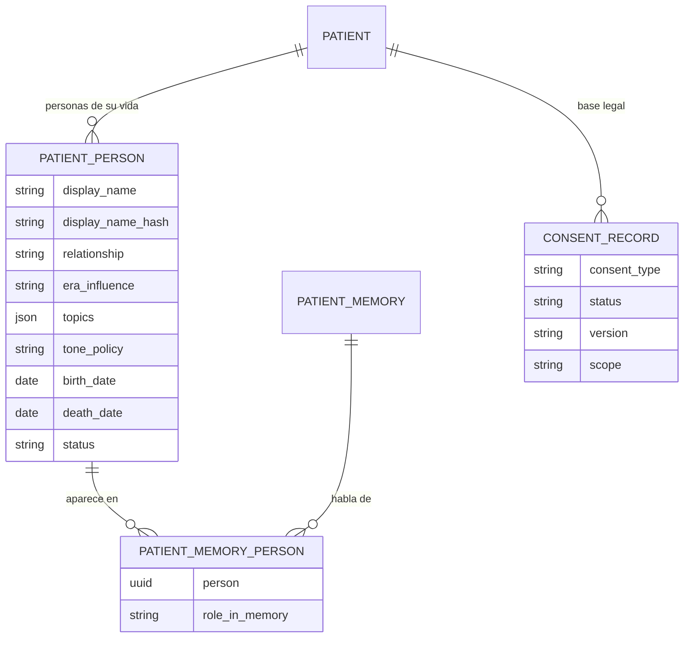
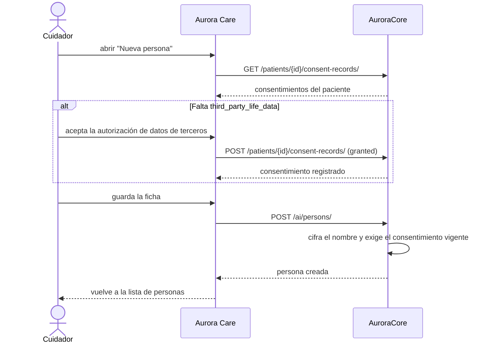
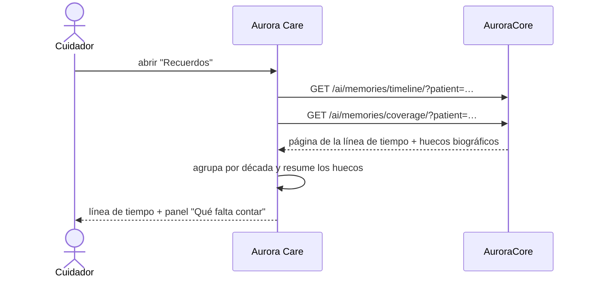
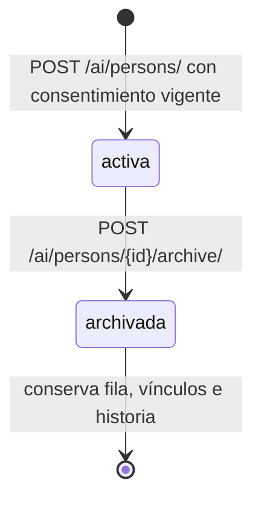

# Artefacto de Trazabilidad — AURA-202 Personas, cobertura y fecha del suceso (Aurora Care)

> **Para qué:** conectar esta historia con sus decisiones de diseño, modelo de datos, código y pruebas.
> **Para quién:** equipo (durante el desarrollo) y docente (evaluación de calidad técnica).

| Campo | Valor |
| --- | --- |
| Historia | **AURA-202** — Ficha de persona, cobertura biográfica y fecha del suceso (Aurora Care) · US-D6 + cierre de US-D5 |
| Épica | AURA-15 — Motor de IA y Memoria del Paciente |
| Requerimientos | RF-49, RF-50, RF-81, RNF-25 (personas) · RF-09, RF-49, RF-68, RNF-31 (cobertura y anclaje) |
| Estado en Jira | **implementada** en Aurora Care (PR #111), sobre Core PR #121 (personas) y #126 (cobertura) |
| Tareas relacionadas | AURA-197 (`CORE-026`, modelo de personas en Core), AURA-199 (`CORE-028`, guarda de sanitización), AURA-201 (línea de tiempo en Care), AURA-198 (`CORE-027`, cobertura en Core), AURA-194 (`CORE-023`, taxonomía y anclaje temporal) |
| Enlace | https://project-aurora-alz.atlassian.net/browse/AURA-202 |

## 1. Historia de usuario
> [!note] Historia de diseño
> La historia de personas vive en [[Handoff y Backlog de Diseño]] §3 (**US-D6 — Personas de la vida del paciente**). AURA-202 es su parte en Aurora Care y, además, cierra dos criterios que quedaban abiertos de **US-D5**: la cobertura biográfica en la vista y la fecha del suceso al cargar un recuerdo.

**Como** cuidador **quiero** registrar a las personas de la vida del paciente con su parentesco, su etapa y el tono con que Aurora debe tratarlas, y ver qué partes de su historia faltan contar, **para** que Aurora hable de ellas con datos reales y con consentimiento, y para orientar la recolección de recuerdos.

### Criterios de aceptación
- [x] La ficha de persona tiene vínculo, etapa de la vida, temas y política de tono, con el vocabulario cerrado de Core (ADR-015).
- [x] El mapeo entre las etiquetas de la interfaz y los tres valores de `tone_policy` quedó fijado: **«Tema alegre» = `alegre`**, **«Con cuidado» = `con_cuidado`**, **«Evitar» = `evitar`**. Es el mismo trío que la app ya usaba para la sensibilidad de un recuerdo, así que el cuidador no aprende dos vocabularios.
- [x] Crear personas exige el consentimiento de terceros (`third_party_life_data`): la app muestra el texto que se acepta y **registra el consentimiento antes de crear la persona**. Si el consentimiento falla, la persona no se crea.
- [x] Una persona con tono «evitar» no viaja al motor de IA: lo garantiza Core (`worker_client.forbidden_tokens_for`), y la app lo explica en la ficha.
- [x] Las personas fallecidas siguen en la historia y no generan avisos: la fecha de fallecimiento es un dato de la ficha y Core dispara la regla de cero push (RNF-35).
- [x] El archivado conserva la fila y sus vínculos, y la app avisa que **no se puede deshacer desde Care** (`status` es de sólo lectura en la API).
- [x] El panel de **cobertura biográfica** muestra las décadas, las personas y los temas sin recuerdos, y cuántos recuerdos quedaron sin fecha. Cuenta sólo memorias `active`.
- [x] El **alta de recuerdo** captura la fecha del suceso con su precisión declarada (día, mes, año, década), que es lo que hace que la línea de tiempo ordene por la vida y no por la fecha de carga.
- [ ] Los vínculos recuerdo→persona: `PatientMemoryPerson` existe y se lee en el recuerdo, pero Core todavía no publica un endpoint que los cree. Queda como propuesta para Core.

> [!warning] Dependencia abierta
> Sin un endpoint que escriba los vínculos recuerdo↔persona, el subtítulo «con Roberto» de la línea de tiempo y el filtro por persona sólo se llenan cuando el Worker IA o un alta explícita los creen del lado de Core. La app ya está preparada: resuelve el nombre contra `GET /ai/persons/` y muestra «N sin nombre visible» cuando el vínculo no está en el catálogo activo.

## 2. Decisiones de diseño (ADR)
- **ADR-015** — Personas de la vida del paciente: modelo, cifrado en reposo, consentimiento de terceros, regla de salida al modelo de lenguaje y API.
- **ADR-014** — Taxonomía de dos niveles y anclaje temporal: `occurred_at` y `occurred_precision` son los campos que la vista de alta escribe y la línea de tiempo lee.
- **ADR-010** — Cifrado de datos personales identificables: el nombre y el apodo de la persona se cifran en reposo y se devuelven en claro sólo al cuidador del hogar.
- **ADR-012** — Diseño de API: la superficie de personas es aditiva y respeta el aislamiento por hogar.

> El texto del consentimiento de terceros lo define el equipo de Core con apoyo legal. La app no lo redacta: guarda el que Core publique y lo manda como `scope` para dejar evidencia de qué se aceptó.

## 3. Modelo de datos (DER)
Entidades en Aurora Core: `PatientPerson` (nombre cifrado + hash, vínculo, etapa, temas, tono, fechas, estado) y `PatientMemoryPerson` (vínculo con rol y unicidad por memoria, persona y rol). En Aurora Care no se persiste nada de esto: la app lee y escribe contra la API.

## 4. Diagramas de modelado

### 4.1 Diagrama de clases
> No aplica: el vault no mantiene diagramas de clases para esta feature.

### 4.2 Diagrama de secuencia

### 4.3 Diagrama de estados (DTE)

## 5. Código relacionado
| Tipo | Ubicación / referencia |
| --- | --- |
| Frontend (personas) | `AuroraCareFront/src/features/persons/`: `types.ts` (vocabulario y etiquetas), `api/personsApi.ts`, `adapters/personsAdapters.ts`, `consent.ts`, `hooks/usePersons.ts`, `hooks/useThirdPartyConsent.ts`, `components/PersonCard.tsx` |
| Frontend (pantallas) | `app/(authenticated)/persons.tsx` (lista), `app/(authenticated)/person-editor.tsx` (alta, edición y archivado con consentimiento) |
| Frontend (cobertura y fecha) | `src/features/memories/components/MemoryCoveragePanel.tsx`, `src/features/memories/hooks/useMemoryTimeline.ts` (`useMemoryCoverage`), `app/(authenticated)/memory-new.tsx` (fecha del suceso con precisión) |
| Frontend (tests) | `src/features/persons/__tests__/`: `personsAdapters.test.ts`, `personsScreen.test.tsx`, `personEditor.test.tsx`; `src/features/memories/__tests__/memoryCoveragePanel.test.tsx`; `memoryNewRoute.test.tsx` (fecha) |
| Backend | `AuroraCore/apps/ai/models.py` (`PatientPerson`, `PatientMemoryPerson`), `apps/ai/persons.py` (consentimiento y cero push), `apps/ai/views.py` (`PatientPersonViewSet`), `apps/ai/coverage.py`, `apps/patients/views.py` (`consent-records`) |
| Backend (tests) | `AuroraCore/apps/ai/tests/test_personas_vida_paciente.py`, `test_personas_guardia_llm.py`, `test_memory_coverage.py`; `apps/patients/tests/test_consent_api.py` (consentimientos) |
| Contrato | `AuroraCore/api-openapi.yaml`: `PatientPerson`, `BiographicalCoverage`, `ConsentRecord` |
| Documentación | `AuroraCore/docs/adr/ADR-012-personas-vida-del-paciente.md`; en el vault: [[Arquitectura y Stack Tecnológico]] (ADR-015) y [[Handoff y Backlog de Diseño]] (US-D6) |
| Commit / PR | Care PR #111 (`a6e0965`) sobre #110. Core: PR #121 (personas) y #126 (cobertura) |

## 6. Casos de prueba
| ID | Precondición | Pasos | Resultado esperado | Resultado de ejecución |
| --- | --- | --- | --- | --- |
| CP-AURA-202-01 | Paciente sin consentimiento de terceros | 1. Abrir «Nueva persona» y guardar sin marcar la autorización. | No se crea la persona y el aviso pide la autorización | OK (26/10): `personEditor.test.tsx::no crea la persona sin la autorización de datos de terceros` |
| CP-AURA-202-02 | Paciente sin consentimiento de terceros | 1. Marcar la autorización y guardar. | El consentimiento se registra **antes** de crear la persona | OK (26/10): `personEditor.test.tsx::registra la autorización antes de crear la persona` (compara el orden de las llamadas) |
| CP-AURA-202-03 | Paciente con consentimiento vigente | 1. Abrir «Nueva persona» y guardar. | No se vuelve a pedir ni a registrar el consentimiento | OK (26/10): `personEditor.test.tsx::con el consentimiento ya vigente no vuelve a pedirlo ni a registrarlo` |
| CP-AURA-202-04 | Persona con fecha de fallecimiento anterior al nacimiento | 1. Completar las dos fechas y guardar. | Se rechaza con un mensaje y no se guarda | OK (26/10): `personEditor.test.tsx::rechaza un fallecimiento anterior al nacimiento` |
| CP-AURA-202-05 | Persona existente | 1. Abrir la ficha, cambiar el nombre y guardar. | La ficha se hidrata con los datos actuales y se actualiza | OK (26/10): `personEditor.test.tsx::edita una persona existente con los datos ya cargados` |
| CP-AURA-202-06 | Persona existente | 1. Tocar «Archivar persona». | El modal avisa que no se puede deshacer desde la app y sólo archiva al confirmar | OK (26/10): `personEditor.test.tsx::avisa que archivar no se puede deshacer desde la app antes de hacerlo` |
| CP-AURA-202-07 | Paciente con huecos biográficos | 1. Abrir Recuerdos y desplegar «Qué falta contar». | Muestra décadas, personas y temas sin recuerdos, y los recuerdos sin fecha | OK (26/10): `memoryCoveragePanel.test.tsx::muestra el detalle por década, persona y tema al abrirlo` |
| CP-AURA-202-08 | Cobertura sin huecos | 1. Abrir el panel. | Lo dice en una línea en vez de mostrar una tarjeta vacía | OK (26/10): `memoryCoveragePanel.test.tsx::sin huecos lo dice en vez de mostrar una tarjeta vacía` |
| CP-AURA-202-09 | Cobertura que falla | 1. Abrir Recuerdos. | La línea de tiempo sigue funcionando sin el panel | OK (26/10): `memoryCoveragePanel.test.tsx::si la cobertura falla no rompe la línea de tiempo` |
| CP-AURA-202-10 | Alta de recuerdo con fecha | 1. Escribir el recuerdo, elegir fecha y precisión, guardar. | Se manda `occurred_at` con `occurred_precision` | OK (26/10): `memoryNewRoute.test.tsx::manda la fecha del suceso con la precisión declarada` |
| CP-AURA-202-11 | Alta de recuerdo sin fecha | 1. Guardar sin fecha. | No se manda ancla temporal y el recuerdo cae en «Sin fecha» | OK (26/10): `memoryNewRoute.test.tsx::sin fecha no manda ancla temporal` |
| CP-AURA-202-12 | Alta de recuerdo con fecha imposible | 1. Escribir `31/02/1972` y guardar. | Se rechaza con un mensaje y no se envía el aporte | OK (26/10): `memoryNewRoute.test.tsx::rechaza una fecha imposible sin guardar el aporte` |

\* **Ejecución de AuroraCareFront (26/10/2026):** `tsc --noEmit` en verde; **1536 pruebas** en verde en 181 suites (37 nuevas sobre el PR #110), 0 fallos. `npx eslint app src` sin errores; los 14 errores de `npm run lint` son preexistentes (`import/no-unresolved` sobre módulos instalados, limitación del resolver en local).

## 7. Matriz de trazabilidad de la historia
| Historia | RF | ADR | DER | Diagramas | Código | Casos de prueba |
| --- | --- | --- | --- | --- | --- | --- |
| AURA-202, AURA-197, AURA-201 | RF-49, 50, 81, 09, 68, RNF-25, RNF-31 | ADR-010, 012, 014, 015 | `PatientPerson`, `PatientMemoryPerson`, `ConsentRecord` | Secuencia, estados | `src/features/persons/*`, `app/(authenticated)/persons.tsx`, `person-editor.tsx`, `src/features/memories/*` | CP-AURA-202-01 a 12 (OK) |

## Checklist de completitud (cátedra)
- [x] Historia y criterios de aceptación
- [x] ADR correspondiente (si hubo decisión técnica nueva)
- [x] DER actualizado (si modificó el modelo de datos)
- [x] Diagramas de modelado relevantes (clases/secuencia/estados, según aplique)
- [x] Casos de prueba con precondición, pasos y resultado esperado
- [x] Resultados de ejecución de las pruebas
- [x] Referencias a código (paths/commits/PRs)

> [!todo] Pendiente
> - **Core**: endpoint para escribir los vínculos recuerdo↔persona (con su rol). Sin él, el filtro por persona y el subtítulo «con Roberto» dependen de que el Worker IA o un alta explícita creen los vínculos.
> - **Core**: expandir `display_name` en `PatientMemoryPerson` para que el recuerdo se lea solo.
> - **Care**: foto de la persona (`photo_attachment_id`) cuando exista contrato de carga para personas.
